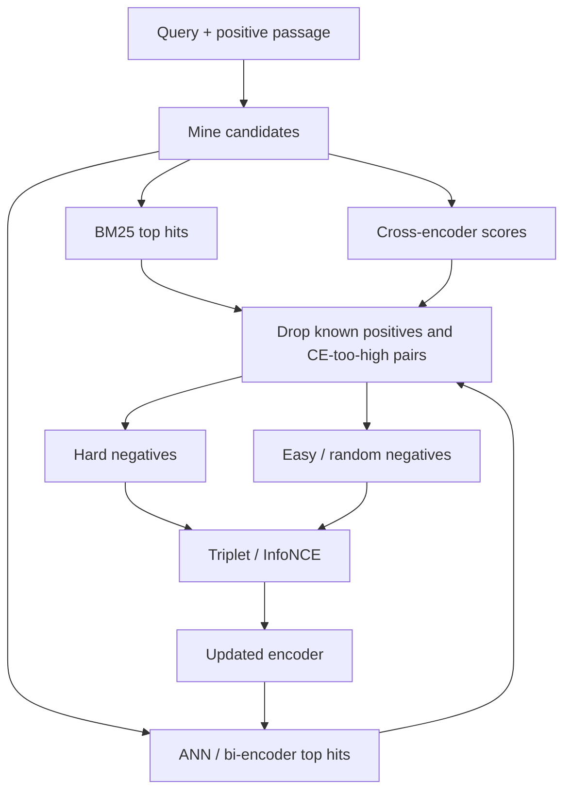

A **hard negative** is an incorrect candidate that scores competitively with, or above, the positive for the current model (or a mining system). It is wrong for the task, but similar enough in surface form, topic, or embedding geometry that the model can confuse it with a true match. Whether it contributes a gradient depends on the chosen loss and clipping or filtering.

Contrast with an **easy negative**: an unrelated example whose score is already low. Easy negatives make training loss look healthy while teaching little once the model has learned coarse separation. Contrast also with a **false negative**: a *true* match that mining or batching wrongly treats as negative, which pushes valid evidence apart.

## Intuition

Retrieval and metric learning ask the model to rank the right neighbor above wrong ones. Most wrong neighbors are trivial: random documents, unrelated classes, far embeddings. The gradient on those terms is near zero. The remaining mistakes are near-misses: same vocabulary, same product line, sibling FAQ, or a document the bi-encoder already ranks high.

Hard negatives are those near-misses. Training on them moves the decision boundary from "same topic" to "actually answers this query." Without them, a dense retriever often returns plausible distractions that share keywords and fail the user.

## How hardness is defined

Hardness is always relative to a **score** and an **anchor** (query, image, or other example).

**Triplet / FaceNet geometry.** With distance $d$ and margin $\alpha$, a negative $n$ for anchor $a$ and positive $p$ is:

| Kind | Condition | Training effect |
|---|---|---|
| Easy | $d(a,n) > d(a,p) + \alpha$ | Loss already zero; no gradient |
| Semi-hard | $d(a,p) < d(a,n) < d(a,p) + \alpha$ | Inside the margin but farther than $p$; FaceNet's preferred band |
| Hard | $d(a,n) \leq d(a,p)$ | Ranked at least as close as the positive; violates the margin, often unstable if labels are noisy |

FaceNet (Schroff et al., 2015) found pure hardest-in-batch negatives can collapse early training and preferred **semi-hard** negatives: still violating the margin, but not closer than the positive.

**InfoNCE / ranking losses.** For cosine (or dot) similarity $\mathrm{sim}$ and temperature $\tau$, each negative contributes $\exp(\mathrm{sim}(q,n)/\tau)$ in the denominator. A hard negative has high $\mathrm{sim}(q,n)$ relative to the positive, so it dominates the softmax and produces most of the push-away gradient. Lower $\tau$ sharpens that concentration.

$$
\mathcal{L} = -\log\frac{\exp(\mathrm{sim}(q,p^+)/\tau)}{\exp(\mathrm{sim}(q,p^+)/\tau)+\sum_j\exp(\mathrm{sim}(q,n_j)/\tau)}
$$

ANCE (Xiong et al., 2020) showed that *local* in-batch negatives often yield tiny gradient norms for dense retrieval: the training negatives do not match the hard global neighbors the model must beat at test time. Mining top ANN misses from the full corpus closes that train/test gap.

## Diagram



## Example

Query: **Which Hugging Face Transformers model method enables gradient checkpointing before training?**

| Candidate | Role | Why |
|---|---|---|
| "Call `model.gradient_checkpointing_enable()` before training" | Positive | Answers the requested framework action |
| "Use `torch.utils.checkpoint.checkpoint()` around selected modules" | **Hard negative for this narrow query** | Same technique, but does not identify the requested Transformers model method |
| "Activation checkpointing trades extra forward compute for lower memory" | Mid-ranked topical | Explains the concept without answering how to enable it |
| "Tune HNSW `efSearch` for retrieval recall" | Easy negative | No shared intent or technical vocabulary |

A BM25 or bi-encoder top-20 may surface the generic checkpoint API and conceptual overview. These are negatives only under the narrow method-lookup intent; the PyTorch API would be valid evidence for a broader question about checkpointing in PyTorch. Verify that intent before assigning labels. If training uses only easy negatives, implementation-specific questions can remain close to broadly related documentation.

## Worked numbers

One InfoNCE row, unit vectors, cosine similarities, $\tau = 0.05$:

| Candidate | $\mathrm{sim}$ | $\mathrm{sim}/\tau$ | Role |
|---|---|---|---|
| $p^+$ | $0.82$ | $16.4$ | positive |
| $n_{\text{hard}}$ | $0.74$ | $14.8$ | hard negative |
| $n_{\text{easy}}$ | $0.05$ | $1.0$ | easy negative |

With only the easy negative:

$$
P_+ = \frac{e^{16.4}}{e^{16.4}+e^{1.0}} \approx 1.0,\quad \mathcal{L}\approx 0
$$

Almost no gradient. With the hard negative instead:

$$
P_+ = \frac{e^{16.4}}{e^{16.4}+e^{14.8}} \approx 0.832,\quad \mathcal{L} \approx 0.184
$$

Most of the loss now comes from separating $n_{\text{hard}}$. That is the learning signal you wanted.

## Mining sources

Common production recipes for retrieval and sentence embeddings:

1. **Lexical hard negatives.** Top BM25 hits that are not labeled relevant (DPR's classic recipe). Cheap and strong early; biased toward keyword overlap.
2. **Dense / ANN hard negatives.** Top-$k$ from the current or previous bi-encoder over the full corpus (ANCE-style asynchronous index refresh). Matches what fails at serving.
3. **Cross-encoder filtered mining.** Retrieve candidates with BM25 or ANN, score with a cross-encoder, keep high-but-not-relevant pairs. Sentence-Transformers MS MARCO training uses a CE score gap so unlabeled true answers are not treated as negatives.
4. **In-batch negatives.** Other positives in the mini-batch act as free negatives for InfoNCE. Scale with batch size; often *too easy* alone for first-stage retrieval.
5. **Task structure.** NLI contradictions as hard negatives for sentence embeddings; sibling product docs; previous reranker mistakes; confused labels from human review.

Always **verify negativity**. Corpus redundancy (multiple valid answers, paraphrases, multi-label tickets) turns "hard" into false negative. Mix hard negatives with ordinary ones so the model does not overfit to adversarial near-duplicates.

```python
# Sketch: mine ANN hard negatives, drop known positives and CE-too-close pairs
cands = ann_search(query_vec, k=50)
hard = []
for doc_id, score in cands:
    if doc_id in gold_positive_ids:
        continue
    ce = cross_encoder.score(query, docs[doc_id])
    if ce < ce_positive - margin:  # e.g. margin = 3.0 on CE logits
        hard.append(doc_id)
```

## What fails in production

| Failure | What you see | Fix |
|---|---|---|
| Only easy negatives | High train accuracy, top-$k$ full of near-topic wrong chunks | Mine BM25/ANN hard negatives; re-evaluate on real misses |
| Mislabeled hard negatives | Positive and paraphrase embeddings drift apart; recall drops | CE filter, multi-positive loss, shared-label masks |
| Stale miners | Model improves but mined set is from an old checkpoint | Periodic re-mine or ANCE-style async index updates |
| Pure hardest only | Early collapse, noisy gradients, brittle margins | Semi-hard band, mix easy + hard, raise $\tau$ slightly |
| Domain shift | Generic hard negatives, domain still fails | Mine from *your* corpus and query log, with public MS MARCO as supplementary data |

## Why it matters here

RAG and dense retrieval quality hinges on fine distinctions among similar chunks. Hard negatives are how you teach that boundary. Without them, contrastive loss mostly relearns "unrelated is far," and the index keeps surfacing plausible distractors that share topic words but not the answer.

## Related terms

- [Contrastive learning](glossary://contrastive-learning)
- [InfoNCE](glossary://infonce)
- [Triplet loss](glossary://triplet-loss)
- [False negative](glossary://false-negative)
- [Dense retrieval](glossary://dense-retrieval)
