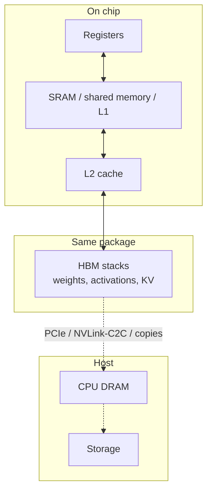

High Bandwidth Memory (HBM) is a JEDEC-standardized, 3D-stacked DRAM technology that sits next to a GPU or accelerator die and supplies the large off-chip memory pool used for model weights, activations, and KV cache. Compared with board-level GDDR or DDR, HBM trades a very wide parallel interface and short on-package links for multi-terabyte-per-second bandwidth at lower energy per bit.

In LLM engineering, "HBM" is usually shorthand for that device memory hierarchy: kernels load and store tensors from HBM into on-chip SRAM (shared memory / L1 / registers), do math, and write results back. Peak FLOPs only show up when those HBM trips are rare enough; many serving paths are limited by HBM bandwidth long before Tensor Cores saturate.

## Intuition

Three bandwidth tiers explain most performance behavior:

1. **Registers and SRAM** on each streaming multiprocessor: tiny, extremely fast, energy-cheap.
2. **HBM** on the package: tens to hundreds of GB, multi-TB/s aggregate, still far slower than SRAM.
3. **Host DRAM / NVMe**: large and relatively slow; crossing the host link is a different bottleneck.

Training and inference keep almost all hot tensors in HBM. Each kernel that rewrites a large intermediate matrix to HBM and reads it back pays bandwidth twice. That is the "memory wall" behind naive attention, low-batch decode, and long-context KV growth.

## How it works

HBM packages a **stack** of DRAM dies bonded vertically and linked with **through-silicon vias (TSVs)** to a base die. Several stacks sit beside the GPU logic die on a **silicon interposer** (2.5D packaging), so thousands of short traces can implement a very wide bus without routing everything across a PCB.

JEDEC generations keep raising pin rate and channel organization while preserving the wide-bus idea:

| Generation (typical) | Interface width | Channel sketch | Rough peak per stack |
|---|---|---|---|
| HBM2 / HBM2e | 1024-bit | 8 × 128-bit channels | ~256–460 GB/s |
| HBM3 | 1024-bit | 16 × 64-bit channels (32 pseudo-channels) | up to ~819 GB/s at 6.4 Gb/s/pin |
| HBM3e | 1024-bit | same channel family, higher pin rates | ~1.0–1.2+ TB/s |

HBM4 doubles the conventional interface to 2048 bits. As of September 2026, [Micron's HBM4 product specifications](https://www.micron.com/products/memory/hbm/hbm4) advertise greater than 11 Gb/s per pin and greater than 2.8 TB/s per stack. Actual HBM4 operating rates vary by implementation.

Products choose stack count, height (capacity), and operating pin speed under power/thermal limits. Device bandwidth is therefore **product-level**, not "JEDEC peak × marketing stack count" by default.

NVIDIA H100 SXM, for example, uses **five HBM3 stacks** for **80 GB** capacity and lists **3.35 TB/s** peak memory bandwidth. The PCIe H100 variant pairs similar capacity with **HBM2e** and about **2 TB/s**. Later accelerators stack more dies and faster HBM3e/HBM4 parts for both capacity and bandwidth.

## Diagram

Useful mental model for kernels: **tile work so intermediates stay in SRAM**; only final tensors (and necessary stats) round-trip through HBM.

## Formula

Per-stack peak bandwidth for a double-data-rate style interface is approximately

$$
B_{\mathrm{stack}} \approx \frac{W \cdot f_{\mathrm{pin}}}{8}
$$

where $W$ is the data width in bits (often $1024$ for HBM2/HBM3 stacks) and $f_{\mathrm{pin}}$ is the per-pin data rate in Gbit/s, yielding GB/s. The data rate already includes transfers on both clock edges; do not multiply it by two again. Aggregate raw peak bandwidth is roughly $N_{\mathrm{stacks}} \cdot B_{\mathrm{stack}}$ at the product's operating pin rate. Usable sustained bandwidth is lower and depends on access patterns, protocol/ECC overhead, and memory-controller efficiency.

For low-batch autoregressive decode, an optimistic weight-streaming ceiling is

$$
\mathrm{TPS}_{\mathrm{ceil}} \approx \frac{B_{\mathrm{HBM}}}{S_{\mathrm{weights}}}
$$

with $B_{\mathrm{HBM}}$ in bytes/s and $S_{\mathrm{weights}}$ the resident weight footprint in bytes. Real tokens/s is lower once KV-cache reads, kernel inefficiency, scheduler overhead, and communication enter the picture.

## Worked numbers

**H100 SXM decode ceiling.** Official peak HBM bandwidth is $3.35$ TB/s $= 3.35 \times 10^{12}$ B/s. A dense BF16 model with about $54$ GB of weights (example scale of a ~27B parameter dense checkpoint) has an idealized weight-only bound:

$$
\mathrm{TPS}_{\mathrm{ceil}} \approx \frac{3.35 \times 10^{12}}{54 \times 10^{9}} \approx 62\ \text{tokens/s}
$$

for a single stream that must effectively rescan the full weight set each step. Raising effective batch reuses the same weight bytes across more tokens, so the bandwidth pays for more useful work per HBM pass.

**Attention traffic.** Standard attention materializes an $N \times N$ score matrix in HBM. For $N = 4096$ and FP16, just one such matrix is $4096^{2} \times 2 \approx 34$ MB per head before the softmax probability matrix and multi-layer multi-head fan-out. FlashAttention tiles $Q$, $K$, $V$ so score/softmax intermediates stay in SRAM and only compact outputs (and small online-softmax stats) hit HBM, cutting traffic while preserving exact attention math.

## Example

**Serving path.** Prefill of a long prompt often looks compute-heavy: large matrix multiplies reuse weights across many tokens, so arithmetic intensity is high and Tensor Cores matter. Decode of one user with a growing KV cache is different: each new token still streams weights (and more K/V history) from HBM for a thin amount of math. Profilers then show **high HBM bandwidth utilization with modest SM/Tensor-Core utilization**.

Concrete operators that fight HBM:

- **FlashAttention / fused kernels:** fewer HBM write–read round trips for attention intermediates.
- **Quantization (INT8/FP8 weights, compressed KV):** fewer bytes moved per token.
- **Continuous batching / larger effective batch:** amortize weight loads across concurrent sequences.
- **PagedAttention / careful KV layout:** controls capacity and fragmentation so more of the HBM pool remains usable.

## Sizing

HBM capacity and HBM bandwidth are related but separate constraints:

| Constraint | What fails first | Typical LLM symptom |
|---|---|---|
| Capacity (GB) | Weights + KV + activations + fragmentation exceed device memory | OOM, forced smaller batch/context, multi-GPU sharding |
| Bandwidth (TB/s) | Bytes/token × tokens/s exceed sustained HBM BW | Low TPS at low batch even when the model "fits" |
| Host path | PCIe/NVLink-C2C or CPU prep cannot feed the GPU | Idle GPU waiting on transfers or the scheduler |

Rough capacity budget:

$$
S_{\mathrm{HBM}} \gtrsim S_{\mathrm{weights}} + S_{\mathrm{KV}} + S_{\mathrm{activations}} + S_{\mathrm{runtime}}
$$

with $S_{\mathrm{KV}}$ growing in sequence length, concurrent requests, layers, and KV-head width (see [KV cache](glossary://kv-cache)). A model that fits at batch 1 can still exhaust HBM under multi-user long-context load.

## Trade-offs

- **Bandwidth vs capacity:** more stacks and taller stacks help fit larger models and caches; pin rate and thermal/power limits cap sustained TB/s.
- **HBM vs GDDR:** HBM wins on package bandwidth density and energy per bit for data-center GPUs; it is costlier and packaging-constrained, so consumer cards often use GDDR instead.
- **HBM vs on-chip SRAM:** HBM holds the working set; good kernels minimize traffic to it. FlashAttention-style IO-aware design reorganizes attention computation around that memory hierarchy while preserving the mathematical operation.
- **HBM vs host memory:** offloading weights or KV to CPU DRAM can increase capacity at a large bandwidth and latency penalty; useful only when the scheduler hides the cost.

## Why it matters here

Almost every LLM systems topic eventually maps onto HBM: how many concurrent users fit (capacity), how fast low-batch decode runs (bandwidth), why prefill and decode want different hardware profiles, and why IO-aware kernels beat FLOP-counting alone. If you can name which tensors live in HBM, how often they move, and whether you are capacity-bound or bandwidth-bound, you can pick the right fix among quantization, batching, kernel choice, and multi-GPU sharding.

## Related terms

- [GPU](glossary://gpu)
- [Arithmetic intensity](glossary://arithmetic-intensity)
- [Roofline model](glossary://roofline-model)
- [FlashAttention](glossary://flashattention)
- [KV cache](glossary://kv-cache)
