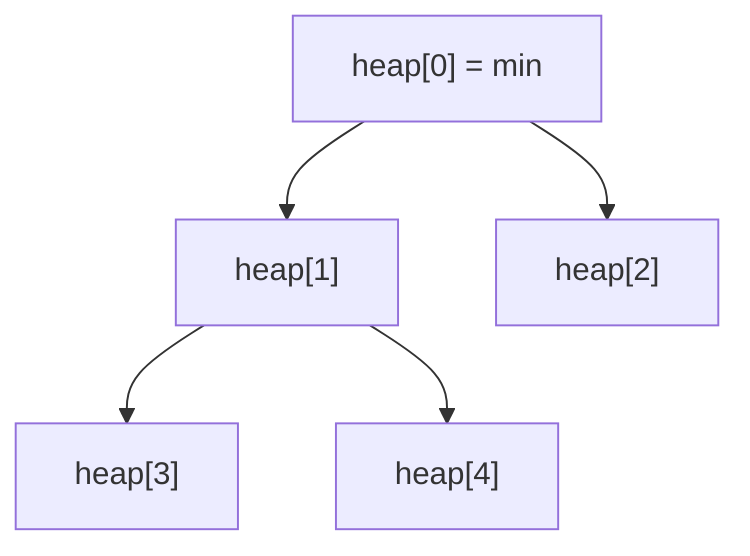

`heapq` is Python's standard-library **heap queue** (priority queue) module. It treats a plain `list` as a **min-heap**: the smallest item always sits at index `0`, and each push or pop restores that property in $O(\log n)$ time without fully sorting the list.

## Intuition

A heap is the right structure when you need "next best" over and over: next deadline, next retry time, next lowest cost, or the current top-$k$ frontier. Full `sort` is $O(n \log n)$ every time; scanning for the min is $O(n)$ every time. A binary heap keeps insert and extract-min both logarithmic and peek-min free ($O(1)$ at `heap[0]`).

The list is **not** sorted end-to-end. Only the **heap invariant** holds: every parent is smaller than or equal to its children. Interact through `heappush`, `heappop`, `heapify`, and the helpers; do not assume `heap[1]` is the second-smallest.

| Need | Typical API |
|------|-------------|
| Repeated extract-min | `heappush` / `heappop` |
| Build once from a list | `heapify` ($O(n)$) |
| Fixed-size top-$k$ stream | `heapreplace` or `heappushpop` |
| One-shot top-$k$ | `nlargest` / `nsmallest` |
| Merge pre-sorted streams | `merge` |

## How it works

**Layout.** For index $k$ (0-based), children live at $2k+1$ and $2k+2$. The min-heap invariant from the [official docs](https://docs.python.org/3/library/heapq.html) is:

$$
\mathrm{heap}[k] \le \mathrm{heap}[2k+1],\qquad
\mathrm{heap}[k] \le \mathrm{heap}[2k+2]
$$

for every $k$ whose children exist. Then $\mathrm{heap}[0]$ is always the global minimum. Comparisons use only `<`, same spirit as `list.sort`.

**Core costs** (list length $n$):

| Operation | Cost | Notes |
|-----------|------|--------|
| `heap[0]` (peek) | $O(1)$ | Does not remove |
| `heappush` | $O(\log n)$ | Bubble up |
| `heappop` | $O(\log n)$ | Move last to root, sift down; empty raises `IndexError` |
| `heapify` | $O(n)$ | Faster than $n$ separate pushes |
| `heappushpop` / `heapreplace` | $O(\log n)$ | Combined ops; fewer steps than push then pop separately |
| `nlargest(k, …)` / `nsmallest(k, …)` | $O(n\log k)$ heap pass | Best for small $k$; prefer full `sorted` ($O(n\log n)$) when $k$ is a large fraction of $n$; use `min`/`max` when $k=1$ |

**Min-heap only (classic API).** To simulate a max-heap on older Pythons, push negated keys (e.g. `(-score, …)` so larger scores pop first). Python 3.14+ also ships explicit max-heap helpers (`heappush_max`, `heappop_max`, …); many production stacks still target the min-heap API and the negation trick.

**Tuples and ties.** Heap entries are often `(priority, sequence, payload)`. The integer sequence is a **tie-breaker**: equal priorities stay stable by insertion order, and Python never falls through to comparing non-orderable payloads (which would raise `TypeError`). The docs recommend this pattern for priority queues.

**Priority updates.** Binary heaps do not support efficient arbitrary decrease-key by index. The standard recipe is **lazy deletion**: mark an entry removed in a dict, push a fresh entry with the new priority, and skip marked entries on pop. Do not search the list and mutate a middle element in place; that breaks the invariant.

**Concurrency.** `heapq` is an in-process algorithm over a shared `list`. It is not a blocking, thread-safe queue. Concurrent `heappush`/`heappop` without an external lock races. For threaded producers/consumers, use `queue.PriorityQueue` (heap-backed, lock-protected, blocking `get`/`put`).

## Example

**Deadline / retry scheduler.** Schedule work by `ready_at` (seconds). The next due task is always a cheap pop:

```python title="heapq-retry.py"
import heapq
from itertools import count

retries: list[tuple[float, int, str]] = []
seq = count()

for ready_at, task in [
    (12.5, "retry-order-A102"),
    (10.0, "retry-ticket-48291"),
    (10.0, "retry-embed-batch-7"),
]:
    heapq.heappush(retries, (ready_at, next(seq), task))

ready_at, _, task = heapq.heappop(retries)
print(ready_at, task)  # 10.0 retry-ticket-48291  (earlier seq wins the tie)
```

**Top-$k$ candidates without full sort.** Keep the $k$ highest retrieval scores with a size-$k$ min-heap of scores (root is the weakest kept score):

```python title="heapq-topk.py"
import heapq

k = 3
# (score, doc_id); min-heap on score so root is the worst of the current top-k
top: list[tuple[float, str]] = []

for score, doc_id in [
    (0.41, "doc-a"),
    (0.92, "doc-b"),
    (0.77, "doc-c"),
    (0.88, "doc-d"),
    (0.55, "doc-e"),
]:
    if len(top) < k:
        heapq.heappush(top, (score, doc_id))
    elif score > top[0][0]:
        heapq.heapreplace(top, (score, doc_id))

# The heap is only partially ordered; sort descending for ranked output.
ranked = sorted(top, reverse=True)
print(ranked)
# [(0.92, 'doc-b'), (0.88, 'doc-d'), (0.77, 'doc-c')]
```

For a one-shot pass over a full list, `heapq.nlargest(k, pairs)` is the same idea with less boilerplate. Streaming or multi-stage pipelines often keep the explicit size-$k$ heap so memory stays $O(k)$ while $n$ grows.

## Diagram



Parent at $k$ is $\le$ children at $2k+1$ and $2k+2$. After `heappop`, the last leaf moves to the root and sifts down until the invariant holds again.

## Trade-offs

| Need | Prefer |
|------|--------|
| Single-thread priority / deadlines / top-$k$ | `heapq` on a list |
| Threads that block until work arrives | `queue.PriorityQueue` |
| FIFO only (no priorities) | `collections.deque` or `queue.Queue` |
| Full order of all $n$ items once | `sorted` |
| True concurrent multi-process / multi-host queue | Redis, SQS, or similar |
| Fast arbitrary delete / decrease-key at scale | Fibonacci heap theory, or a different structure; with `heapq`, use lazy tombstones |

**What fails in production.** Empty `heappop` raises `IndexError` (guard with `if heap:`). Equal priorities without a sequence can raise `TypeError` on unorderable payloads, or silently order by payload instead of insertion order. Mutating priorities in the list without re-heapifying silently corrupts order. Unbounded heaps of deferred retries grow until memory or latency blows up; pair with caps, TTL, and backoff. Starvation of low-priority work reflects the scheduling policy; add aging, quotas, or separate lanes.

## Why it matters here

LLM and ML services repeatedly schedule work by urgency and select the best few candidates under a budget. Retry queues after 429s, event loops keyed by `ready_at`, interactive jobs ahead of batch embeds, and "keep top 50 chunks before the reranker" are all heap-shaped. Interview and practice problems (merge $k$ sorted lists, running median with two heaps, Dijkstra-style costs, top-$k$ frequencies) use the same module. Choosing `heapq` over sort or scan is a complexity choice; choosing it over `PriorityQueue` is a concurrency-contract choice. Get the tuple shape, the min-heap direction (or negated scores), and the bound right, and the rest of the pipeline stays predictable.

## Related terms

- [queue.PriorityQueue](glossary://queue-priority-queue)
- [collections.deque](glossary://collections-deque)
- [Priority scheduling](glossary://priority-scheduling)
- [Top-k](glossary://top-k)
- [Thread safety](glossary://thread-safety)
