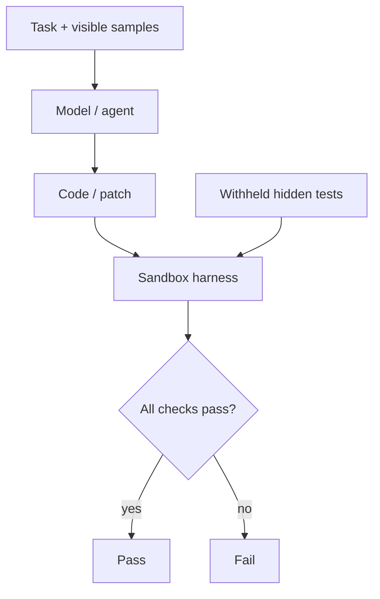

**Hidden tests** are evaluation checks that the system under test cannot see while it produces an answer, patch, or tool sequence. The [eval harness](glossary://eval-harness) holds the tests private until grading time, then runs them against the submitted artifact (usually in a [sandbox](glossary://sandbox)) and scores pass or fail.

They are the functional counterpart of a held-out [offline evaluation](glossary://offline-evaluation) set for code and agents. Visible sample tests teach the task and support iterative debugging; hidden tests measure whether the solution generalizes beyond the examples the model was allowed to read.

## Intuition

If every assertion is public, a model can optimize the checker instead of the problem. Hard-coded returns, prompt-specific branches, and patches that only satisfy the shown test cases all look "correct" until a private suite runs.

Hidden tests flip the information asymmetry: the model sees the issue, docstring, or API schemas; the grader sees inputs and expected behavior the model was not handed. That is the same idea as keeping a private [golden dataset](glossary://golden-dataset) out of training and few-shot demos, applied at the unit-test or integration-test layer.

Sparse hidden suites still miss wrong programs. A function can pass three happy-path cases and break on empty input, ties, or large $n$. EvalPlus (Liu et al., 2023) showed this at scale: expanding HumanEval tests by $80\times$ produced **relative pass@k reductions of $19.3\%$ to $28.9\%$** across the models they studied, not drops of that many percentage points, because many "solutions" only matched the original thin suite.

## How it works

A typical coding or agent eval loop:

1. **Task surface.** The model or agent receives a problem statement, API signature, repository snapshot, and sometimes a few public sample tests or test cases.
2. **Produce artifact.** The system emits code, a unified diff, or a sequence of file edits. It must not receive the hidden suite, its names, or its expected values (except through what it can legitimately infer from code and issue text).
3. **Apply and execute.** The harness applies the artifact in a clean environment and runs the hidden suite under resource limits (CPU, memory, wall time, network policy).
4. **Grade.** All required hidden cases must pass. Failures, timeouts, and apply errors count as incorrect. Partial credit is rare on functional code benches; binary pass is the default.

On repository-level benches such as [SWE-bench](glossary://swe-bench) (Jimenez et al.), the hidden suite is usually split into two roles:

| Suite role | Pre-patch | Post-patch (correct fix) | What it checks |
| --- | --- | --- | --- |
| `FAIL_TO_PASS` | fail | pass | The issue is actually fixed |
| `PASS_TO_PASS` | pass | pass | Neighboring behavior did not regress |

OpenAI's SWE-bench Verified writeup states the evaluation schema explicitly: agents get the issue text and codebase; **the tests are not shown to the agent**; both `FAIL_TO_PASS` and `PASS_TO_PASS` must pass for a full resolve.

Interview-style and practice platforms use a lighter version of the same split: sample tests for local debugging, hidden tests only on submit.

## Diagram



## Example

**Function-level (HumanEval-style).** The prompt shows a signature and docstring for `has_close_elements(numbers, threshold)`. Sample checks in the prompt might cover two nearby floats. Hidden tests, never printed to the model, include empty lists, single-element lists, exact threshold partitions, and large arrays. Correctness is functional: the completion is executed against the hidden suite; string match to a reference solution is not required. Aggregate reporting often uses [pass@k](glossary://pass-at-k): with $n$ samples of which $c$ pass the hidden suite,

$$
\mathrm{pass@}k = 1 - \frac{\binom{n-c}{k}}{\binom{n}{k}}
$$

(when $n-c < k$, the ratio is treated as $0$ and pass@k is $1$).

**Repo-level (SWE-bench-style).** An agent receives a GitHub issue and a checkout at the base commit. The evaluator withholds the gold test patch and grading specification. Existing repository tests may still be visible, including tests later used for `PASS_TO_PASS`; hidden grading does not mean every test body is secret. After submission, the harness applies the candidate and test patches in a Docker environment and runs the required suites. Instance $i$ is resolved only if every required test passes:

$$
\mathrm{Resolved}_i =
\begin{cases}
1 & \text{if all F2P and P2P pass after apply} \\
0 & \text{otherwise}
\end{cases}
$$

Headline score is mean resolved rate over the split. A patch that hard-codes a return for the issue's example string but leaves the real bug path broken fails `FAIL_TO_PASS`. A patch that fixes the bug but breaks an unrelated module fails `PASS_TO_PASS`.

**Product practice harness.** A platform can ship starter code and sample cases to the client while retaining hidden test code on the server for submit-time grading. Merely hiding a panel in the browser is insufficient if the test bodies remain in client data. A solution that passes three sample cases and fails required hidden edge cases is not accepted.

Minimal grading sketch:

```python
def grade(solution: str, hidden_tests: list[str], timeout_s: float = 2.0) -> bool:
    try:
        run_in_sandbox(solution, hidden_tests, timeout_s=timeout_s)
        return True
    except Exception:
        return False  # fail, timeout, OOM, sandbox violation
```

## What weak hidden suites miss

| Failure mode | Symptom | Mitigation |
| --- | --- | --- |
| Thin coverage | High public pass@k, many wrong programs | Expand suites (EvalPlus-style mutation / generation); property tests |
| Over-specific oracles | Correct fixes rejected (false negatives) | Human review of oracles (SWE-bench Verified); prefer behavioral specs over exact log strings |
| Flaky or env-coupled tests | Score jitter across runs | Pin containers, seeds, clocks; quarantine flakes |
| Test leakage | Model saw tests or solutions in train/RAG | Private holdouts; post-cutoff tasks; decontamination |
| Reward hacking under training | Policy optimizes the training checker | Separate train verifier from held-out hidden eval |

SWE-bench Verified was built partly because many original `FAIL_TO_PASS` suites were too narrow or misaligned with the issue text, so valid patches could still fail grading. Hidden tests are only as honest as the oracle.

## Trade-offs

| Design choice | Benefit | Cost |
| --- | --- | --- |
| Fully hidden suite | Harder to game; better measure of generalization | Agents cannot use test-driven repair; underspecified issues hurt more |
| Public samples + hidden submit suite | Better UX and partial feedback | Models can overfit samples; hiddens must cover additional cases consistent with the same specification |
| Very large hidden suites | Fewer false positives | Runtime, flake surface, and false negatives from brittle oracles |
| Exact string/log oracles | Easy to automate | Rejects equivalent correct behavior |

For agent products, some teams allow *local* tests the agent authors or discovers in-repo, while still grading on a held-out hidden suite the agent never receives. That mirrors real software work: engineers run tests they can see; release quality is judged by CI suites and review they do not invent after the fact.

## Why it matters here

Coding models and agents are easy to overrate when every check is visible. Hidden tests keep the evaluation target real: solve the specified behavior, not the prompt's toy test case. They support HumanEval-style pass@k, SWE-bench resolve rates, interview submit buttons, and [RLVR](glossary://rlvr)-style code rewards. Weak or leaked hiddens inflate leaderboards; brittle hiddens punish valid work. For production ship decisions, treat a thin public suite as a smoke check and a versioned hidden [regression suite](glossary://regression-suite) as the real gate.

## Related terms

- [SWE-bench](glossary://swe-bench)
- [pass@k](glossary://pass-at-k)
- [Eval harness](glossary://eval-harness)
- [Offline evaluation](glossary://offline-evaluation)
- [Regression suite](glossary://regression-suite)
