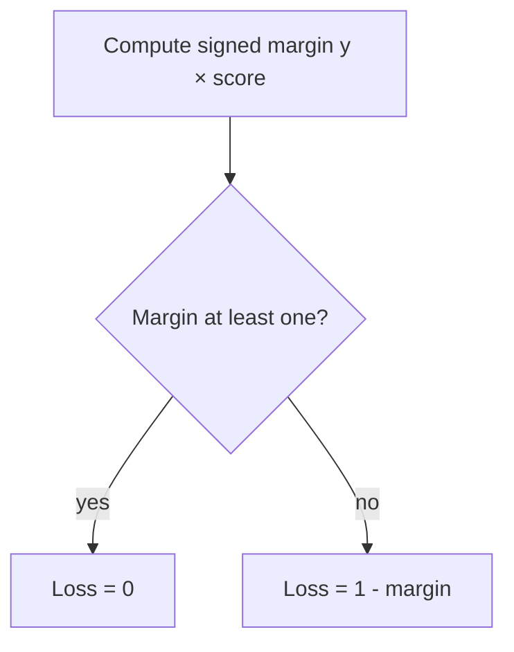

Hinge loss penalizes classification scores that are wrong or insufficiently separated from the decision boundary. For a binary label encoded as $-1$ or $+1$, it is zero only when the example's signed score reaches a specified margin, conventionally one. It is a standard objective component in maximum-margin support vector machines.

## Piecewise-linear margin penalty

For label $y$ and score $f(x)$, $\ell_{hinge}(y,f)=\max(0,1-yf(x))$. A negative signed margin corresponds to a wrong-side prediction; a margin between zero and one is correct but insufficiently confident under the model's geometric objective. Unlike logistic loss, hinge loss stops rewarding an example once its margin reaches one. Some implementations instead use squared hinge loss, which penalizes violations quadratically.

## Example

A required-review request with score 0.4 has signed margin 0.4 and hinge loss 0.6. A confidently correct request with score 1.4 has loss zero. A missed review with score -0.2 has signed margin -0.2 and loss 1.2. Logistic losses for those same margins remain positive: approximately 0.513, 0.220, and 0.798. Both objectives prefer correct scores, but they distribute training pressure differently.

## Why it matters here

The logistic-regression lesson compares losses without confusing a thresholded decision, a geometric margin, and a calibrated probability. Hinge loss explains why support-vector classifiers can share a linear boundary while optimizing different evidence and requiring separate probability calibration.

## Related terms

- [Support vector machine](glossary://support-vector-machine)
- [Cross-entropy](glossary://cross-entropy)
- [Decision threshold](glossary://decision-threshold)
