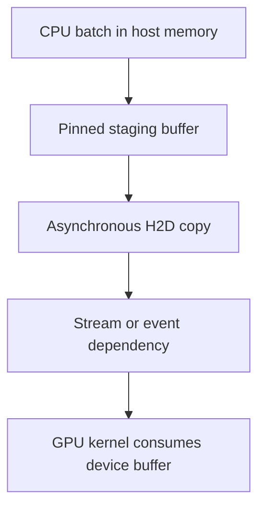

A host-to-device transfer copies data from CPU-accessible host memory into memory usable by an accelerator. On a discrete NVIDIA GPU, that path commonly crosses an interconnect such as PCIe before a GPU kernel consumes the destination buffer. Model weights, token batches, image tensors, and expert-routing metadata can all enter a workload through this boundary. A transfer's cost depends on byte count, effective bandwidth, memory type, scheduling, and synchronization.

## Pinned buffers and asynchronous copies

Ordinary pageable host memory can require staging or synchronization before a transfer proceeds. Page-locked, or pinned, host memory permits asynchronous copies. Overlap with a GPU kernel additionally requires hardware that supports concurrent copy and compute, separate streams, and independent work. Keep the host source buffer unchanged until its copy completes; order the consuming kernel after the copy in the same stream or through an event dependency. Use a timeline profiler to confirm that copy and kernel work overlap. These conditions are described in NVIDIA's [transfer guidance](https://docs.nvidia.com/cuda/cuda-c-best-practices-guide/index.html#asynchronous-and-overlapping-transfers-with-computation).

Effective bandwidth can be far below the accelerator's local HBM bandwidth, so repeated small copies or a copied batch on every decode step can dominate end-to-end runtime. Grouping transfers, preparing the next batch early, and keeping reusable tensors on-device often help more than optimizing an already-fast compute kernel.

## Example

A `4096 x 4096` BF16 tensor contains `4096 * 4096 * 2 = 33,554,432` bytes, or 32 MiB. At an illustrative sustained 16 GB/s host-device link, moving it once takes about 2.1 ms before launch and synchronization overhead. If the following model kernel takes 1 ms, copying that tensor again for every request more than triples the critical-path work. A pinned next-batch transfer may overlap with the current batch when separate streams and dependencies permit it.

## Why it matters here

Training data loaders, CPU-offloaded parameters, inference preprocessing, and distributed worker initialization all cross host-device boundaries. The project deep dives compare kernel time with data movement, so readers need to identify when a slow step is actually waiting on transfer or accidental synchronization. The same principle clarifies why Apple unified memory and discrete CUDA devices require different performance assumptions.

## Related terms

- [CUDA stream](glossary://cuda-stream)
- [CUDA kernel](glossary://cuda-kernel)
- [Unified memory](glossary://unified-memory)
- [HBM](glossary://hbm)
