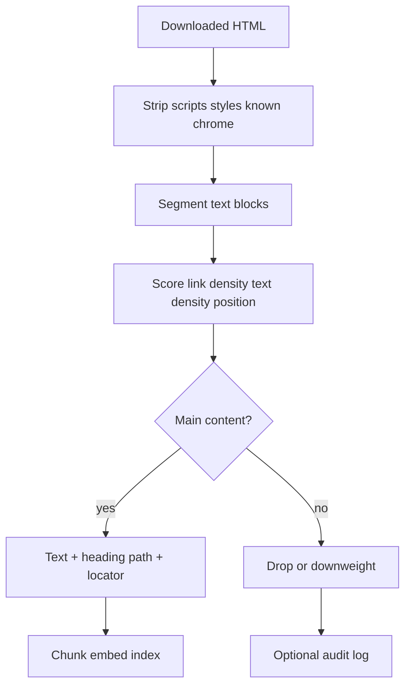

**HTML boilerplate** is the repeated page-shell text that surrounds the document's main content: navigation menus, sidebars, footers, cookie banners, related-link widgets, legal notices, social chrome, and script-injected UI copy. Humans skim past it. A crawler, [document parser](glossary://document-parser), or [RAG](glossary://rag) indexer that keeps a large shell can make distinct pages look misleadingly similar.

The research name for stripping this shell is **boilerplate removal** or **main content extraction**: label text blocks as main content vs everything else, then keep only the former for indexing, search, or language modeling.

## Intuition

A docs page is a layout tree where the same strings ("Docs", "Status", "Privacy", "Was this helpful?") appear on hundreds of URLs. Embedding the full page can pull unrelated pages toward each other in vector space. [BM25](glossary://bm25) downweights terms appearing in many documents, but retained chrome still adds irrelevant matches and affects document-length normalization. The useful signal may be a small fraction of the downloaded HTML.

Kohlschütter et al.'s [WSDM 2010 paper](https://doi.org/10.1145/1718487.1718542) reports earlier estimates of roughly $40\%$–$50\%$ template material and retrieval improvements on the BLOGS06 track. Those results describe the historical corpora; measure template share on each modern page. For LLM pipelines, removing irrelevant shell text leaves more [token budget](glossary://token-budget) for source evidence; evaluate retrieval changes on the target corpus.

## How it works

Production systems usually combine several signals rather than relying on one selector:

1. **Trusted regions.** Prefer semantic HTML (`<main>`, `<article>`, role landmarks) or site-specific CSS selectors when the layout is controlled.
2. **Hard strip.** Drop `script`, `style`, and known chrome containers before text conversion. Don't remove every `header` or `aside` blindly: an article header or contextual sidebar can contain useful evidence.
3. **Block scoring.** Split remaining DOM text into blocks and score each with shallow features (word count, link density, text density, position).
4. **Cross-page templates.** Lines or subtrees that repeat across many pages of the same host are template candidates even if density looks "content-like."
5. **Emit structure.** Keep headings, lists, and locators (URL fragment, heading path) so chunking and citations still point at the real page.

Classic densitometric features (boilerpipe / Kohlschütter et al.) work without site-level training:

**Link density** for a text block $b$ is the fraction of tokens that sit inside anchor tags (token *occurrences*, not unique types):

$$
\mathrm{ld}(b) = \frac{|T_a(b)|}{|T(b)|}
$$

where $T(b)$ is the token sequence in $b$ and $T_a(b)$ is the subsequence whose tokens sit inside $\langle a\rangle$. Navigation and "related articles" blocks tend toward high $\mathrm{ld}(b)$ (often near $1$). Body prose is low.

**Text density** measures how packed a block is after wrapping at a fixed width $w$ (Kohlschütter et al. use $w = 80$ for English; $80$–$90$ is the reported sweet spot). Let $L_b$ be the number of wrapped lines and $T'_b$ the token count on all but the last line (the incomplete wrap is dropped so a short trailing line does not understate density). If the block is a single line, use the full token count $T_b$:

$$
\rho(b) =
\begin{cases}
\dfrac{T'_b}{L_b - 1} & L_b > 1 \\[0.6em]
T_b & L_b = 1
\end{cases}
$$

Boilerplate blocks are often short, link-heavy, or low-density after wrap. Main content forms longer runs of higher density. Modern extractors (Readability-style heuristics, Trafilatura, jusText, boilerpipe ports) combine these ideas with tag analysis, sentence-like line filters, and optional fallbacks. Learned sequence labelers (for example Web2Text) treat the page as a chain of blocks labeled content vs boilerplate.

Generic `get_text()` over the whole body is not extraction. It is template ingestion.

## Diagram



## Example

Imagine a rate-limit page with $2000$ tokens of shell and $120$ tokens of policy. This shortened HTML illustrates its structure; those counts aren't measurements of the snippet:

```html
<html><body>
  <nav>Docs | API | Status | Pricing | Login</nav>
  <aside>Related: Auth · Webhooks · SDKs · Changelog</aside>
  <main>
    <h1>Rate limits</h1>
    <p>Default: 100 requests per minute per API key.
       Burst: 20 extra requests. Exceeding the limit returns HTTP 429.</p>
  </main>
  <footer>Privacy | Terms | Cookie settings | © 2026 Acme</footer>
  <div class="widget">Was this helpful? Yes No</div>
</body></html>
```

Naive full-page extraction indexes strings like `Docs`, `Status`, `Privacy`, and `Was this helpful?` on every docs URL. A large shared shell can mix unrelated pages in dense retrieval. A main-content extract keeps:

```text
Rate limits
Default: 100 requests per minute per API key.
Burst: 20 extra requests. Exceeding the limit returns HTTP 429.
```

Minimal operational pattern when you control the HTML:

```python
from bs4 import BeautifulSoup

def main_text(html: str) -> str:
    soup = BeautifulSoup(html, "html.parser")
    for tag in soup.select("nav, footer, aside, script, style"):
        tag.decompose()
    main = soup.find("main") or soup.find("article")
    if main is None:
        raise ValueError("missing_main_content")
    return main.get_text(" ", strip=True)
```

For open-web corpora, use a dedicated extractor (for example Trafilatura or a Readability port), then **inspect repeats within each host**. Repeated lines may be navigation or relevant shared policy text; inspect them before removing or downweighting. [Trafilatura's extraction modes](https://trafilatura.readthedocs.io/en/latest/extraction-overview.html) make the precision/recall tradeoff explicit. Store `parser`, `content_sha256` of the cleaned text, and a locator for re-ingestion and citation audits.

**What fails in production**

| Failure | Symptom | Typical fix |
|---|---|---|
| Full-page text | Unrelated pages cluster; menus in citations | Main-content isolation before chunking |
| Over-aggressive strip | Policy tables or code samples vanish | Prefer `<main>` / structure-aware keep; evaluate recall |
| SPA shell only | Empty or "Loading…" body | Render JS when needed, or use a content API |
| Hidden injection in chrome | Retrieved instructions override policy | Treat web HTML as untrusted; quarantine markers |
| No cross-page dedup | Footer matches clutter queries mentioning template terms | Inspect site-level repeats before filtering |

## Why it matters here

Retrieval quality starts with the source text. HTML boilerplate can contaminate an index even when the chunker follows its rules: ranking and reranking operate on menus, answers cite navigation, and [token budget](glossary://token-budget) goes to page chrome. Clean the page shell first; then [chunk](glossary://chunking), embed, and retrieve.

## Related terms

- [Document parser](glossary://document-parser)
- [Chunking](glossary://chunking)
- [Embedding](glossary://embedding)
- [Token budget](glossary://token-budget)
- [Parsing](glossary://parsing)
