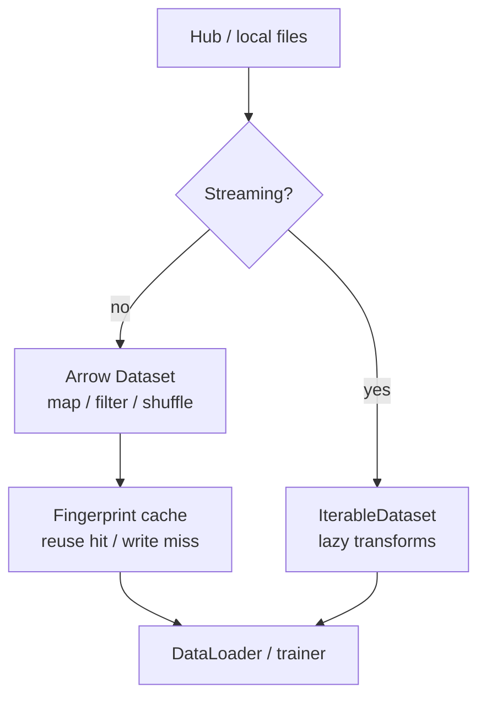

**Hugging Face Datasets** (`datasets`) is a Python library for loading, versioning, transforming, and caching ML corpora. It is the common path from Hub (or local files) to training and eval loops: pin a dataset id and revision, choose a split, apply `map` / `filter` / `shuffle`, and either materialize an Arrow-backed **map-style** `Dataset` or stream an **`IterableDataset`**. Introduced as a community library for shared NLP loaders and documentation (Lhoest et al., EMNLP 2021 demo), it now covers text, images, audio, and multimodal rows used across LLM training and evaluation.

Under the hood, map-style datasets store columns in **Apache Arrow** tables on disk and **memory-map** them. You get random access (`ds[i]`) and fast column slices without loading the full table into RAM. Streaming mode skips the full download and disk cache: examples are produced as you iterate, which is how multi-hundred-GB corpora (for example C4-scale text) stay usable on modest machines.

## Intuition

Treat the library as a **reproducible data graph** whose source revisions, splits, transforms, fingerprints, and cache files define each dataset:

| Piece | Role |
| --- | --- |
| Hub id + `revision` | Which published snapshot (commit / tag), not "whatever is latest" |
| Split | Train / validation / test (or a named subset) |
| Transform chain | `filter`, `map`, `shuffle`, column renames |
| Fingerprint | Hash of prior state + transform so processed Arrow files can be reused |
| Cache files | On-disk Arrow (and metadata) under the HF datasets cache |

Pandas is a full in-memory table workbench. Datasets is optimized for **large, column-oriented, repeatable pipelines** that feed tokenizers and trainers. If you only need a few thousand rows of tabular analysis, a DataFrame is often simpler. If you need Hub versioning, tokenizer `map` with multiprocess, and disk-backed reuse across jobs, Datasets is the usual tool.

## Example

Fine-tune prep: pin a Hub revision, take the train split, drop short texts, tokenize in batches, and keep only model columns. A second run with the same function and args should hit the transform cache instead of re-tokenizing.

```python
from datasets import load_dataset
from transformers import AutoTokenizer

REPO = "stanfordnlp/imdb"
REVISION = "e6281661ce1c48d982bc483cf8a173c1bbeb5d31"
TOKENIZER_REVISION = "86b5e0934494bd15c9632b12f734a8a67f723594"
tok = AutoTokenizer.from_pretrained(
    "google-bert/bert-base-uncased", revision=TOKENIZER_REVISION
)

ds = load_dataset(REPO, split="train", revision=REVISION)
# 25_000 rows for this classic IMDB train split

ds = ds.filter(lambda ex: len(ex["text"].split()) >= 20)
# fewer rows after the length gate

def tokenize_batch(batch):
    return tok(
        batch["text"],
        truncation=True,
        max_length=256,
        padding=False,
    )

tokenized = ds.map(
    tokenize_batch,
    batched=True,
    batch_size=1000,
    remove_columns=["text"],
    num_proc=4,
)
# The fingerprint hashes the function, captured objects, and map kwargs.
# It doesn't independently monitor every external file or service.
tokenized = tokenized.with_format("torch", columns=["input_ids", "attention_mask", "label"])
```

These dataset and tokenizer commits were checked against the Hub on September 23, 2026. Since `padding=False` leaves variable-length sequences, a training batch needs a padding collator such as `DataCollatorWithPadding(tokenizer=tok)`; `with_format("torch")` alone doesn't stack them into equal-length tensors.

For a corpus that should not land fully on disk:

```python
stream = load_dataset("allenai/c4", "en", split="train", streaming=True)
stream = stream.filter(lambda ex: len(ex["text"]) > 200)
stream = stream.shuffle(seed=42, buffer_size=10_000)  # approximate, not full shuffle
for i, ex in enumerate(stream):
    if i >= 3:
        break
```

## How it works

### Map-style `Dataset` vs `IterableDataset`

- **`Dataset` (map-style):** download or convert sources to Arrow, memory-map the cache, support `len(ds)`, indexing, exact `shuffle` via an indices mapping, and eager `map` that writes a new cached table.
- **`IterableDataset` (streaming):** lazy iteration; `map` / `filter` chain runs on the fly; no full random access; shuffle uses a **buffer** plus optional **shard reordering** (approximate). Prefer this when the corpus exceeds disk budget or first-byte latency matters more than exact reshuffles.

```python
# materialize only when disk is acceptable
map_ds = load_dataset("nyu-mll/glue", "mrpc", split="train")
# stream when the full snapshot is too large
it_ds = load_dataset("nyu-mll/glue", "mrpc", split="train", streaming=True)
```

### Processing API

The following map-style `Dataset` operations return a **new** dataset object (not in-place mutation). Streaming datasets have a different API; for example, their `map` is lazy and doesn't accept `num_proc`:

- **`map(fn, batched=..., num_proc=...)`** apply row or batch transforms (tokenization, feature extraction). Batch map can grow or shrink row count.
- **`filter(predicate)`** keep rows that match a condition.
- **`select(indices)`** keep specific indices.
- **`train_test_split(test_size=..., seed=...)`** build splits with optional shuffle.
- **`shard(num_shards, index)`** hand a worker its slice for data-parallel training.
- **`with_format("torch" | "numpy" | ...)`** cast columns on read for the training framework.

Shuffle on a map-style dataset builds an indices mapping. The [processing docs](https://huggingface.co/docs/datasets/en/process) report that non-contiguous access can be 10× slower; this example has no measured slowdown. `flatten_indices()` rewrites the Arrow table in shuffled order to restore contiguous reads.

### Cache and fingerprints

After load, each transform updates a **fingerprint**: a hash of the previous fingerprint plus a hash of the transform (function body and closed-over objects via `dill` / pickle, plus parameters such as `batch_size` and `remove_columns`). With caching enabled and a reusable cache file, a matching fingerprint permits reuse. See the [cache documentation](https://huggingface.co/docs/datasets/en/about_cache); separately pin external inputs such as files, tokenizer revisions, and remote resources.

```text
load (Arrow on disk, fingerprint F0)
  -> map(tokenize)  => F1 = hash(F0, tokenize, map_kwargs)
  -> filter(len)    => F2 = hash(F1, filter, ...)
```

If the function is not hashable or closes over non-deterministic objects, the library may assign a **random** fingerprint and recompute (and warn). That is a common source of "why did my preprocessing run for hours again?" Caching can also keep a **stale** transform if you edited a dependency the hasher did not see; force a clean run by changing the function signature, clearing the relevant cache, or setting `load_from_cache_file=False` on `map`.

Default cache lives under the Hugging Face cache directory (override with `HF_HOME` / datasets cache env vars). Large tokenized runs fill disk quickly; treat cache growth as an ops metric.

### Persistence

- **`save_to_disk` / `load_from_disk`**: local Arrow layout for job-to-job reuse.
- **`push_to_hub` / `load_dataset`**: share versioned Parquet-backed datasets on the Hub.
- Always log **repo id, revision (commit), config name, split, library version, and transform code hash** next to the training run.

## Diagram



## Production pitfalls

- **Revision drift:** `load_dataset("org/name")` without a pinned commit can silently change rows when the Hub dataset updates.
- **Split vs filter order:** filtering *before* `train_test_split` vs *after* changes class balance and can make two "same seed" runs incomparable.
- **Tokenizer not in the fingerprint story you think you have:** if the tokenize function only closes over a path string but files on disk change, or you load a different tokenizer revision outside the hashed function, the cache may still hit incorrectly or miss unpredictably. Prefer hashing tokenizer identity (name + revision) into logged metadata and into `fn_kwargs` or the function body you control.
- **Streaming shuffle ≠ epoch-perfect shuffle:** buffer size trades memory for mix quality; multi-worker streaming can also retain more memory than expected.
- **Indices mapping pain:** heavy `shuffle` / `select` without `flatten_indices` slows I/O on map-style data.
- **Non-serializable maps:** lambdas that capture large models, open sockets, or unpicklable objects break multiprocess `num_proc` and cache stability.

## Why it matters here

LLM lessons treat data as an artifact trail: which corpus, which revision, which filters, which tokenizer, which train/eval split. Hugging Face Datasets turns that trail into executable code and cached intermediates. Repeatable results require pinned source and external inputs plus deterministic transformations. When pretraining, SFT, or eval harness work cites a Hub dataset, this library is usually what materializes the rows.

## Related terms

- [Dataset record](glossary://dataset-record)
- [DataFrame](glossary://dataframe)
- [Tokenizer artifact](glossary://tokenizer-artifact)
- [Train, validation, and test split](glossary://train-validation-test-split)
- [Dependency lockfile](glossary://dependency-lockfile)
