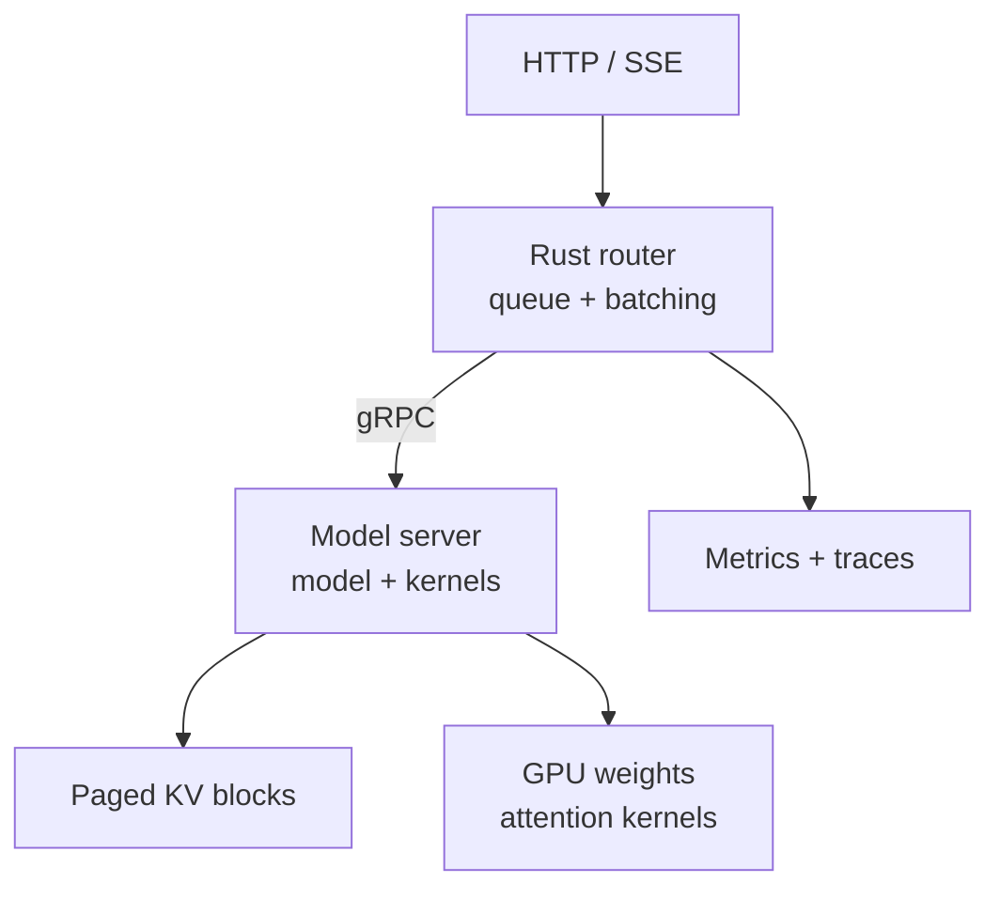

**Hugging Face Text Generation Inference (TGI)** is a production LLM serving stack: a Rust HTTP router, a Python (and CUDA) model engine, and gRPC between them. You point it at a supported checkpoint (Hub id or local weights), and it owns load, tokenization, continuous batching, KV-cache memory, streaming generation, and server telemetry. Training workflows use a training library; the application owns auth, routing policy, prompts, retrieval, safety, and fallbacks.

TGI was built and run at Hugging Face for Hugging Chat, the Inference API, and Inference Endpoints. As checked on September 23, 2026, its [official documentation](https://huggingface.co/docs/text-generation-inference/en/index) declares **maintenance mode**, covering minor bug fixes, documentation and lightweight maintenance. The [GitHub repository](https://github.com/huggingface/text-generation-inference) was archived read-only on March 21, 2026. Hugging Face recommends engines such as [vLLM](glossary://vllm) or [SGLang](glossary://sglang) going forward; TGI remains useful for understanding existing serving stacks.

## Diagram



## How it works

At a high level TGI splits **control plane** from **model plane**:

1. **Router (Rust).** Accepts HTTP (native `/generate`, `/generate_stream`, and OpenAI-style `/v1/chat/completions`), validates and tokenizes payloads, enforces limits (`max_input_tokens`, `max_total_tokens`, concurrent request caps), and runs continuous batching so finished sequences free budget for waiting ones.
2. **Warmup.** Before traffic, the engine probes how large a prefill and how many total tokens fit without OOM, optionally recording CUDA graphs for common batch sizes.
3. **Engine (`text_generation_server`).** Loads weights (typically via Safetensors), runs prefill then decode with KV caching, Flash Attention, and PagedAttention-style block pools on supported architectures. Multi-GPU uses NCCL [tensor parallelism](glossary://tensor-parallelism) (`--num-shard`).
4. **Streaming and telemetry.** Tokens stream over Server-Sent Events (SSE). Prometheus metrics and OpenTelemetry spans cover queue, prefill, and decode.

Generation is still [autoregressive decoding](glossary://autoregressive-decoding): **prefill** processes the prompt in one or more forward passes and contributes to [TTFT](glossary://ttft), alongside queueing, tokenization and delivery. Ordinary **decode** emits one token per active sequence per step; supported speculation can accept several. Long outputs can spend most of their wall time in decode ([TPOT](glossary://tpot) / [tokens per second](glossary://tokens-per-second)).

### Continuous batching knobs

TGI budgets work in **tokens**. Configure token limits alongside request-count limits:

| Launcher flag | Role |
|---|---|
| `--max-input-tokens` | Max prompt length per request |
| `--max-total-tokens` | Max prompt + generated tokens per request (memory footprint of one request) |
| `--max-batch-prefill-tokens` | Cap on tokens in one prefill forward (prefill is compute- and memory-heavy) |
| `--max-batch-total-tokens` | Cap on live tokens across the running batch (main concurrency budget after weights load) |
| `--waiting-served-ratio` / `--max-waiting-tokens` | When to pause decode to admit waiting prefills |

Admission is roughly: a waiting request joins only if its expected token load fits remaining `max_batch_total_tokens` and the next prefill fits `max_batch_prefill_tokens`. Finished sequences (EOS or `max_new_tokens`) free budget immediately so new work can enter without waiting for a static batch to drain. That is the same idea as [continuous batching](glossary://continuous-batching) in Orca-style schedulers.

TGI v3 **zero-config** mode can leave those batch limits unset so startup picks maxima for the detected GPU and model. Full context length and high concurrency still trade off: a 128k context may only fit a handful of concurrent sequences on a given card; lowering max context can raise concurrency.

## Example

Serve a chat model with the official container. The tag below selects a documented release; production reproducibility additionally needs an image digest and a model commit via `--revision`:

```bash
model=HuggingFaceH4/zephyr-7b-beta
volume="$PWD/data"

docker run --gpus all --shm-size 1g -p 127.0.0.1:8080:80 -v "$volume:/data" \
  ghcr.io/huggingface/text-generation-inference:3.3.5 \
  --model-id "$model"
```

Native streaming:

```bash
curl 127.0.0.1:8080/generate_stream \
  -X POST \
  -H 'Content-Type: application/json' \
  -d '{"inputs":"What is Deep Learning?","parameters":{"max_new_tokens":20}}'
```

OpenAI-compatible Messages API (chat template applied server-side when the tokenizer provides one):

```bash
curl localhost:8080/v1/chat/completions \
  -X POST \
  -H 'Content-Type: application/json' \
  -d '{
    "model": "tgi",
    "messages": [
      {"role": "system", "content": "You are a helpful assistant."},
      {"role": "user", "content": "What is deep learning?"}
    ],
    "stream": true,
    "max_tokens": 20
  }'
```

A realistic production shape: one TGI replica per GPU (or one multi-shard replica for a large model), load balancer in front, Prometheus scraping TGI metrics, app gateway handling API keys and rate limits. For a 70B model that does not fit one GPU, set `--num-shard` to the GPU count and ensure `--shm-size` (or a `/dev/shm` emptyDir in Kubernetes) is large enough for NCCL.

## Sizing intuition

Weights dominate fixed VRAM; the [KV cache](glossary://kv-cache) dominates the variable part. For a rough full-precision-style weight cost with $N$ parameters and $b$ bytes per parameter (for example $b=2$ for FP16/BF16):

$$
\mathrm{VRAM}_{\mathrm{weights}} \approx N \cdot b
$$

KV memory grows with layers, heads (or head dim), sequence length, batch, and dtype. Under continuous batching, estimate usable concurrency from the VRAM available after weights and other runtime allocations. If every live request reserves up to `max_total_tokens` of sequence budget, concurrency scales like:

$$
\text{concurrency} \lesssim \frac{\texttt{max\_batch\_total\_tokens}}{\text{typical total tokens per request}}
$$

with hard stops from `max_batch_prefill_tokens` during admission spikes. Prefill tends to be **compute-bound** (many tokens, one weight load); decode tends to be **memory-bandwidth-bound** (reload weights each step for few tokens). Raising concurrent decode sequences improves GPU utilization until KV pressure forces queueing or OOM.

Quantization (`--quantize` with paths such as AWQ, GPTQ, Marlin, bitsandbytes, EETQ, fp8 where supported) shrinks weights so more KV (and thus more concurrency) fits. Measure quality and latency on your eval set because reduced memory use can trade against accuracy.

## What fails in production

- **Unsupported or half-supported architecture.** Optimized kernels cover popular families; other models fall back to slower `AutoModel` paths or fail to load. Check the supported-models list and Hub `apps=tgi` filter before promising a launch date.
- **Token budget mis-set.** Too-high `max_total_tokens` / batch limits → OOM under load. Too-low → artificial 503/queue and idle GPU. Prefer warmup/zero-config, then load-test with your real prompt and output length mix.
- **Chat template and tokenizer skew.** Serving the wrong revision, missing `chat_template`, or client-side formatting that double-applies roles destroys quality while metrics still look "healthy."
- **Quality blamed on the server.** Temperature, top-p, stop sequences, max tokens, and LoRA adapter selection live at the API boundary; fix prompts and generation config before retuning batch flags.
- **NCCL / SHM.** Multi-GPU without enough shared memory often fails or crawls; Docker needs `--shm-size`, Kubernetes needs a memory-backed `/dev/shm`.
- **Maintenance trajectory.** The archived repository does not prove future model support or security-patch availability. Review the maintenance status when operating an existing fleet; evaluate an actively developed engine for new requirements.

## Debug path

Split the path before changing engine flags:

1. **Load / health:** model revision, dtype/quantize, shard count, startup OOM vs runtime OOM.
2. **Queue wait:** concurrent request limit, batch full (`max_batch_total_tokens`), prefill starvation vs decode hogging (`waiting_served_ratio`, `max_waiting_tokens`).
3. **Prefill (TTFT):** input length distribution, `max_batch_prefill_tokens`, long RAG contexts.
4. **Decode (TPOT):** batch occupancy, KV fragmentation, speculation flags if enabled.
5. **Network / client:** SSE buffering, proxy timeouts, client reassembly.
6. **Quality:** evaluate tokenizer, chat template, and generation parameters with an eval set; batch size measures serving capacity.

Benchmark under a realistic mix of prompt and output lengths. TGI's own micro-benchmarks can skip full router behavior; use an HTTP load tool (for example k6) against `/generate_stream` or `/v1/chat/completions` for end-to-end numbers.

## Trade-offs

| Strength | Cost / limit |
|---|---|
| Hugging Face-native path (Hub id, Safetensors, chat templates) | Architecture must be on the supported list for full performance |
| Production HTTP, SSE, OpenAI Messages API, Prometheus, OTel | App still needs auth, multi-tenant policy, and product SLOs |
| Continuous batching + paged KV + Flash Attention | Tuning is token-budget driven; wrong limits waste GPU or OOM |
| Tensor parallel large models | NCCL, SHM, and multi-GPU ops complexity |
| Mature, well documented for learning serving | Maintenance mode; new investment targets vLLM / SGLang |

Choose TGI when you already run it successfully, need parity with a legacy HF endpoint, or are studying a complete open serving design. For new high-throughput or rapidly evolving model support, benchmark [vLLM](glossary://vllm), [SGLang](glossary://sglang), or [TensorRT-LLM](glossary://tensorrt-llm) on the same checkpoint and traffic shape.

## Why it matters here

TGI is a concrete answer to "what sits between my open weights and a production HTTP API?" Understanding its router/engine split, token budgets, and prefill/decode metrics transfers directly to any modern serving engine, even when the binary you ship is no longer TGI.

## Related terms

- [Continuous batching](glossary://continuous-batching)
- [vLLM](glossary://vllm)
- [PagedAttention](glossary://pagedattention)
- [KV cache](glossary://kv-cache)
- [TTFT](glossary://ttft)
