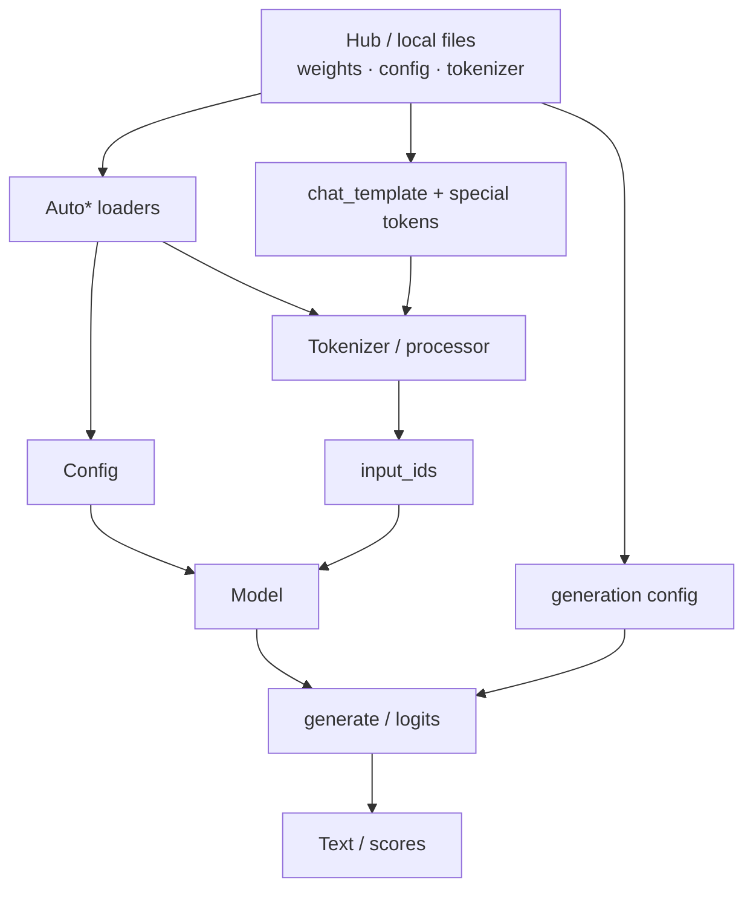

Hugging Face **Transformers** is the open-source Python library that defines, loads, runs, trains, and exports transformer-based models (text, vision, audio, multimodal) from the Hugging Face Hub and local paths. Official docs frame it as the **model-definition framework**: a shared config + model + preprocessor contract that training stacks (Trainer, Accelerate, DeepSpeed, FSDP, Axolotl, Unsloth) and serving engines (vLLM, TGI, SGLang, TensorRT-LLM, llama.cpp conversion paths) can agree on.

In practice you almost always touch three surfaces: `Auto*` loaders (`AutoConfig`, `AutoTokenizer`, `AutoModelForCausalLM`, …), `model.generate` / `pipeline` for inference, and `Trainer` / PEFT for fine-tunes. It is the usual bridge from "there is a Hub repo" to "I can inspect tokens, logits, and generations on my laptop." For high-concurrency production serving, evaluate a dedicated serving engine against the same model and workload.

## Diagram



## How it works

Every architecture is built from three main pieces (library design principle):

1. **Configuration** (`PreTrainedConfig` / `AutoConfig`): architecture hyperparameters (`model_type`, hidden size, vocab size, rope settings, and so on).
2. **Model** (`PreTrainedModel` / task-specific `AutoModel*`): PyTorch modules and weights. Task class matters: `AutoModelForCausalLM` for next-token generation, `AutoModelForSequenceClassification` for labels, `AutoModel` for base encoder/decoder bodies.
3. **Preprocessor** (`AutoTokenizer`, image processor, feature extractor, or multimodal processor): turns raw inputs into tensors the model expects.

`from_pretrained(name_or_path)` resolves a Hub repo id or a local directory, downloads or reads files into a cache, picks the concrete class from `config.json` (`model_type`) or registration tables, and materializes weights. Pin `revision` to an immutable commit for reproducibility; branch names and movable tags don't freeze the files.

**Auto classes** hide the architecture name so the same call pattern works across BERT, Llama, Whisper, CLIP, and new Hub models. Custom architectures that ship modeling code *on the Hub* only load when you set `trust_remote_code=True`, which executes that remote Python on your machine. Default is `False`; only enable it for repos you have read and trust.

For chat models, the tokenizer often owns a Jinja [chat template](glossary://chat-template). Skipping `apply_chat_template` and feeding free-form text is a common reason "same weights" look worse than the model card demo. Generation defaults may live in `generation_config.json` (temperature, max length, EOS, sampling flags); ad hoc `generate(...)` kwargs override them for that call.

## Example

Load a causal LM, apply the chat template, generate a short answer. This example needs PyTorch, Transformers and Accelerate for `device_map="auto"`; inspect `model.hf_device_map` to see whether it uses GPU, CPU or offload:

```python
from transformers import AutoModelForCausalLM, AutoTokenizer

model_id = "Qwen/Qwen2.5-0.5B-Instruct"
revision = "7ae557604adf67be50417f59c2c2f167def9a775"
tok = AutoTokenizer.from_pretrained(model_id, revision=revision)
model = AutoModelForCausalLM.from_pretrained(
    model_id,
    revision=revision,
    dtype="auto",
    device_map="auto",
)

messages = [
    {"role": "system", "content": "Answer in one short paragraph."},
    {"role": "user", "content": "Explain KV cache briefly."},
]
prompt = tok.apply_chat_template(
    messages, tokenize=False, add_generation_prompt=True
)
inputs = tok(prompt, return_tensors="pt", add_special_tokens=False).to(model.device)
out = model.generate(**inputs, max_new_tokens=64, do_sample=False)
print(tok.decode(out[0][inputs["input_ids"].shape[-1]:], skip_special_tokens=True))
```

The commit was checked on the Hub on September 23, 2026. `add_special_tokens=False` follows the [chat-template guidance](https://huggingface.co/docs/transformers/en/chat_templating): the template already supplies its control tokens, so tokenizing the rendered string mustn't add them again.

One-liner path for demos (hides template and batching details):

```python
from transformers import pipeline

pipe = pipeline("text-generation", model="gpt2", device_map="auto")
print(pipe("The capital of France is", max_new_tokens=8)[0]["generated_text"])
```

For training, `Trainer` + `TrainingArguments` wrap the PyTorch loop (mixed precision, logging, checkpointing, multi-GPU) around a Transformers model and a collated dataset. Parameter-efficient fine-tunes usually attach PEFT adapters (for example LoRA) rather than rewriting the full loop by hand.

## Artifact boundary

A "working Transformers load" is more than `*.safetensors` or `pytorch_model.bin`. Behavior also depends on:

| Artifact | Why it matters |
|---|---|
| `config.json` | Architecture and head shapes |
| Tokenizer files (`tokenizer.json`, merges, specials) | Token id contract with the embedding table |
| Chat template | Instruct / tool formatting |
| `generation_config.json` | Default decoding |
| dtype / quant config | Numerical path and memory |
| Library + remote-code revision | Implementation of the forward pass |
| Pad / EOS / BOS ids | Stopping and batching |

Record those when comparing Transformers output to [vLLM](glossary://vllm), [TGI](glossary://hugging-face-tgi), or [llama.cpp](glossary://llama-cpp). Artifact mismatch (template, tokenizer revision, EOS handling, sampling defaults) is one concrete cause to check before attributing a quality gap to the runtime.

## Trade-offs

**Strengths:** fastest path to inspect a Hub checkpoint; one API across many architectures; transparent access to logits, hidden states, and hooks; good for unit tests, small fine-tunes, export, and parity debugging before a serving cutover.

**Limits in production:** wrapping ordinary `generate` calls in an HTTP handler doesn't by itself provide request scheduling. As checked on September 23, 2026, Transformers also documents [continuous batching](https://huggingface.co/docs/transformers/en/continuous_batching) through `generate_batch` and `ContinuousBatchingManager`, with paged attention and supported-model constraints. Compare the actual configured paths rather than assuming the library lacks batching. Large models need careful placement, sharding or offload; a serving product still needs auth, admission limits and operational controls. `pipeline` convenience can hide task or template choices. `trust_remote_code=True` executes repository code and requires explicit trust.

Use Transformers to establish a reference generation (pinned revision, template, decode settings). Then move the same [model checkpoint](glossary://model-checkpoint) and [tokenizer artifact](glossary://tokenizer-artifact) into a serving engine and demand parity on a fixed eval set before blaming the engine.

## Why it matters here

Many curriculum paths move between architecture theory, Hub checkpoints, tokenizers, fine-tuning, and production serving. Transformers is the concrete load/run surface that makes those layers debuggable in one Python process: you can print token ids, compare chat templates, dump logits, and save a clean export before you optimize throughput elsewhere.

## Related terms

- [Transformer](glossary://transformer)
- [Tokenizer artifact](glossary://tokenizer-artifact)
- [Model checkpoint](glossary://model-checkpoint)
- [Chat template](glossary://chat-template)
- [vLLM](glossary://vllm)
