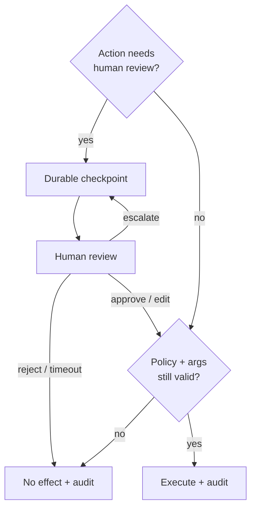

**Human-in-the-loop (HITL)** means a person contributes feedback or decisions within an automated process. It can mean labeling training data or reviewing a proposed runtime action. An enforced runtime approval gate uses trusted code to bind an authenticated person's decision to a specific action before its side effect.

In ML and LLM products the phrase covers two related loops. **Training-time HITL** is humans labeling data, ranking model outputs, or answering active-learning queries so the model improves offline ([active learning](glossary://active-learning), [RLHF](glossary://rlhf)). **Runtime HITL** is humans sitting on the execution path of an agent or decision system: the model proposes; a gate pauses; a reviewer decides; the runtime resumes only with a validated decision. For agent scaffolds and tool use, the runtime sense is the one that stops high-impact writes, deploys, and external messages.

HITL is a harder gate than **human-on-the-loop** (monitor and interrupt while the system already runs) and the opposite of **human-out-of-the-loop** (no real-time human on that action). If the irreversible effect can complete before a human acts, you have on-the-loop supervision, not an in-the-loop gate.

## Diagram



## Intuition

Automation is fast; some actions are hard or impossible to undo. A human only helps when four conditions hold at once:

1. **Trigger in code** (amount, risk tier, tool name, confidence, policy class), with the condition enforced by trusted runtime logic.
2. **Evidence** the reviewer can actually use (slice metrics, failing eval rows, exact tool args, policy citations).
3. **Authority** (role, dual-control for critical actions) enforced by permissions and tied to the authenticated reviewer.
4. **Enforced outcomes** (approve runs *this* hashed action; edit re-validates; reject or timeout performs no rollout; everything is logged).

A review gate needs enough context, a timeout, and an audit record to support an accountable decision. Measure how often reviewers change proposals to detect rubber-stamping.

## How it works

A production runtime HITL path usually looks like this:

1. **Classify risk.** Map each tool (and often its arguments) to auto-run, notify, require-approval, or escalate. Tool name alone is rarely enough: `shift_traffic(1%)` and `shift_traffic(100%)` are different policies.
2. **Propose and validate.** The model (or planner) emits a structured action: name, args, rationale. An [action allowlist](glossary://action-allowlist) and [policy gate](glossary://policy-gate) validate it *before* any side effect.
3. **Checkpoint.** Persist thread id, pending action, action hash, evidence refs, policy version, required role, and expiry. The worker must not block in memory for hours; durable state is the control plane ([workflow checkpoint](glossary://workflow-checkpoint)).
4. **Present a review packet.** Show what will run, why the agent thinks it should, and what a human needs to decide. Treat packet content as untrusted if it came from user or retrieved text (prompt-injection can live in the summary).
5. **Decide.** Allowed decisions are a small enum: approve as-is, edit args/text, reject, escalate. Prefer compare-and-swap on a versioned approval row so two reviewers cannot both "approve" a stale proposal.
6. **Resume under guard.** On approve or edit, re-validate schema, allowlist, spend caps, and expiry. Execute only the reviewed action hash (or the re-validated edit). On reject or timeout, park without side effects and [fail closed](glossary://fail-closed) for the gated step.
7. **Audit and learn.** Store reviewer id, decision, evidence snapshot or hashes, latency, and whether the human changed the model proposal. High-value edits can feed labeling or preference datasets later; that feedback path is optional and separate from the safety gate.

Frameworks such as LangGraph implement the pause with [`interrupt()` plus a checkpointer](https://docs.langchain.com/oss/python/langgraph/interrupts): the graph saves state, returns control, and later resumes with an external decision (for example `Command(resume=...)`). The interrupted node restarts from the beginning on resume, so its preceding work must be safe to replay. LangGraph waits indefinitely by default; a review deadline and reviewer authentication belong in the application.

## Example

A release agent evaluates a candidate model and proposes:

```json
{"name": "shift_model_traffic", "args": {"model_id": "reranker-v7", "percent": 50}}
```

Policy: traffic shifts above $10\%$ need a release manager; smaller canaries may auto-run only when every eval slice meets its floor. The runtime does **not** change routing yet. It writes a checkpoint and opens a review UI with baseline and candidate metrics, failing rows, rollback target, policy citations, and the exact tool-call hash. Allowed decisions: approve, edit traffic percentage, deny, escalate. Timeout: $15$ minutes, then the proposal parks with **no** traffic change.

Consider two reviewers opening the same pending proposal, version 7:

| Event | Required behavior |
| --- | --- |
| First reviewer approves version 7 | Authenticate the reviewer, check the required role, current policy, expiry and exact stored action; atomically claim version 7 for execution |
| Second reviewer approves version 7 | The claim fails because the proposal has already changed state; don't execute again |
| Reviewer edits 50% to 100% | Recompute the action hash and required authority under current policy; an approval for the old arguments doesn't cover the edit |
| Execution succeeds but its response is lost | Recover using the same execution identity if the target supports idempotency, or reconcile its state before retrying |

Exactly-once external effects require downstream idempotency or state reconciliation. A database claim protects only the local approval state. Record execution states and outcomes separately from the review decision. Bind reviewer identity to the authenticated review session and risk to trusted policy.

If reviewers approve $95\%$ of packets unchanged and never reduce rollout size, either proposals are unusually reliable or the queue is rubber-stamping. Track edit rate, time-to-decision, timeout rate, and post-approval incidents separately.

## Review contract

Name these fields up front; leave any blank and the gate becomes informal:

| Field | What to define |
| --- | --- |
| Trigger | Score, amount, tool, risk class, tenant, or policy rule that forces review |
| Reviewer role | Who may decide; dual-control for critical actions |
| Evidence shown | IDs, redacted bodies, metrics, exact proposed tool args |
| Allowed decisions | Approve, edit, reject, escalate (and nothing else) |
| Timeout | Duration and default (usually park / deny, not auto-approve) |
| Binding | Action hash or version so approval cannot apply to a mutated proposal |
| Audit | Reviewer id, decision, timestamps, evidence refs, effect id |
| Post-decision | What executes, what is re-validated, what feeds training later |

Enforce the review boundary in code and permissions. A system prompt can explain the review process to the model, while trusted runtime checks control execution.

## What fails in production

- **Rubber-stamping.** Always-approve queues add latency without safety. Measure override and edit rates; sample decisions for quality review.
- **Stale approvals.** Context changes after the packet was opened (candidate superseded, canary already unhealthy). Bind approvals to action hashes and expiry; re-check state at resume.
- **Fail-open timeouts.** Auto-approving when the reviewer is late is often worse than never having a gate. Prefer park/deny for irreversible actions.
- **Non-durable pause.** In-memory waits die on deploy. Use checkpoints and a resume API (or workflow engine) so approval can arrive hours later.
- **Non-idempotent resume.** Side effects before the interrupt re-run on resume and double-charge or double-send. Put effects after the decision, or make pre-interrupt work safe to replay.
- **Hostile review packets.** Prompt injection in tickets, docs, or commit messages can urge "approve immediately." Show raw fields the reviewer needs; do not let untrusted text become authority; keep the final allow in code.
- **Identity dilution.** One shared "bot" service account for all reviews removes accountability. Record the human principal.

## When to use it

Prefer HITL for irreversible or costly actions, unclear policy, low-confidence automation, safety- or rights-sensitive workflows, and cases where corrected outputs should become labeled feedback. Prefer auto-run (with audit) for bounded reads and reversible drafts inside a least-privilege allowlist. Prefer human-on-the-loop only when post-hoc interrupt or rollback is an acceptable recovery path.

[EU AI Act Article 14](https://eur-lex.europa.eu/eli/reg/2024/1689/oj/eng) describes human-oversight requirements for high-risk AI systems, including interpreting outputs, overriding decisions and stopping operation where appropriate. It doesn't require a human approval for every action or make every agent a high-risk system. Applicable duties depend on the system's classification and the regulation's application provisions.

## Why it matters here

Agent products need hard boundaries around tools that spend, write, or send messages. HITL turns "we trust the model" into an explicit control state: the model proposes, then policy and an authorized human approve the exact effect. It connects [policy gates](glossary://policy-gate), allowlists, checkpoints, and audit into one reviewable path, including model promotion and traffic shifts.

## Related terms

- [Policy gate](glossary://policy-gate)
- [Action allowlist](glossary://action-allowlist)
- [Audit trail](glossary://audit-trail)
- [Workflow checkpoint](glossary://workflow-checkpoint)
- [Active learning](glossary://active-learning)
