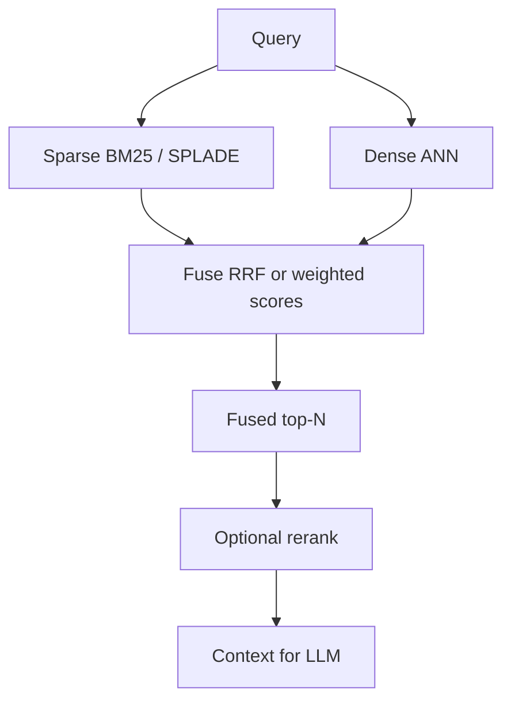

**Hybrid search** runs two or more retrievers on the same query and fuses their ranked lists into one candidate set. In LLM systems a common pair is **lexical / sparse retrieval** (BM25 or a learned sparse model) plus **dense retrieval** (embedding nearest neighbors). Lexical search can help with exact tokens, subject to its analyzer; dense search can help with paraphrases. Whether their combination improves [RAG](glossary://rag) depends on the corpus and query mix.

The fusion step is the hard part. BM25 scores are unbounded and corpus-dependent; cosine similarity usually sits in a fixed range. Adding raw scores without normalization is a common silent bug. Rank-based fusion (especially reciprocal rank fusion) and normalized weighted scores are the two practical fixes.

## Intuition

Sparse and dense retrievers produce independent rankings whose raw scores are not directly comparable. Rank fusion combines their *positions* instead:

- Sparse says: "this doc has `API_KEY_ROTATION` and `CVE-2024-...`."
- Dense says: "this doc means 'reset compromised credentials' even if the words differ."
- Fusion keeps evidence that either specialist ranked highly, and boosts items both ranked well.

This is complementary **candidate generation**. A cross-encoder [reranker](glossary://reranker) can then spend more compute on the shortlist. Hybrid widens recall across query types.

## How it works

1. **Index twice (or once with dual fields).** Store an inverted index for BM25/sparse vectors and a dense vector index (HNSW, IVF, or a managed hybrid store). Same chunk IDs and metadata on both sides.
2. **Query in parallel.** Encode the query for dense search; tokenize/analyze for sparse. Apply the same ACL, tenant, and hard filters on both paths when access control matters.
3. **Take top-$k$ per retriever.** Typical depths are $k \in [20, 100]$ per list; too shallow starves fusion, too deep floods the union with noise.
4. **Fuse.** Reciprocal rank fusion (RRF) or min-max / relative score blending produces one ordered list.
5. **Optional second stage.** Rerank the fused top-$N$, deduplicate near-identical chunks, pack context for the generator.

Elasticsearch RRF retrievers, Weaviate hybrid search and Qdrant hybrid queries support server-side fusion. PostgreSQL can combine pgvector with a separate lexical retrieval path in SQL; add another component for BM25 scoring. These approaches avoid merging two client-side result sets.

## Diagram



## Formula

### Reciprocal rank fusion

Cormack, Clarke, and Buettcher's [SIGIR 2009 paper](https://plg.uwaterloo.ca/~gvcormac/cormacksigir09-rrf.pdf) defines RRF over a document set $D$ and a set of rankings $R$:

$$
\mathrm{RRF}(d)=\sum_{r\in R}\frac{1}{k+\mathrm{rank}_r(d)}
$$

where $\mathrm{rank}_r(d)$ is the 1-based rank of $d$ in list $r$, and documents missing from a truncated list contribute $0$ from that list. Here $k$ is the smoothing constant, distinct from the retrieval depth called top-$k$ above. The paper fixed $k=60$ in its pilot; [Elasticsearch](https://www.elastic.co/docs/reference/elasticsearch/rest-apis/reciprocal-rank-fusion) also defaults to 60. Other implementations can differ, so check their convention. Larger $k$ flattens rank differences; smaller $k$ rewards top hits more sharply.

### Weighted score fusion

When you prefer tunable balance and can normalize scores, a common form is:

$$
s_{\mathrm{hybrid}}(d)=\alpha\,\tilde{s}_{\mathrm{dense}}(d)+(1-\alpha)\,\tilde{s}_{\mathrm{sparse}}(d)
$$

with $\tilde{s}$ min-max (or similar) scaled to $[0,1]$ **per query** over the retrieved window, and $\alpha\in[0,1]$ the dense weight. Weaviate's [`relativeScoreFusion`](https://docs.weaviate.io/weaviate/concepts/search/hybrid-search) follows this idea: $\alpha=0$ pure keyword, $\alpha=1$ pure vector. Its rank-based fusion is a different option. Define how absent hits and equal-score windows are handled; raw BM25 $+$ cosine has no calibrated balance.

RRF needs almost no calibration across incompatible score scales. Linear blend can win after careful normalization and $\alpha$ tuning on your eval set, but it is brittle when score distributions shift (new embedder, corpus growth, analyzer change).

## Example

Support corpus. Query: *"how do I rotate leaked API credentials for project X9?"*

| Chunk | BM25 top-40 | Dense top-40 | Notes |
|-------|-------------|--------------|--------|
| `runbook: API_KEY_ROTATION` | rank 1 | rank 18 | Rare token + procedure title |
| `guide: reset compromised keys` | rank 27 | rank 2 | Paraphrase of "rotate credentials" |
| `changelog: X9 auth middleware` | rank 9 | missing | Project id match, weak semantic |
| `blog: password tips` | missing | rank 7 | Semantic noise |

With $k=60$ RRF:

| Chunk | RRF contribution | Approx score |
|-------|------------------|--------------|
| `API_KEY_ROTATION` | $1/61 + 1/78$ | $0.0292$ |
| `reset compromised keys` | $1/87 + 1/62$ | $0.0276$ |
| `X9 auth middleware` | $1/69$ | $0.0145$ |
| `password tips` | $1/67$ | $0.0149$ |

Fusion keeps the exact runbook and the paraphrase near the top; pure dense might bury `API_KEY_ROTATION`, while pure BM25 might bury the paraphrase. Pass the fused top 20 to 50 candidates to a cross-encoder, then pack 5 to 8 chunks.

Notice that `password tips` still beats `X9 auth middleware` ($0.0149 > 0.0145$). RRF combines rankings, so evaluate whether its candidates answer the query. Tune the illustrative shortlist and context sizes for your workload.

The table above uses full top-40 ranks ($1/61+1/78$, and so on). The snippet below demonstrates the RRF merge routine on a **short illustrative list**; its ranks differ from the table, so recompute table values from the full lists.

```python
def rrf_fuse(lists: list[list[str]], k: int = 60) -> list[tuple[str, float]]:
    scores: dict[str, float] = {}
    for ranking in lists:
        for rank, doc_id in enumerate(ranking, start=1):
            scores[doc_id] = scores.get(doc_id, 0.0) + 1.0 / (k + rank)
    return sorted(scores.items(), key=lambda x: -x[1])

# Short illustrative lists; the table above uses full top-40 ranks.
bm25_ids = ["API_KEY_ROTATION", "X9_auth", "reset_keys"]
dense_ids = ["reset_keys", "password_tips", "API_KEY_ROTATION"]
for doc, score in rrf_fuse([bm25_ids, dense_ids])[:5]:
    print(doc, round(score, 4))
```

## Worked production path

Production failures usually occur around the RRF formula.

| Failure | What you see | Fix |
|---------|----------------|-----|
| Score add without normalize | One retriever always dominates | Use RRF or per-query min-max before weighting |
| ACL only on one path | Dense returns private chunks BM25 never saw (or the reverse) | Same filter set on both retrievers *before* fusion |
| Untuned retrieval depths | One path contributes many more low-ranked candidates | Start with comparable windows, then tune each depth against recall and latency |
| Stale dual indexes | BM25 has new text; vectors are old | Co-version embeds + inverted index; reindex on model upgrade |
| Chunking mismatch | Same logical doc, different chunk IDs per index | Shared chunker, shared IDs, shared metadata |
| "Hybrid did nothing" | Eval set is all paraphrase or all keyword | Slice eval: exact-ID queries vs paraphrase vs mixed; measure recall@k per slice |

Log per query: sparse top IDs, dense top IDs, fused order, rerank order, filters, and whether a known gold chunk was present at each stage. That trace separates "never retrieved" from "fused out" from "reranked out."

## Trade-offs

- **Recall vs cost.** Two indexes, two queries, merge CPU. Parallelize; budget latency for the slower of BM25 and ANN, not their sum if they run concurrently.
- **RRF vs weighted.** RRF is the default start: robust, one knob ($k$). Weighted fusion needs normalization and offline tuning of $\alpha$.
- **BM25 vs learned sparse.** SPLADE / ELSER-style sparse models expand terms and often beat plain BM25 on BEIR-style sets, at higher encode cost. Hybrid can still be BM25+dense or sparse-neural+dense.
- **Query-dependent gains.** Hybrid gains can be small when one method dominates every query type. Measure on *your* query mix.

## Why it matters here

Hybrid search is the default production pattern for grounded assistants that must honor both natural language and the brittle tokens of real systems: tickets, CVEs, SKUs, function names, policy codes. Curriculum work on RAG, embeddings, BM25, RRF, and rerankers all meet here: dual candidate generators, rank fusion, then optional cross-encoder polish before context packing.

## Related terms

- [Sparse retrieval](glossary://sparse-retrieval)
- [Dense retrieval](glossary://dense-retrieval)
- [BM25](glossary://bm25)
- [Reciprocal Rank Fusion](glossary://reciprocal-rank-fusion)
- [Reranker](glossary://reranker)
