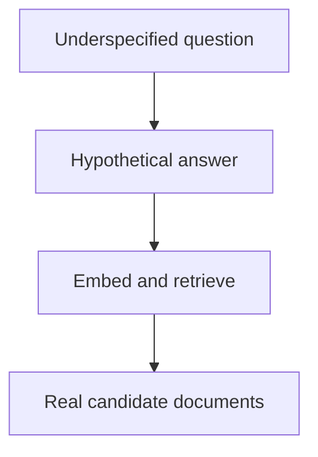

**Hypothetical Document Embeddings (HyDE)** improves some retrieval queries by asking a language model to write a plausible answer document, embedding that generated document, and searching for real documents near its embedding. Gao and colleagues introduced that mechanism in [Precise Zero-Shot Dense Retrieval without Relevance Labels](https://arxiv.org/abs/2212.10496). Treat the generated passage as a retrieval probe. Present verified source documents as evidence in the final answer.

A short question and a detailed policy document may contain different wording even when they concern the same topic. A hypothetical answer can supply technical vocabulary and structure closer to the relevant documents. That geometric bridge can help broad conceptual queries, but it can hurt exact identifiers, version numbers, and security-sensitive facts when the generated passage invents details.

## Generate a probe, then retrieve real evidence

## Example

A developer asks, "How can we increase embedding throughput?" The model drafts a paragraph mentioning batching, tokens-per-minute limits, backoff, and approved quota changes. That draft is embedded and used to retrieve real internal API policy. Retrieval finds candidates. Check the actual policy documents for currentness and support before citing a quota or endpoint in the final answer.

Keep the original query available for exact-match retrieval, enforce the user's authorization boundary before selecting evidence, and measure recall against a labeled evaluation set. Isolate cached probes and results containing private context by tenant and permission scope; a public query-only probe has different sharing requirements. Generation also adds a model call and latency, so compare that cost with any measured retrieval gain.

## Why it matters here

Advanced RAG lessons compare query rewriting, hypothetical documents, reflection tokens, and corrective retrieval. HyDE is appropriate when a measured semantic gap exists. Pair it with source verification, exact identifier matching, and permission-aware search.

## Related terms

- [Embedding](glossary://embedding)
- [Query rewriting](glossary://query-rewriting)
- [Dense retrieval](glossary://dense-retrieval)
- [RAG](glossary://rag)
