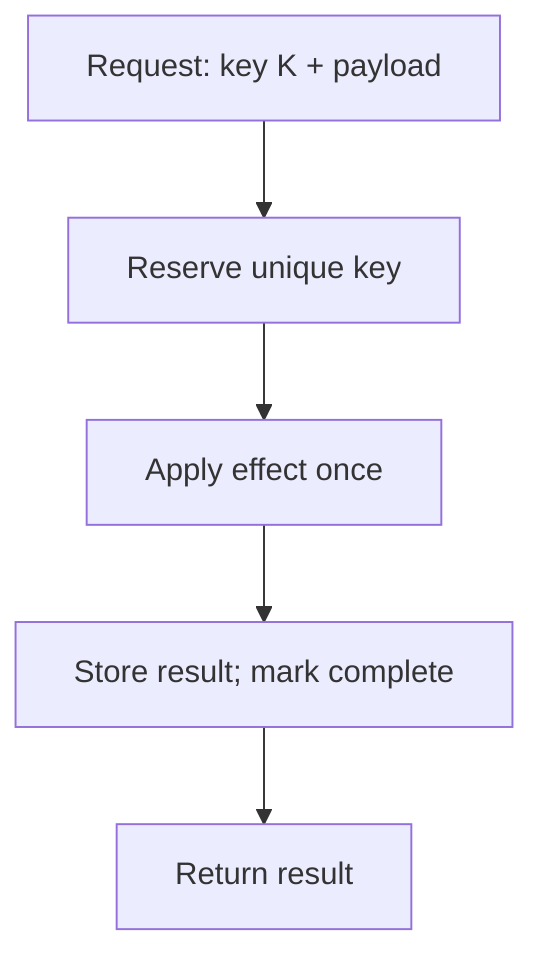
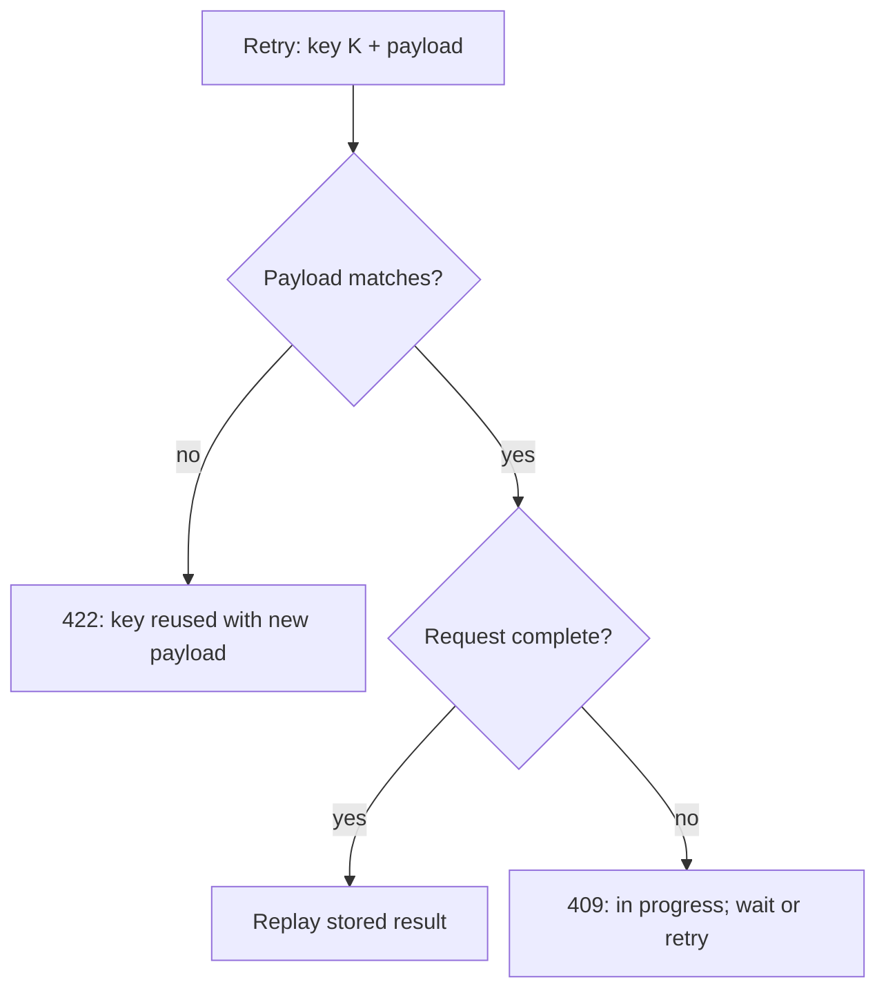

**Idempotency** means applying an operation once or many times yields the same *externally visible* effect as applying it once. In distributed systems, that property makes a timeout safe to retry: the client may not know whether the first attempt completed, so repeated requests must resolve to the same charge, email, ticket, index write, or tool outcome.

[RFC 9110 §9.2.2](https://www.rfc-editor.org/rfc/rfc9110.html#section-9.2.2) defines an HTTP method as idempotent when the intended effect on the server of multiple identical requests equals the effect of a single request. The guarantee covers intended server effects. Response bodies and log lines may differ.

## Intuition

Retrying systems can deliver the same logical operation more than once: clients retry after timeouts, queues redeliver, and agents re-issue tool calls when a worker dies mid-step. Networks can lose requests or responses entirely. Idempotency prevents repeated attempts from duplicating the intended business effect within its documented scope and retention window.

Mathematically, a function $f$ is idempotent when

$$
f(f(x)) = f(x).
$$

For APIs and tools, $x$ is the current resource state and $f$ is the intended state transition keyed by the request (or by an explicit idempotency key). Server-side logs, metrics, and audit rows may still grow; the *user-visible* outcome (balance, ticket status, sent-message set) must not.

| Kind | Safe to auto-retry? | Why |
|---|---|---|
| Read-only lookup | Yes | No write side effect |
| Replace-by-key (`PUT` resource to fixed ID) | Yes (if implementation matches intent) | Second write is a no-op or same state |
| Create-and-charge (`POST` new transfer) | Only with the same idempotency key | Each unkeyed call can create a new row |
| LLM completion (billed) | Retry only when duplicate cost and output variation are acceptable | Each call may bill again and may sample a different completion |

## How it works

Two complementary mechanisms show up in production systems.

### 1. Naturally idempotent operations

HTTP methods that are idempotent by definition (RFC 9110): safe methods (`GET`, `HEAD`, `OPTIONS`, `TRACE`), plus `PUT` and `DELETE`. A client may retry these after a connection failure before a response is read. `POST` and typical "create" RPCs need an application-level key or deduplication logic to make retries idempotent.

The *handler* must implement the method's idempotent intent. Repeating `DELETE /model-aliases/canary` leaves the alias absent. Repeated `POST /index-publications` calls need a key or de-duplication so they resolve to one publication revision.

### 2. Idempotency keys (make `POST` retry-safe)

Payment and API platforms use patterns such as [Stripe's idempotency contract](https://docs.stripe.com/api/idempotent_requests). The [IETF `Idempotency-Key` draft](https://datatracker.ietf.org/doc/draft-ietf-httpapi-idempotency-key-header/) describes a proposed header contract; as checked on September 23, 2026, revision 07 is expired and archived and never reached RFC status. Providers can implement status codes differently:

1. Client generates a unique key (UUID v4 or similar high-entropy string) for one logical operation.
2. Client sends it on every attempt of that operation, often as header `Idempotency-Key`.
3. Server stores key → payload fingerprint, status, and response (or outcome ID).
4. On a later attempt with the same key and same payload, server returns the stored outcome without re-applying the effect.
5. Same key with a **different** payload is a client bug: reject it (the draft suggests `422`) and preserve the original operation.
6. Same key while the first attempt is still in flight: respond with conflict (`409` in the draft) so the client waits or polls for the first outcome instead of launching a second worker.

Stripe stores a result once endpoint execution begins, including `500` responses; validation failures and concurrent-execution conflicts are not cached. Keys can be pruned after at least 24 hours, and reuse after pruning creates a new request. Inspect the provider's failure and pruning rules before retrying; an exact 24-hour expiry assumption can create a second request. Avoid putting personal information in key strings.

### Atomicity of "check then act"

The dangerous window is: perform side effect, crash, never record the key. Recovery then re-runs the effect. A reservation protocol begins with:

1. **Reserve** the key (insert row with status `in_progress` under a unique constraint).
2. Perform the side effect (or enqueue the sole worker that will).
3. **Commit** status `completed` plus response or effect ID.

If step 1 races, only one writer wins. If the process dies after 1 and before 3, a retry sees `in_progress` and waits or fails closed, preventing a second charge.

An external write needs downstream idempotency using the same logical key, or state reconciliation before retrying, to recover safely after a crash. For a write in the same database, committing the result and effect in one transaction can close the gap. The example below explicitly requires downstream idempotency.

## Diagram



### Retry with the same key



## Example

An ingestion agent tool `publish_index` must not publish duplicate vector-index revisions when the worker times out and the workflow retries.

```python title="idempotent-index-publication.py"
import hashlib
import json
from dataclasses import dataclass
from typing import Any, Literal, Protocol

@dataclass
class IndexResult:
    index_id: str
    collection_id: str
    status: str


@dataclass(frozen=True)
class Reservation:
    status: Literal["claimed", "completed", "in_progress"]
    owner_token: str | None = None
    result: IndexResult | None = None


class IdempotencyStore(Protocol):
    def reserve(self, key: str, payload_fp: str) -> Reservation:
        """Atomically claim new, failed, or lease-expired work.

        Return the stored result when completed, return in_progress for an
        active lease, and reject key reuse with a different payload.
        """
        ...

    def complete(
        self, key: str, owner_token: str, result: IndexResult
    ) -> IndexResult:
        """CAS owned in_progress -> completed; never overwrite completed."""
        ...

    def fail(self, key: str, owner_token: str, error: str) -> None:
        """CAS only the caller's attempt; no-op after ownership is lost."""
        ...


def payload_fingerprint(body: dict[str, Any]) -> str:
    canonical = json.dumps(body, sort_keys=True, separators=(",", ":"))
    return hashlib.sha256(canonical.encode("utf-8")).hexdigest()

def publish_index(
    store: IdempotencyStore,
    key: str,
    collection_id: str,
    snapshot_uri: str,
    commit_once,  # callable that publishes or returns revision for this key
) -> IndexResult:
    body = {"collection_id": collection_id, "snapshot_uri": snapshot_uri}
    fp = payload_fingerprint(body)

    reservation = store.reserve(key, fp)
    if reservation.status == "completed":
        if reservation.result is None:
            raise RuntimeError("completed publication is missing its result")
        return reservation.result
    if reservation.status == "in_progress":
        raise RuntimeError("index publication in progress for this key; retry later")
    if reservation.owner_token is None:
        raise RuntimeError("claimed publication is missing its owner token")

    try:
        # Downstream publication enforces the same key. If its response was lost,
        # this call returns the original immutable revision instead of creating one.
        index_id = commit_once(key, collection_id, snapshot_uri)
        result = IndexResult(
            index_id=index_id,
            collection_id=collection_id,
            status="succeeded",
        )
        return store.complete(key, reservation.owner_token, result)
    except Exception as exc:
        # CAS cannot replace an outcome another worker already completed.
        store.fail(key, reservation.owner_token, type(exc).__name__)
        raise
```

Call shape on the wire:

```http
POST /v1/index-publications
Idempotency-Key: 8e03978e-40d5-43e8-bc93-6894a57f9324
Content-Type: application/json

{"collection_id": "policy-docs", "snapshot_uri": "s3://eval-artifacts/index-2026-07-20"}
```

If the first attempt publishes the index and its response is lost, the retry passes the same key downstream and receives the original `index_id`. If the worker crashes while its row remains `in_progress`, a retry can claim the expired lease and replay the same downstream key. Store finalization compares the attempt's owner token, so a slow failure cannot overwrite another worker's completed result. A different snapshot URI with the same key is rejected.

## What fails in production

- **Key recorded after the write.** Crash between publication and insert creates a duplicate revision on retry.
- **In-memory `set()` of keys.** Multiple replicas each apply the effect once.
- **Key not bound to payload.** Client bug reuses `publish-1` for a different snapshot; server treats it as success.
- **Key scope too wide or too narrow.** Global keys leak cross-tenant outcomes; per-request random keys defeat retries if the client forgets to reuse them.
- **Agent tools without keys.** The model retries `send_email` after a timeout; users get three messages.
- **Treating LLM sampling as free.** Retries of completions re-bill tokens and may change the answer even when the *tool layer* is idempotent.
- **Webhook handlers that are not de-duplicated.** Provider redelivery is normal; process-once needs delivery ID or event key.

## Trade-offs

| Choice | Gain | Cost |
|---|---|---|
| Client-generated UUID key | Simple, works across retries | Client must persist key across its own retries |
| Natural key (`collection_id` + snapshot hash) | Human-debuggable, stable | Collisions if two legitimate ops share the natural key |
| Short key TTL | Smaller store | Late retries after expiry double-apply |
| Store full response | Perfect replay | Storage + PII retention burden |
| Store only effect ID | Smaller, often enough | Client may need a follow-up GET |

## Why it matters here

LLM agents, RAG pipelines, and training jobs all sit on unreliable networks and retriable workers. Model calls cost money; tool calls change the world. Idempotency is the contract that lets [retry backoff](glossary://retry-backoff) and [workflow checkpoints](glossary://workflow-checkpoint) recover without corrupting balances, inboxes, indices, or audit state. Design every write tool and webhook consumer for duplicate delivery, which is a normal result of retries and provider redelivery.

## Related terms

- [Retry backoff](glossary://retry-backoff)
- [Tool calling](glossary://tool-calling)
- [Workflow checkpoint](glossary://workflow-checkpoint)
- [Checksum](glossary://checksum)
- [API contract](glossary://api-contract)
