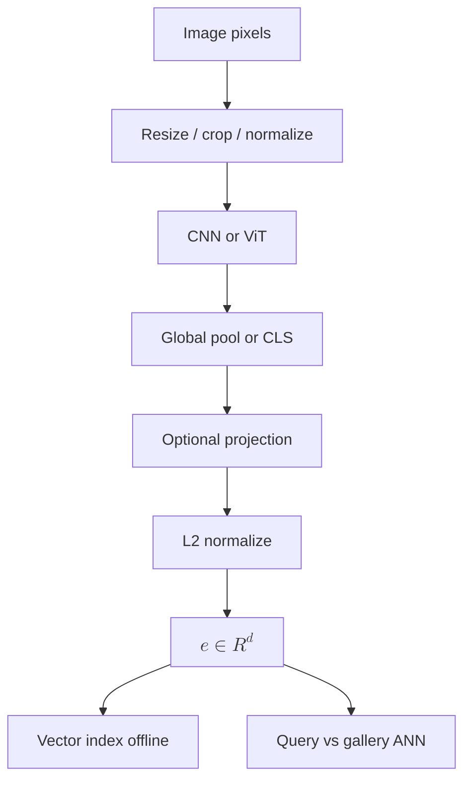

An **image embedding** is a fixed-size numeric [vector](glossary://vector) produced by a vision encoder from a raw image (pixels, or tokens derived from them). Nearby vectors mean the images are similar *for the training objective*: object class, visual structure, caption-level semantics, or near-duplicate identity. Once each image is $e \in \mathbb{R}^{d}$, you can rank neighbors with [cosine similarity](glossary://cosine-similarity) or a [dot product](glossary://dot-product), run [ANN search](glossary://ann-search), cluster, train linear heads, or align images with text in a shared multimodal space (as in [CLIP](glossary://clip)).

An image embedding is the vision-side instance of a general [embedding](glossary://embedding). It represents an image as one fixed-size vector (or, less often, a multi-vector set of patch or region features) that the rest of the stack can search and score. Captions, bounding-box lists, and generative VLM answers are separate output types.

## Intuition

Raw pixel distance is a poor semantic metric. An encoder trained for product retrieval may place two photos of the same shoe near one another despite changes in crop, lighting, or background. Check those invariances against the training objective and data before relying on them for another vision encoder.

Neighborhood structure varies by encoder. The same photo can sit in different neighborhoods under different encoders:

| Training signal | Neighborhood tends to mean |
| --- | --- |
| ImageNet-style classifier (penultimate layer) | Same object category or texture statistics |
| Self-supervised views (SimCLR / DINO-style) | Same instance under crop, color, and blur augmentations |
| Image-text contrastive (CLIP and successors) | Same caption-level concept; text and image share one space |
| Domain metric learning (pairs, triplets, hard negatives) | Same specimen, finding, identity, or task-specific class |

The vector's geometry reflects the data, loss, negatives, pooling, and preprocessing used to create it.

## How it works

**1. Preprocess.** Resize and crop to the encoder's input (for example $224 \times 224$ or $336 \times 336$), convert color space, and normalize with the training mean and standard deviation. Aspect ratio, letterboxing vs center crop, and EXIF orientation are part of the model contract. Mismatched preprocessing silently rotates the geometry.

**2. Encode.** A backbone maps the image tensor to intermediate features:

- **CNN** (ResNet and relatives): convolutional stages produce a feature map; global average pooling collapses spatial dimensions to one vector $h \in \mathbb{R}^{h_{\mathrm{dim}}}$ (for example $2048$ for ResNet-50).
- **Vision Transformer (ViT):** the image is split into patches, embedded, and run through transformer blocks. A class token or mean-pooled patch tokens become $h$.

**3. Project (optional).** Some contrastive setups attach a small MLP projection head $g$ and train on $z = g(h)$, then **discard $g$ for downstream evaluation** and use $h$ as the representation ([SimCLR](https://arxiv.org/abs/2002.05709) found this helpful for transfer). Follow the model's inference contract: [CLIP](https://arxiv.org/abs/2103.00020)-style dual encoders retain their projections into the shared multimodal dimension $d$.

**4. Pool and normalize.** Collapse multi-token or multi-location features to one vector, then often L2-normalize:

$$
\hat{e} = \frac{e}{\lVert e \rVert_2}
$$

so cosine ranking reduces to maximum inner product search (MIPS) in the index.

**5. Index and query.** Embed the gallery offline; embed a query image (or, with a dual encoder, a query text) online; return top-$k$ under the training metric. That is the same bi-encoder / dual-encoder pattern used for dense text retrieval, applied to vision.

## Formula

**Encoder map.** For image $I$:

$$
e = f_\theta(I) \in \mathbb{R}^{d}, \qquad
\hat{e} = \frac{e}{\lVert e \rVert_2}
$$

**Pair score** after normalization:

$$
\mathrm{sim}(I_a, I_b) = \hat{e}_a^\top \hat{e}_b = \cos(e_a, e_b)
$$

**Self-supervised contrastive training** (SimCLR / NT-Xent style): two augmented views $I_i$ and $I_j$ of the same source form a positive pair; other in-batch views are negatives. With temperature $\tau$:

$$
\mathcal{L}_{i,j}
=
-\log
\frac{\exp(\mathrm{sim}(z_i,z_j)/\tau)}
{\sum_{k \neq i}\exp(\mathrm{sim}(z_i,z_k)/\tau)}
$$

where $z = g(h)$ is the projection used for the contrastive loss. In SimCLR's downstream evaluation, $h$ is used without that head; other embedding models may retain it.

**Image-text dual encoder** (CLIP-style): image embedding $v$ and text embedding $u$ live in one space; a batch of $N$ pairs yields an $N \times N$ similarity matrix scored with symmetric InfoNCE. At inference you can query with either tower (image-to-image, text-to-image, image-to-text ranking).

## Diagram



## Example

**Technical image retrieval (image-to-image).** Archive of $N = 2 \times 10^6$ microscopy images, dual encoder with $d = 512$, float32 vectors, L2-normalized, HNSW under inner product.

Storage for raw vectors alone:

$$
2 \times 10^6 \times 512 \times 4\,\mathrm{B} \approx 3.8\,\mathrm{GiB}
$$

(before graph/index overhead; $4\,\mathrm{B}$ is float32). Offline: embed every archived image once with the image tower. Online: a researcher submits a new microscopy crop; the same image tower produces $\hat{e}_q$ and ANN returns nearest archived vectors. No text query is required.

**Worked ranking scores.** Suppose three archived images, all unit vectors, with these cosine scores against the query crop:

| Image | Cosine | Interpretation |
| --- | ---: | --- |
| Same cell type and staining pattern | $0.91$ | strong task-specific match |
| Same stain, different morphology | $0.74$ | color signal matches; structure does not |
| Same morphology, different stain | $0.61$ | structure matches; acquisition differs |

If the retrieval requirement is "same morphology regardless of stain," a caption-aligned CLIP space may overweight color relative to cell structure. This **objective mismatch** calls for training or evaluation that emphasizes morphology. A metric-learning model trained on matched-specimen pairs with visually similar hard negatives can reshape those neighborhoods.

**Text-to-image with the same index.** With a dual encoder, "dense cluster of elongated cells" embeds with the text tower into the same $d$-space and ranks the same archive. Image embeddings make that shared space usable for both modalities.

**Operational snippet** (encode once, cosine equals dot after normalize):

```python
import numpy as np

def l2_normalize(e):
    e = np.asarray(e, dtype=np.float32)
    norm = np.linalg.norm(e)
    if not np.isfinite(norm) or norm == 0:
        raise ValueError("Cosine similarity needs a finite, nonzero vector")
    return e / norm

# e_query, e_gallery[i] from the same model + preprocess
score = float(l2_normalize(e_query) @ l2_normalize(e_gallery[i]))
```

## What the vector notices

A classifier-trained embedding may emphasize class identity. A CLIP-style contrastive embedding may emphasize caption-level semantics. A domain metric-learning model may emphasize morphology or instance identity. Nearby vectors can mean "same object," "same layout," "same caption meaning," or "same finding," depending on the objective. Evaluate those slices separately: a model that retrieves "cell microscopy" well can still miss the specific morphology required by a scientific query.

## Production contracts and failures

| Failure | What broke | Fix |
| --- | --- | --- |
| Rankings look random after a model upgrade | Query and gallery vectors from different encoders or dimensions | Version model + preprocess; re-embed the full gallery |
| Duplicates of the same photo rank poorly | Different crops, JPEG quality, or EXIF rotation at index vs query | Canonicalize orientation, crop policy, and compression path |
| Text query works; phone photo does not | Domain shift (studio vs UGC lighting/background) | Fine-tune or hard-negative mine on real UGC; eval on phone photos |
| Fine-grained SKUs confuse each other | Caption-level space collapses models that share a description | Metric learning, specialist backbone, or rerank with attributes/OCR |
| OCR-heavy screenshots mis-retrieve | Global embedding ignores small text | OCR pipeline, hybrid text+image features, or region embeddings |
| Thresholds from another model | Cosine scales are not portable across families | Calibrate per model and corpus; log score distributions |
| Stale index | New or changed images never re-embedded | Re-embed on image change; store content hash + model id |

Keep the metric and normalization contract consistent. For unit vectors, squared Euclidean distance is $2 - 2\cos(e_a,e_b)$, so it gives the same exact ranking as cosine or inner product. Raw, unnormalized Euclidean distance does not need to agree; approximate index settings and thresholds also need evaluation. Log **model id**, input resolution, normalize policy, and dimension with every index build and every request trace.

## Trade-offs

| Choice | Gain | Cost |
| --- | --- | --- |
| Global single vector | Cheap ANN over millions of images | Weak fine spatial layout, counting, multi-object scenes |
| CLIP-style dual encoder | Open-vocabulary text and image queries in one index | Fine-grained domains and systematic relations often need extra work |
| Self-supervised visual features (DINO-style) | Strong pure-vision neighborhoods without captions | No free text tower; text search needs a separate path |
| Larger $d$ / heavier backbone | Often better separation | Encode cost, storage, and ANN memory |
| Multi-vector / late interaction | Richer matching | Higher index and query cost |

Global image embeddings excel at retrieval, near-duplicate detection, clustering, and candidate generation. Use detectors for boxes, segmenters for masks, and generative vision-language models for grounded multi-sentence answers.

## Why it matters here

Image embeddings are how retrieval, ranking, and multimodal products leave pure text. Visual search, multimodal RAG (retrieve figures and screenshots), moderation clustering, and CLIP-style open-vocabulary scoring all rest on a versioned vision encoder and a matching similarity contract (cosine vs IP vs Euclidean, plus the same preprocess). Curriculum topics on embeddings, dual encoders, contrastive losses, ANN indexes, and vision-language models assume you can name what the vector is trained to notice, how it is produced, and what breaks when preprocess or model version drifts between index and query.

## Related terms

- [Embedding](glossary://embedding)
- [CLIP](glossary://clip)
- [Contrastive learning](glossary://contrastive-learning)
- [Cosine similarity](glossary://cosine-similarity)
- [Vision-language model](glossary://vision-language-model)
