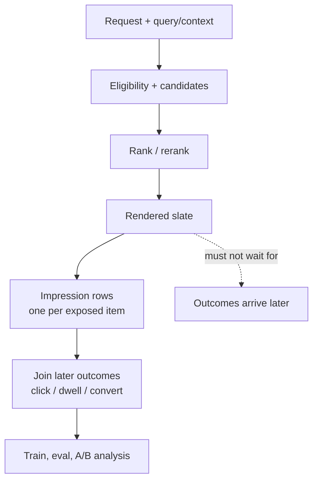

An **impression log** is an immutable, per-item record of what a ranking, search, recommendation, or answer UI actually exposed to a user (or tenant), with enough context to reconstruct the slate later. Each row is exposure evidence: request identity, item, position, policy and model versions, experiment assignment, and (when available) whether the item was viewable in the viewport. Later clicks, dwell, citation opens, or accepted-answer events join back to these rows. Without the impression row, "not clicked" and "never shown" collapse into the same absence.

## Intuition

A click log answers "what did the user do?" An impression log answers "what did the system actually expose?" That second answer is the **denominator** for CTR, conversion, and engagement rates, and it is the exposure set for learning-to-rank and offline metrics. Eligibility and candidate generation decide what *could* have ranked; the impression log records only the slate that rendered (or was viewable).

Server-side ranking and client-side exposure are different events. A retriever can return 50 chunks while the answer UI renders only three citation cards. Logging all 50 as impressions overstates exposure and creates false negatives for chunks the user could not inspect. Choose whether "impressed" means rendered or viewable, then capture that event consistently.

## Diagram



Write impressions when the slate is shown (or when client visibility is confirmed), not when the first click arrives. Outcomes are append-only and optional; the impression set is the causal bookkeeping spine.

## How it works

1. **Decide exposure.** After eligibility and ranking, freeze the displayed slate (top-$k$, carousel page, citation cards). Server-only candidate dumps are not impressions unless the UI actually rendered them.
2. **Emit one immutable row per exposed item.** Include request id, item id, position (1-based or 0-based, but consistent), surface, and versions. Prefer append-only storage; never rewrite positions after the fact.
3. **Join outcomes later.** Use an impression id, or a key such as `(request_id, item_id, position, render_version)` that distinguishes repeated exposures. An unmatched item outcome needs reconciliation before becoming ranking feedback; request-level outcomes such as answer acceptance don't automatically belong to one citation.
4. **Use the log as the sample frame.** Metrics, training labels, and experiment integrity checks all start from impressed items (or from requests that produced a logged slate), not from the full candidate corpus.

For LLM products, log what the user could interact with: answer variant, visible citations, tool-result cards, follow-up suggestions, and policy or prompt version. Logging only "chunks in the model context" confuses retrieval input with user exposure.

## Formula

For binary click-through rate on an item (or slot), count each impression at most once in the numerator:

$$
\mathrm{CTR} = \frac{\#\text{impressions with a click}}{\#\text{impressions}}.
$$

Without impressions, the denominator is undefined or silently wrong (for example, counting only requests that produced a click).

Under a simple **position-based model**, a click occurs only if the user examines the slot and finds the item relevant. With a correct, positive examination propensity $p_k$ at logged position $k$, IPS reweights observed clicks. A simplified estimator of a candidate ranker's relevance-weighted gain is:

$$
\hat{G}_{\mathrm{IPS}}(f) = \frac{1}{N}\sum_{i=1}^{N}\sum_{(d,k)\in\mathcal{L}_i} \frac{c_{i,d,k}}{p_k} \cdot g\big(\operatorname{rank}_f(q_i,d)\big),
$$

where $N$ is the number of logged requests, $c_{i,d,k}\in\{0,1\}$ records a click, and $g$ discounts the item's position under the **candidate** ranker $f$, not its logged position. For example, DCG uses $g(r)=1/\log_2(1+r)$. This simple model assumes clicks reveal examined binary relevance. It doesn't correct candidate-selection bias for documents never exposed, or arbitrary trust/click noise. Real propensities may depend on context as well as position. See [Joachims et al., Unbiased Learning-to-Rank with Biased Feedback](https://www.cs.cornell.edu/people/tj/publications/joachims_etal_17a.pdf).

Propensity estimation itself needs positions and a defensible estimation design, such as controlled randomization. Logging exposure is necessary bookkeeping, but doesn't by itself establish unbiased counterfactual estimates.

## Example

RAG request `req-1042` for `"Should gradient clipping happen before or after AMP unscale?"` displays three citation cards after retrieval and reranking. Persist three impression rows **before** reading clicks:

```python
impressions = [
    {
        "request_id": "req-1042",
        "query": "Should gradient clipping happen before or after AMP unscale?",
        "user_key": "u_918",
        "item_id": "chunk_amp_unscale_41",
        "position": 1,
        "surface": "answer_citations",
        "eligibility_policy": "docs-acl-v4",
        "candidate_set": "retrieval-v3",
        "ranker": "cross_encoder_v7",
        "experiment_arm": "rerank_on",
        "score": 0.91,
        "viewable": True,  # client: above fold / viewport event
        "impressed_at": "2026-05-01T12:00:00Z",
    },
    # position 2: chunk_grad_clip_77, position 3: chunk_amp_overview_12 ...
]
# Later (append-only outcomes, join on request_id + item_id)
outcomes = [
    {"request_id": "req-1042", "item_id": "chunk_amp_unscale_41", "event": "citation_open"},
    {"request_id": "req-1042", "event": "answer_accepted"},  # request-level outcome
]
```

| item | position | impressed? | click | naive label if you only store clicks |
| --- | ---: | --- | --- | --- |
| chunk_amp_unscale_41 | 1 | yes | yes | positive |
| chunk_grad_clip_77 | 2 | yes | no | **missing, not "irrelevant"** |
| chunk_amp_overview_12 | 3 | yes | no | same |
| chunk_optimizer_99 | never ranked | no | no | must not enter training as a skip |

Restricting negative labels to **impressed** items avoids inventing feedback for unseen candidates, but a non-click still isn't proof of irrelevance: the user may not have examined the item. A click model, propensity correction, or other justified label design is still needed. Answer acceptance also doesn't prove that every displayed citation was useful.

For an LLM answer UI, log which citation cards rendered next to the answer; prompt membership alone does not record user-visible exposure.

## Required fields

Keep enough fields to reproduce the decision and join outcomes cleanly:

| Field | Why |
| --- | --- |
| `request_id` (and query/session ids) | group the slate; join outcomes |
| user / tenant / entity key | assignment unit and personalization audit |
| `item_id` (or citation id) | what was exposed |
| `position` | exposure and position bias |
| ranker / retriever / prompt versions | attribution and rollback |
| eligibility and candidate-set versions | what *could* have ranked |
| experiment arm / assignment key | A/B integrity |
| surface, device, pagination | fold and layout confounds |
| timestamp (+ optional viewability) | order of events; served vs seen |
| filters / context snapshot | reproduce the request |

Optional but high value: logged scores (if policy allows), randomization seed when you inject exploration, and client visibility flags. Prefer schema contracts so late fields do not silently null out.

## Worked numbers

Suppose two equally relevant items were each impressed 1,000 times historically, but one always sat at position 1 and the other at position 2:

| item | position | impressions | clicks | raw CTR |
| --- | ---: | ---: | ---: | ---: |
| A | 1 | 1000 | 400 | 0.40 |
| B | 2 | 1000 | 200 | 0.20 |

Raw CTR says A is twice as good. Under the position-based model, $P(\text{click}\mid k)=p_k\cdot r$, so estimated relevance is $\mathrm{CTR}/p_k$. With $p_1=1.0$ and $p_2=0.5$, that gives $0.40/1.0=0.40$ and $0.20/0.5=0.40$: same estimated relevance once position is accounted for. That correction is impossible if you only stored the 600 clicks and lost the 2,000 impression rows (and positions).

## What fails in production

- **Server slate ≠ client slate.** Logging all ranked candidates while the UI shows 3 cards, infinite-scroll pages, or personalized modules makes CTR denominators too large and "skips" fake.
- **Late or missing client events.** Mobile visibility callbacks drop; treatment that changes layout can change log volume and look like SRM or metric lift.
- **Outcomes without impressions.** Citation-open or tool-success rows that do not join to an impressed item pollute training and NDCG-style online analyses.
- **Mutable logs.** Overwriting positions after re-ranking or "fixing" history destroys counterfactual evaluation.
- **Version holes.** Missing eligibility, ranker, or prompt versions make you unable to attribute regressions or rebuild features as-of the request.

Before blaming a ranker for fewer clicks under treatment, check whether treatment logged more below-the-fold impressions, changed pagination, deduped differently, or dropped visibility events. Those are logging problems that masquerade as product regressions.

## Why it matters here

AI ranking, retrieval, recommendation, and LLM answer UIs need causal bookkeeping. Impression logs preserve the exposure set that turns raw behavior into trainable labels, position-aware evaluation, and honest experiment analysis. Offline NDCG on judged fixtures measures order quality; production learning needs the same discipline on what real users were actually shown.

## Related terms

- [Position bias](glossary://position-bias)
- [NDCG](glossary://ndcg)
- [A/B testing](glossary://ab-testing)
- [Stable assignment](glossary://stable-assignment)
- [Sample ratio mismatch](glossary://sample-ratio-mismatch)
