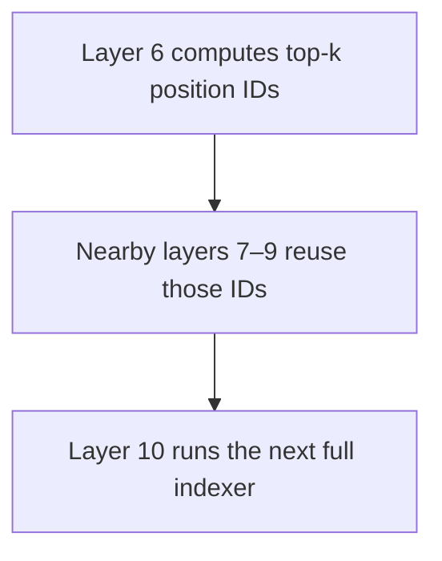

**IndexShare** is a mechanism used by GLM-5.2 and GLM-5.3 to reuse sparse-attention index selections across transformer layers. One layer computes which context positions matter, and nearby layers consume those indexes instead of repeating the indexer dot products and top-k operation every time.

It reduces index-selection overhead; model width and KV storage remain unchanged. Reuse is safe only because the architecture and training process were designed around that sharing pattern.

## Four-layer cadence

GLM-5.3 retains the four-layer cadence of GLM-5.2. Its explicit layer schedule starts with full indexers at layers 0, 1, and 2, then at 6, 10, and every fourth layer through 74. Each subsequent group reuses the full layer's selection for three layers. Read that schedule rather than assuming layer 0 supplies the first four layers. Across the 78 main decoder layers, 21 compute fresh selections and 57 reuse them.

## Diagram

## Example

Instead of performing four separate top-2,048 searches for four consecutive layers, one indexer search supplies the shared position set. Attention projections still run in each layer; only selection is reused.

## Why it matters here

Indexer time becomes important at 100K context and during speculative decoding. Profiles should separate full-indexer layers from reuse layers rather than average them into one opaque attention timer.

Source: [GLM-5.3 BF16 configuration](https://huggingface.co/zai-org/GLM-5.3-BF16/blob/304b8051cfb2b260b61ce0cbe330e02a98e73639/config.json).

## Related terms

- [DeepSeek Sparse Attention](glossary://deepseek-sparse-attention)
- [Multi-token prediction](glossary://multi-token-prediction)
- [Top-k](glossary://top-k)
- [Multi-head latent attention](glossary://multi-head-latent-attention)
- [Transformer](glossary://transformer)
