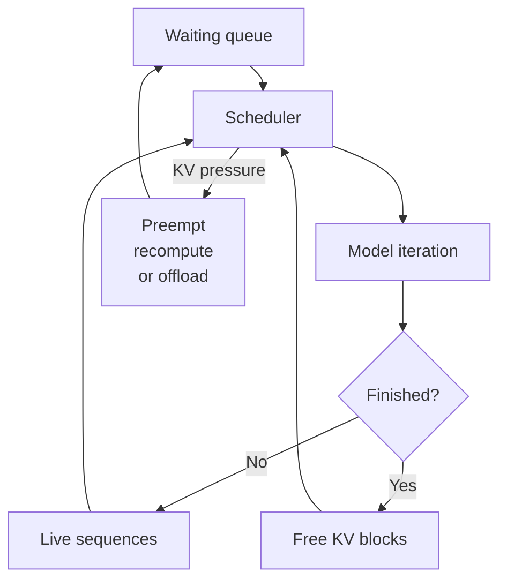

An **inference scheduler** is the control loop inside an LLM serving engine that decides, every model iteration, which requests run on the GPU, how they are batched (prefill vs decode, how many tokens), and what happens when KV-cache or concurrency limits force a choice. It applies serving policy to fixed model weights and attention math, and different scheduling rules can produce very different behavior.

Modern autoregressive engines often use continuous batching ([Orca's iteration-level scheduling](https://www.usenix.org/conference/osdi22/presentation/yu)): after each forward pass, finished sequences leave and free capacity can allow new work. The scheduler is the policy that fills that capacity under hard constraints (KV blocks, `max_num_seqs`, token budget per step) and soft goals (TTFT, TPOT, fairness, multi-tenant priority).

## Intuition

A classical GPU batch job is "run this tensor once and return." Autoregressive LLM serving is multi-step: each live sequence needs many forward passes, prompt and output lengths vary by orders of magnitude, and memory for the [KV cache](glossary://kv-cache) grows with every token. The scarce resource is often HBM for KV, not FLOPs.

The scheduler makes four coupled decisions for one or more GPUs:

- **Waiting queue:** arrived but not yet allowed (or preempted and waiting to resume).
- **Running set:** sequences that already hold KV and expect a next token.
- **Step budget:** caps on concurrent sequences and tokens processed in *this* iteration.
- **Memory budget:** free KV blocks (often paged) plus a watermark so the engine does not thrash.

Every iteration the controller rebuilds a batch, runs one model step, frees finished work, and decides whether to allow, continue, or preempt.

## How it works

At high level, engines such as vLLM, TensorRT-LLM, TGI, and SGLang share a loop shaped like Orca (Yu et al., OSDI 2022):

1. **Order candidates.** Apply FCFS, priority, or other policy among waiting and preempted requests.
2. **Compose under limits.** Respect free KV, concurrent sequence cap, and remaining token budget for this step. Optionally leave a free-block *watermark* so one more long decode does not force immediate eviction.
3. **Pick prefill vs decode mix.** Pure prefill, pure decode, or hybrid (for example one prefill chunk plus many decodes under chunked prefill). Decode-first policies pack running decodes before spending leftover budget on new prefills; prefill-first policies do the reverse.
4. **Execute one iteration.** One forward pass: each selected sequence advances by its scheduled tokens (full remaining prompt chunk, or one new decode token per sequence in the usual case).
5. **Retire, free, preempt.** EOS / max tokens free KV. Memory pressure can preempt a running sequence (swap KV to CPU or drop it and recompute later) so higher-priority or earlier work can continue.

```text
# Conceptual engine step (not a real API)
# Decode-first + chunked prefill shape; prefill-first inverts the two loops.
while True:
    tokens_left = max_num_batched_tokens
    batch = []
    # 1) Pack already-running decodes first
    for req in running:
        if len(batch) >= max_num_seqs or tokens_left < 1:
            break
        if not kv_can_grow(req, watermark):
            maybe_preempt(req)
            continue
        batch.append(req)
        tokens_left -= 1  # one new token per decode
    # 2) Fill leftover budget from waiting / preempted (FCFS or priority)
    for req in order(waiting + preempted, policy):
        need = tokens_for_this_step(req)  # prefill chunk (or full prompt)
        if len(batch) >= max_num_seqs:
            break
        if need > tokens_left or not kv_can_admit(req, watermark):
            continue
        batch.append(req)
        tokens_left -= need
    outs = engine.forward(batch)
    free_finished(outs)
    maybe_preempt_on_kv_pressure(running)
```

This sketch omits engine bookkeeping: a real scheduler must reserve KV for the entire proposed batch, track partial-prefill progress, and update queues consistently. Independent capacity checks without reservations can over-allocation work. Speculative decoding also schedules draft/lookahead work, so scheduled tokens aren't necessarily the number of accepted output tokens.

### Prefill-prioritizing vs decode-prioritizing

[Sarathi-Serve (Agrawal et al., OSDI 2024)](https://www.usenix.org/conference/osdi24/presentation/agrawal) classifies common iteration-level policies by which phase they favor:

| Policy family | Typical behavior | Helps | Hurts |
|---|---|---|---|
| **Prefill-prioritizing** | Eagerly schedule new prefills when KV frees; often pure-prefill then pure-decode batches | Throughput and subsequent decode batch size; TTFT for newly allowed work | Ongoing streams: a long prefill can stall every active decode (generation stalls, worse TPOT / ITL) |
| **Decode-prioritizing** | Pack all pending decodes first; only then spend leftover token budget on prefills (often chunked) | Streaming smoothness for live users | New arrivals wait longer for first token if decode load is high |
| **Hybrid / stall-free** | Split long prefills into chunks; pack a prefill chunk with many decodes under a token budget | Smoother TBT/TPOT without giving up as much throughput | Tuning `max_num_batched_tokens` / chunk size becomes load-dependent |

Classic vLLM without chunked prefill prioritized prefills and avoided mixing prefill and decode in the same batch (good for TTFT, can hurt ITL). Current [vLLM V1 documentation](https://docs.vllm.ai/en/latest/configuration/optimization/#chunked-prefill) enables chunked prefill by default whenever possible: it packs decodes first, then fills the remaining token budget with prefill chunks. Model/configuration support still matters; don't infer the policy of an installed engine from an older version's behavior.

### Token budget and concurrency caps

Two knobs appear in almost every production engine:

- **`max_num_seqs`:** upper bound on concurrent sequences in a step.
- **`max_num_batched_tokens`:** upper bound on prompt+decode tokens processed in that step.

Current [vLLM engine arguments](https://docs.vllm.ai/en/latest/configuration/engine_args/#schedulerconfig) also distinguish `max_num_scheduled_tokens` from the runner's token capacity when the model appends work (such as speculation), and `max_num_active_seqs` from the per-iteration sequence capacity. These names and constraints are engine/version-specific.

If a waiting request needs more remaining prompt tokens than the leftover budget, chunked prefill schedules only part of the prompt now and continues next iterations. Without chunking, a long prompt either waits for a large free budget or monopolizes a step.

### Preemption under KV pressure

When free blocks cannot cover the next token for every running sequence, the scheduler must drop someone from the running set. Common tactics:

- **Preempt last-in (FCFS-friendly):** keep earlier arrivals running; preempt newer ones (vLLM's classic FCFS + reverse-arrival preemption pattern).
- **Priority preemption:** drop lowest priority first.
- **Swap vs recompute:** an engine may offload KV to host memory (transfer cost) or discard KV and recompute prefill later (more GPU work). Which is faster depends on transfer and recompute costs. vLLM V1 documents recomputation as its default, rather than the older swap behavior.

Thrashing (constant preempt/resume) shows up as rising preemption counters, jittery TPOT, and KV utilization pegged near 100% with low useful tokens/s.

## Diagram



## Example

In a hypothetical configuration, the sequence cap is 96 and this iteration's token budget is 720. Assume sufficient KV capacity for the listed work; actual capacity depends on the model and sequence lengths. At one scheduling step the engine sees:

| Request | Class | Phase | Prompt left | Priority | Notes |
|---|---|---|---:|---:|---|
| A1–A80 (80) | interactive chat | decode | 0 | 0 | Already streaming |
| I | interactive | waiting prefill | 120 | 0 | Short follow-up |
| J | interactive | waiting prefill | 4,096 | 0 | Long document Q&A |
| K | batch summarization | decode | 0 | 10 | Low priority, long output |

A **decode-first, chunked-prefill** scheduler might:

1. Keep A1–A80 in the batch (80 scheduled decode tokens).
2. allow I's full 120-token prefill if the token budget allows, because it is short and same priority as the live chats.
3. Give J a 512-token prefill *chunk* only if budget remains, so J does not pause every active chat for an entire multi-thousand-token prefill.
4. K can also decode if KV permits. Including it gives $80+120+512+1=713$ scheduled tokens and 83 sequences, within both caps. Under pressure, this priority policy preempts K before a priority-0 chat.

A **prefill-first, no-chunk** policy needs a larger token budget to immediately run all of J's 4,096 tokens. It may reduce J's first-token wait but delays A1–A80's next decode. The stall's size depends on actual prefill runtime. Users experience that as "the stream froze," even though aggregate tokens/s might look fine.

## Worked numbers: generation stall

Suppose each decode step for a batch of $B$ live streams costs roughly $t_d$ milliseconds when the step is decode-only, and a pure prefill of $P$ prompt tokens costs $t_p(P)$ milliseconds and *replaces* that decode step (prefill-prioritizing, non-hybrid).

While the prefill runs, every active streamer waits. If a decode-only step must follow that pure prefill to produce their next tokens, the next-token gap is about $t_p(P)+t_d$, rather than $t_d$. The added delay is about $t_p(P)$, not $t_p(P)-t_d$. This comparison assumes no other queueing or overlapping work.

For illustration, if $t_d\approx20\,\mathrm{ms}$ for $B\approx80$ and a pure prefill of $P=4096$ costs $t_p\approx400\,\mathrm{ms}$, the gap is about $420\,\mathrm{ms}$, an extra $400\,\mathrm{ms}$. Chunked prefill can split that prompt into eight 512-token chunks and co-batch them with decodes. This trades one large interruption for additional work in each mixed step; actual mixed-step latency must be measured. Sarathi's stall-free design aims to keep active decodes advancing while prefill work runs.

## Trade-offs

- **Throughput vs interactive latency.** Higher concurrency can improve utilization up to a point, but filling every KV slot doesn't guarantee maximum throughput and can trigger costly preemption.
- **TTFT vs TPOT.** Prefill-first policies cut first-token wait for new work; decode-first and chunked hybrid policies protect streaming cadence.
- **FCFS vs priority.** FCFS is simple; eventual service still requires work to finish and request gating not to bypass requests indefinitely. Priority (vLLM `--scheduling-policy priority`, lower number first) protects selected classes but needs aging, quotas, or reserved capacity so bulk traffic isn't starved forever.
- **request gating greed vs stability.** allowing until KV is full raises concurrency then forces preemption. A free-block watermark reduces thrashing at the cost of some unused memory.
- **Local scheduler vs cluster routing.** The engine scheduler packs one replica. Gateway routing, prefill/decode disaggregation, and prefix-cache affinity decide *which* replica sees the request; both layers affect user SLOs.

## What fails in production

- **Generation stalls:** long unchunked prefills freeze many streams; p95 TPOT spikes while mean tokens/s stays healthy.
- **Head-of-line blocking:** under pure FCFS, a backlog of long generations blocks short interactive work from request gating.
- **KV thrashing:** preemption counters climb; the same sequences swap or recompute repeatedly; useful throughput collapses near full KV.
- **Wrong objective:** dashboards celebrate peak tokens/s while chat p95 TTFT and ITL miss SLO. Split metrics by priority class and by prompt/output length bins.
- **Over-request gating with chunked prefill:** allowing many long prompts because only the first chunk "fits" can oversubscribe future KV. Engines that reserve capacity for full input sequence length (or use watermarks) exist to blunt this.

Track queue time, TTFT, TPOT/ITL, preemptions, batch tokens per step, active sequences, KV utilization, starvation by priority class, and p95 latency split by prompt and output length.

## Why it matters here

The inference scheduler is where serving SLOs are won or lost: same model, same GPU, very different latency under load. Curriculum topics on continuous batching, KV memory, prefill vs decode, and priority only compose into a production system once you can reason about this loop.

## Related terms

- [Continuous batching](glossary://continuous-batching)
- [Prefill](glossary://prefill)
- [Decode phase](glossary://decode-phase)
- [KV cache](glossary://kv-cache)
- [Priority scheduling](glossary://priority-scheduling)
