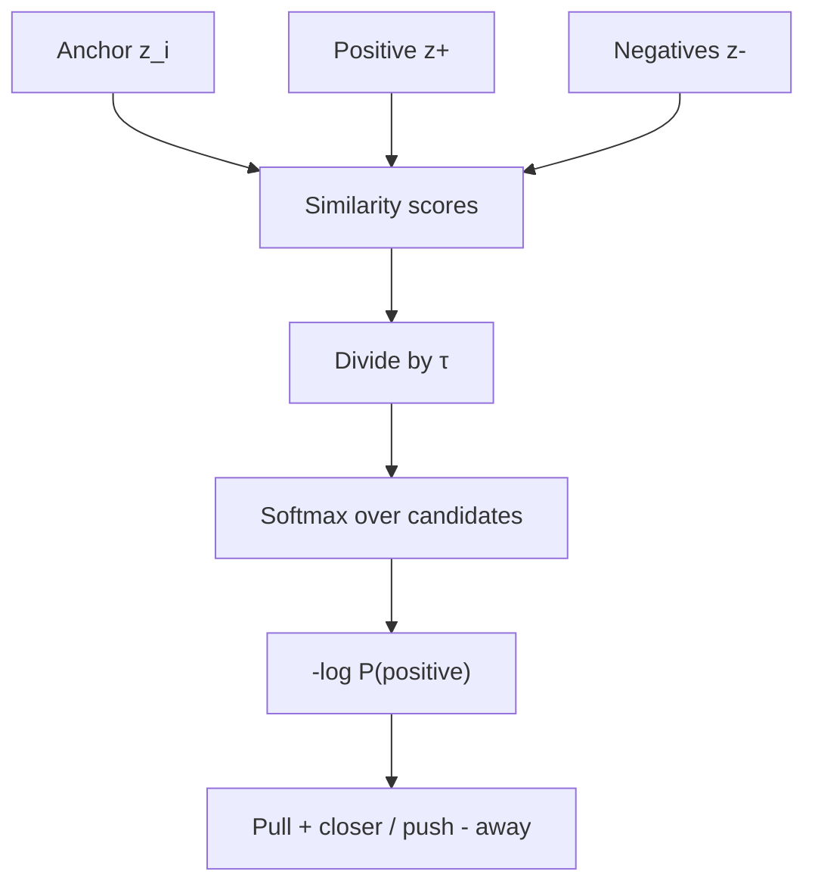

**InfoNCE** (Information Noise-Contrastive Estimation) is a contrastive loss that treats matching as multi-class classification: for each anchor, the true positive must win a softmax against a set of negatives. van den Oord, Li, and Vinyals introduced it in [Contrastive Predictive Coding (CPC, 2018)](https://arxiv.org/abs/1807.03748). Variants are used for dense dual encoders, sentence embeddings, self-supervised vision, and image-text alignment. **NT-Xent** (normalized temperature-scaled cross-entropy) is the cosine + temperature variant and augmented-view recipe popularized by [SimCLR](https://arxiv.org/abs/2002.05709); InfoNCE also includes other scoring and sampling setups.

## Intuition

Supervised classification says "this input is class $c$." InfoNCE says "among these candidates, the correct partner is *this one*." Each training row becomes a softmax over similarities. The positive logit must dominate the sum of competitors. Easy negatives (low similarity) barely move the loss once coarse separation exists. Hard negatives dominate the denominator and supply most of the gradient. The batch (or queue, or mined set) *is* the class set for that row, so batch construction shapes the objective.

InfoNCE also has an information-theoretic reading from CPC under its sampling assumptions: the optimal score estimates a density ratio, and $\log N - \mathcal{L}$ lower-bounds mutual information between matched views. Arbitrarily mined or correlated negatives don't automatically satisfy that derivation. In retrieval, ranking geometry may be more useful than the bound itself.

## Formula

**CPC form.** Given context (or anchor) $c$, one positive $x$ drawn from $p(x \mid c)$, and $N-1$ negatives independently drawn from the marginal $p(x)$, use a positive score function $f(x,c)$:

$$
\mathcal{L}_{\mathrm{InfoNCE}} = -\mathbb{E}\left[\log \frac{f(x, c)}{\sum_{x' \in X} f(x', c)}\right]
$$

CPC used a log-bilinear score $f_k(x_{t+k}, c_t) = \exp(z_{t+k}^\top W_k c_t)$. The unconstrained optimal score is proportional to $p(x\mid c)/p(x)$; a finite neural model does not need to realize it exactly. Optimizing the loss is categorical cross-entropy for "which of $N$ samples is the true future?" Under the CPC sampling assumptions, its population expectation supplies the bound:

$$
I(x; c) \ge \log N - \mathcal{L}_{\mathrm{InfoNCE}}
$$

The bound cannot exceed $\log N$ because the loss is nonnegative. Larger candidate sets can make the optimal bound tighter under this sampling construction; increasing a mined retrieval batch isn't by itself a mutual-information guarantee.

**Modern dual-encoder / NT-Xent form.** For L2-normalized embeddings, cosine similarity $\mathrm{sim}$, temperature $\tau > 0$, positive index $j(i)$, and candidate set $K$ (positive plus negatives):

$$
\mathcal{L}_i = -\log \frac{\exp\big(\mathrm{sim}(z_i, z_{j(i)}) / \tau\big)}{\sum_{k \in K}\exp\big(\mathrm{sim}(z_i, z_k) / \tau\big)}
$$

Equivalently, with logits $\ell_k = \mathrm{sim}(z_i, z_k)/\tau$:

$$
\mathcal{L}_i = \mathrm{logsumexp}(\ell) - \ell_{j(i)}
$$

$\mathrm{sim}$ is often cosine (dot product after unit-norm). Lower $\tau$ sharpens competition toward the hardest competitors; higher $\tau$ softens the ranking signal. SimCLR has $2N$ augmented views but excludes the anchor itself: each row has one positive and $2N-2$ negatives. CLIP averages the same structure in both directions (image$\to$text and text$\to$image) over an $N \times N$ similarity matrix.

InfoNCE is **not** the same as pairwise logistic NCE (one binary pos/neg decision) or [triplet loss](glossary://triplet-loss) (one negative, margin hinge). It is multi-way softmax over a whole candidate pool.

## Diagram



## Worked numbers

One query row, unit vectors, cosine similarities, $\tau = 0.05$:

| Candidate | $\mathrm{sim}$ | $\mathrm{sim}/\tau$ | Role |
|---|---|---|---|
| $p^+$ | $0.82$ | $16.4$ | positive |
| $n_{\mathrm{hard}}$ | $0.74$ | $14.8$ | hard negative |
| $n_{\mathrm{easy}}$ | $0.05$ | $1.0$ | easy negative |

With only the easy negative:

$$
P_+ = \frac{e^{16.4}}{e^{16.4}+e^{1.0}} \approx 1,\quad \mathcal{L} \approx 0
$$

Almost no gradient. With the hard negative instead:

$$
P_+ = \frac{e^{16.4}}{e^{16.4}+e^{14.8}} \approx 0.832,\quad \mathcal{L} \approx 0.184
$$

Most of the loss now comes from separating $n_{\mathrm{hard}}$. Same pair with $\mathrm{sim}(+)=0.90$ and $\mathrm{sim}(-)=0.20$ at different temperatures:

| $\tau$ | $P_+$ | $\mathcal{L}$ |
|---|---|---|
| $0.01$ | $\approx 1$ | $\approx 0$ (saturated) |
| $0.05$ | $\approx 1$ | $\approx 0$ |
| $0.10$ | $\approx 0.999$ | $\approx 0.001$ |
| $0.50$ | $\approx 0.80$ | $\approx 0.22$ |
| $1.00$ | $\approx 0.67$ | $\approx 0.40$ |

Tune $\tau$ with the batch recipe and label noise, not alone. Very low $\tau$ on noisy batches turns false negatives into extreme push-apart pressure.

## Example

Train a support-doc [bi-encoder](glossary://bi-encoder) with InfoNCE.

- Query: "How do I rotate API credentials?"
- Positive: credential-rotation runbook.
- In-batch negatives: other passages in the mini-batch (free but often easy).
- Mined [hard negative](glossary://hard-negative): "reset password" doc (shared security language, wrong intent).

With batch size $B$, encode $B$ queries and $B$ passages independently. The $B \times B$ cosine matrix has positives on the diagonal (or known pair indices) and off-diagonal cells as in-batch negatives. Loss is mean row-wise (query$\to$passage) cross-entropy, often plus the column-wise (passage$\to$query) term for symmetry, as in CLIP and many retrieval trainers.

```python
# Stable one-row InfoNCE (logits already = sim / tau)
# logits: shape [num_candidates], positive_index is the true match
import torch
import torch.nn.functional as F

def infonce_row(logits: torch.Tensor, positive_index: int) -> torch.Tensor:
    target = torch.tensor([positive_index], dtype=torch.long, device=logits.device)
    return F.cross_entropy(logits.unsqueeze(0), target)
    # same as: torch.logsumexp(logits, dim=0) - logits[positive_index]
```

If two passages both answer the same query and land in one batch, treating one as negative is a **false negative**: the loss pushes valid matches apart. Dedup, multi-positive masks, or CE-filtered mining reduce that damage.

CLIP uses the same recipe on $N$ image-text pairs: maximize diagonal cosine scores, minimize off-diagonal ones, average image$\to$text and text$\to$image InfoNCE. SimCLR uses two augmented views of each image as the positive pair and the other $2N-2$ views as negatives.

## How the pieces interact

1. **Similarity.** Cosine (or normalized dot) keeps magnitude from dominating ranking. Unnormalized dots mix length with alignment and can collapse or scale poorly with $\tau$.
2. **Temperature.** Scales the logits before softmax. Pair it with informative hard negatives and clean labels.
3. **Candidate set.** In-batch negatives scale with $B$ and are cheap. Memory queues (MoCo) decouple negative count from batch size. Global ANN mining (ANCE-style) matches what fails at retrieval time.
4. **Directionality.** CLIP trains both directions; query-to-passage retrieval can use a one-way loss. Having two encoder towers doesn't require symmetric training. Choose the direction and positive labels to match the retrieval task.
5. **Evaluation.** Watch recall@$k$, nDCG, and nearest-neighbor tables on held-out queries. Training loss alone can look healthy while false negatives or easy-only batches leave geometry wrong for production search.

## What fails in production

| Symptom | Likely InfoNCE issue | Fix |
|---|---|---|
| Loss near zero, retrieval mediocre | Easy-only in-batch negatives | Mine BM25/ANN hard negatives; raise effective $N$ |
| Recall drops after more training | False negatives (paraphrases, multi-answer docs) | Mask multi-positives; CE filter miners; soften $\tau$ |
| Near-topic wrong chunks dominate | Soft decision boundary | Harder negatives; slightly lower $\tau$ if labels clean |
| Unstable or NaN losses | Nonfinite inputs, tiny $\tau$, low-precision overflow | Check inputs and $\tau$; use stable cross-entropy with float32 logits where needed; any clipping changes the objective |
| Large batch OOM for dual encoders | Full $B \times B$ matrix + large models | Gradient checkpointing, smaller embed dim, queue/memory bank, carefully designed grad-accum for contrastive |
| Train good, serve bad | Train/serve skew (dropout on, different pooling, missing L2 norm) | Eval mode, same pooling and normalize-at-index contract |

Gradient accumulation does **not** automatically enlarge the contrastive candidate set: negatives must be scored in the same all-pairs step (or queue) that defines the denominator. Accumulating micro-batches only averages gradients; it does not invent cross-microbatch negatives unless you implement that explicitly.

## Why it matters here

InfoNCE is the concrete loss that turns an embedding batch into a ranking problem. Dense retrieval for RAG, sentence-embedding fine-tunes (SimCSE, E5-style dual encoders), and multimodal aligners all stand on this softmax-over-candidates pattern. When search returns the wrong chunk, start by checking batch construction, temperature, and false negatives in InfoNCE training.

## Related terms

- [Contrastive learning](glossary://contrastive-learning)
- [Hard negative](glossary://hard-negative)
- [Temperature](glossary://temperature)
- [Softmax](glossary://softmax)
- [Triplet loss](glossary://triplet-loss)
