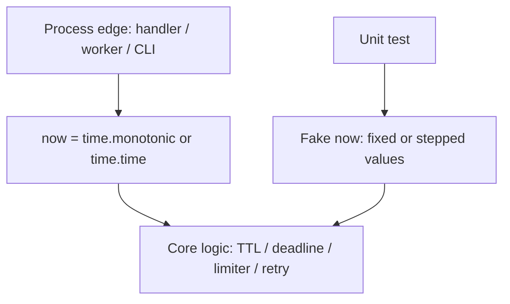

An **injected `now` function** is a clock dependency your code receives instead of calling the real OS clock. The production edge wires `time.monotonic` or `time.time`; tests pass a fake that returns values you choose. Time-dependent decisions become controllable without waiting; concurrency, random choices, and external dependencies still need their own test controls.

## Intuition

Any call to `time.time()`, `time.monotonic()`, or `datetime.now()` is a hidden global. You cannot step it, freeze it, or replay it without sleeping, monkeypatching, or racing the wall. Passing `now: Callable[[], float]` (or a small clock object) makes that global an explicit argument, the same way you inject a DB handle or HTTP client.

Two different clocks, two different jobs:

| Need | Production `now` | Why |
| --- | --- | --- |
| Elapsed timeout, TTL age, retry delay, latency | `time.monotonic` | Does not go backward when NTP or the admin steps the system clock |
| Logs, DB `created_at`, signed tokens, cross-host "what wall time is it?" | `time.time` / timezone-aware `datetime` | Absolute calendar time; may jump |

Inject the clock that matches the math. [Python documents `time.monotonic`](https://docs.python.org/3/library/time.html#time.monotonic) as the same clock for all processes, with an undefined reference point. That permits differences within the same supported clock domain, not comparisons across hosts or reboots. Don't store these values as durable calendar timestamps. Whether elapsed time includes system suspend also depends on the underlying clock/platform; [PEP 418](https://peps.python.org/pep-0418/) explains the distinction.

## Formula

For a deadline started at $t_0$ with budget $T$:

$$
\mathrm{remaining}(t) = T - (t - t_0),\qquad
\mathrm{expired}(t) \iff t \ge t_0 + T.
$$

For a TTL set at write time $t_w$ with duration $\tau$:

$$
\mathrm{expires\_at} = t_w + \tau,\qquad
\mathrm{stale}(t) \iff t \ge \mathrm{expires\_at}.
$$

In tests you supply $t$ directly. No sleep. Boundary cases ($t = t_0 + T$, $t = t_w + \tau$) are where inclusive/exclusive bugs hide.

## Example

A process-local, single-threaded TTL key-value store takes `now` in its constructor. This example assumes finite, nonnegative TTLs and a nondecreasing clock. Production passes `time.monotonic`; a test advances a mutable clock without waiting. Persistent storage and concurrent access need separate implementations.

```python title="injected-now.py"
from dataclasses import dataclass
from typing import Callable
import time


@dataclass
class Entry:
    value: str
    expires_at: float


class TTLStore:
    def __init__(self, now: Callable[[], float]) -> None:
        self.now = now
        self.items: dict[str, Entry] = {}

    def set(self, key: str, value: str, ttl: float) -> None:
        self.items[key] = Entry(value, self.now() + ttl)

    def get(self, key: str) -> str | None:
        entry = self.items.get(key)
        if entry is None or entry.expires_at <= self.now():
            self.items.pop(key, None)
            return None
        return entry.value


# Production: real monotonic clock at the edge
live = TTLStore(now=time.monotonic)

# Tests: controllable clock, no sleep
clock = {"t": 10.0}
store = TTLStore(now=lambda: clock["t"])
store.set("session", "alice", ttl=5.0)
assert store.get("session") == "alice"   # t = 10, expires_at = 15
clock["t"] = 14.999
assert store.get("session") == "alice"   # still valid just before expiry
clock["t"] = 15.0
assert store.get("session") is None      # expired at equality
```

The same pattern applies to token-bucket refill (`elapsed = now() - last_refill`), request budgets (`if now() >= deadline: cancel`), and retry scheduling (`if now() < next_attempt_at: wait`).

## How it works

1. **Define a narrow interface.** A zero-arg callable returning seconds is enough: `Callable[[], float]`. A tiny protocol with `.now()` is fine if you need advance/sleep helpers in tests.
2. **Accept `now` at construction or call sites.** Prefer constructor injection for long-lived objects (caches, limiters). Prefer a parameter default for pure helpers: `def has_budget(start, timeout, now=time.monotonic)`.
3. **Wire the real clock once at the process edge.** HTTP handler, worker loop, CLI entrypoint, or DI container. Core modules import neither `time.time` nor `time.monotonic` for control flow.
4. **In tests, replace the clock.** Advance in discrete steps: before expiry, exactly at expiry, one unit after, or across a retry window. Use a fresh object/clock for each test rather than winding a monotonic fake backward while live state still depends on it. Assert outcomes immediately.
5. **Keep sleep out of unit tests.** If the production path must wait, either mock the sleeper too or drive pure "should I wait / how long?" pure functions with injected time and test those.

Global freezers (`freezegun`, similar tools) can still help when third-party code calls the wall clock. Prefer injection for *your* control-plane math so the contract is explicit and freezers do not need to rewrite every call site.

## Diagram



## Worked numbers

Token bucket with capacity $C = 10$, refill rate $r = 2$ tokens/s, last updated at $t_{\mathrm{last}} = 100$:

$$
\mathrm{tokens}(t) = \min\bigl(C,\; \mathrm{tokens}_{\mathrm{last}} + r \cdot (t - t_{\mathrm{last}})\bigr).
$$

| Step | $t$ | Action | Tokens after |
| ---: | ---: | --- | ---: |
| 0 | 100 | start with 10 | 10 |
| 1 | 100 | spend 10 | 0 |
| 2 | 102 | refill $2 \cdot 2 = 4$ | 4 |
| 3 | 102 | spend 3 | 1 |
| 4 | 107 | refill capped at capacity | 10 |

With an injected clock you set $t$ to $100$, $102$, $107$ in three assertions. With wall sleep you would wait seven real seconds and still risk scheduling jitter around the boundary.

## Trade-offs

| Approach | Pros | Cons |
| --- | --- | --- |
| Injected `now` | Explicit, fast tests, easy replay and audit | Call sites must pass the dependency; easy to miss one path |
| Global freezer (e.g. freezegun) | Works for code you do not own | Hides the dependency; can fight monotonic clocks; brittle with threads |
| Real sleep in tests | Exercises OS timers end-to-end | Slow, flaky under load, bad for interview and CI unit suites |
| Fixed timestamps as pure args | Simplest pure function | Callers still need a clock to produce the timestamp |

Missed call sites are the production footgun: one helper still calls `time.time()` while the rest use the injected clock, so tests pass and production timeouts drift under NTP steps. Grep for raw clock imports in modules that own deadlines.

## Debug path

When expiry or timeout behavior is wrong:

1. **Find every clock read** on the path. Mixed wall and monotonic clocks in one formula are a bug.
2. **Check the boundary.** Confirm whether expiry is `<=` or `<`. Document it and test equality.
3. **Separate "what time is it?" from "how long has this run?"** Feature freshness and log stamps need wall time; request budgets need monotonic elapsed time.
4. **Replay with a scripted clock.** Reproduce the incident timestamps in a unit test instead of waiting for the next flaky run.
5. **Check the clock domain.** Don't assume a persisted monotonic value remains meaningful across a reboot or on another host. For durable expiry, persist an absolute expiry under an explicit wall-clock policy, then translate any remaining budget to a fresh local monotonic deadline. Clock jumps and downtime still need a defined policy; an injected clock doesn't eliminate them.

## Why it matters here

AI systems are full of soft real-time rules: cache TTLs for retrieval, prompt-cache validity, streaming cancellation budgets, provider rate limits, retry/backoff, feature freshness gates, and eval timeouts. Injected time makes those decisions testable without sleeping through CI. A controlled clock plus canned tool responses removes those sources of drift; it doesn't guarantee that every other part of a test is deterministic.

## Related terms

- [time.monotonic](glossary://time-monotonic)
- [Deadlines and TTL](glossary://ttl-deadline)
- [Feature freshness](glossary://feature-freshness)
- [Token bucket](glossary://token-bucket)
- [Unit test](glossary://unit-test)
