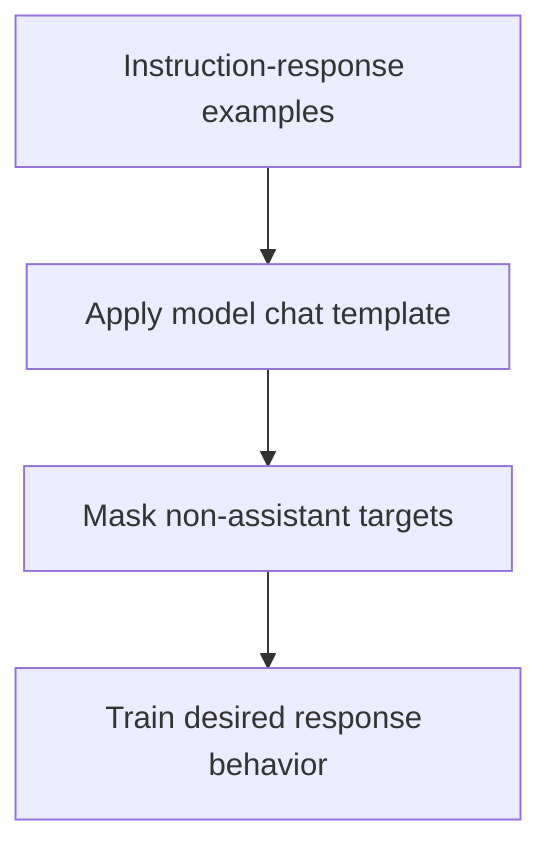

Instruction tuning adapts a pretrained language model using examples that pair instructions or conversations with desired responses. The adaptation teaches response patterns, task formatting, conversational roles, and refusal behavior represented in the training data. Factual correctness depends on data and evaluation, and serialization must match the model's trained chat template.

## Format and loss ownership

Instruction examples are serialized into the exact role markers and separators expected by the target model's tokenizer and training recipe. A typical supervised setup predicts assistant response tokens while masking user instructions and padding from the loss. Training on malformed separators, duplicated special tokens, or user-text labels can teach the wrong partitions even when reported loss decreases.

## Example

A developer question asks how to rotate an API key, and the approved answer says to create the replacement before revoking the old key. The training pipeline renders system, user, and assistant messages with the model's supported chat template. Assistant answer tokens contribute to loss; user instruction tokens do not. Evaluation then checks the required action order on held-out questions instead of treating a lower training loss as proof of factual grounding.

## Why it matters here

Chat products depend on the perimeter between pretrained continuation behavior and adapted instruction-following behavior. Correct templates, response masking, dataset quality, held-out evaluation, and explicit security source of truth remain important when later lessons cover fine-tuning, tool use, and production agents.

## Related terms

- [Supervised fine-tuning](glossary://supervised-fine-tuning)
- [Chat template](glossary://chat-template)
- [Cross-entropy](glossary://cross-entropy)
