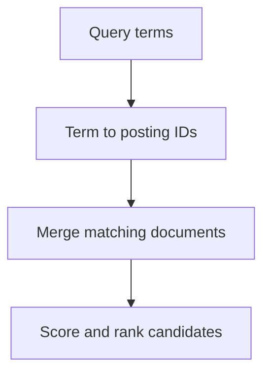

An **inverted index** maps a search term to the documents containing that term. It reverses the ordinary document-to-words relationship: instead of opening every document to see whether it contains `token`, a query can look up `token` and jump directly to its matching document identifiers.

The collection of matching identifiers is a posting list. Production systems may also store term frequency, token positions, field information, and compressed document IDs. A beginner implementation can map each normalized term to a set of IDs when the desired score is simple binary term membership.

## Separate lookup from posting work

Looking up one term in a hash map can be expected constant time. Reading its posting list isn't free: a common term can appear in most of the corpus. Query time still depends on how many matching postings are visited, how candidate scores are combined, and how the best results are selected.



## Example

```python
postings = {"token": {0, 2}, "hit": {2}}
scores = {doc: int(doc in postings["token"]) + int(doc in postings["hit"]) for doc in {0, 2}}
assert scores == {0: 1, 2: 2}
```

Document 2 ranks ahead of document 0 because it contains both query terms. Document 1 is never inspected because neither posting list contains it.

## Why it matters here

Lexical search, document retrieval, hybrid search, and corpus inspection use inverted indexes to avoid repeated full scans. Their correctness also depends on consistent token normalization, document updates, access filtering, and clear handling of repeated terms.

## Related terms

- [Sparse retrieval](glossary://sparse-retrieval)
- [BM25](glossary://bm25)
- [Tokenization](glossary://tokenization)
- [Hybrid search](glossary://hybrid-search)
