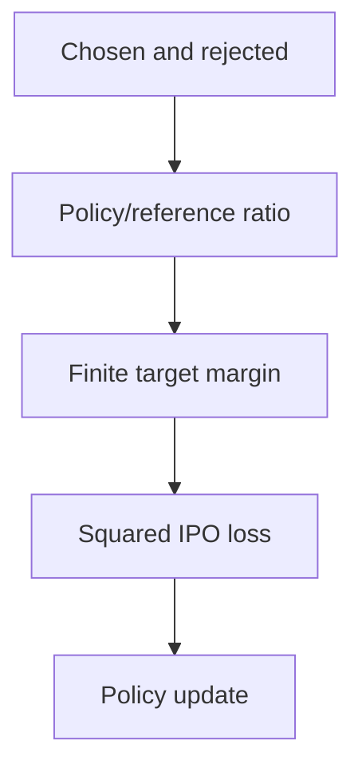

**Identity Preference Optimization (IPO)** is an offline pairwise preference objective. Like [DPO](glossary://dpo), it compares chosen and rejected completions relative to a reference policy. IPO uses a squared error on the pairwise log-ratio instead of DPO's logistic classification loss.

Define:

$$
h=\log\frac{\pi_\theta(y_w\mid x)\pi_{ref}(y_l\mid x)}
{\pi_\theta(y_l\mid x)\pi_{ref}(y_w\mid x)}.
$$

A common sampled loss for one preference pair, with positive regularization coefficient $\tau$, is:

$$
L_{IPO}=\left(h-\frac{1}{2\tau}\right)^2.
$$

Coefficient convention varies between papers and implementations. State whether configuration uses $\tau$, $\beta$, or transformed equivalent before comparing runs.

The finite target penalizes a margin that is too small or too large. This regularization doesn't repair biased pairs, missing slices, tokenizer mismatch, or a wrong reference. Validate sequence reduction and coefficient convention before attributing different behavior to the algorithm.

## Why use it

IPO was motivated partly by risk that DPO overfits deterministic preference labels. Finite target discourages unbounded preference margin. It still depends on coverage and quality of fixed [preference data](glossary://preference-data).

## Example

A dataset contains prompts, chosen responses, and rejected responses. The trainer computes their policy and reference log-probabilities and pulls each pairwise log-ratio toward the finite target. For $\tau=0.5$, that target is $1$: margins $0$, $1$, and $2$ have losses $1$, $0$, and $1$. Overshooting is penalized as well as undershooting. No online environment interaction is required during the update.

## Why it matters here

Compare IPO with other offline preference objectives through their loss assumptions. It may fit when preference labels are nearly deterministic and DPO margin keeps growing.

## Related terms

- [DPO](glossary://dpo)
- [Preference data](glossary://preference-data)
- [Reward model](glossary://reward-model)
- [Supervised fine-tuning](glossary://supervised-fine-tuning)
