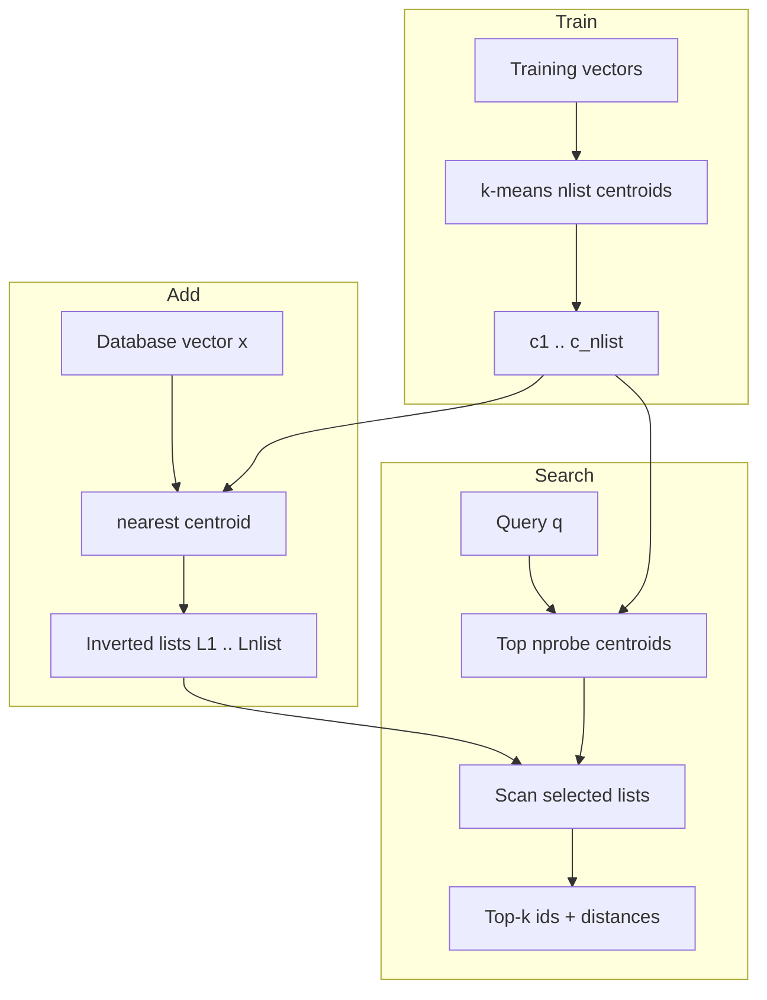

**Inverted file (IVF)** indexing is a cell-probe structure for approximate nearest neighbor (ANN) search. A coarse quantizer (usually k-means) partitions the embedding space into $nlist$ Voronoi cells. Each database vector is assigned to the nearest centroid and stored in that cell's inverted list. At query time the system scores the query against the centroids, opens only the $nprobe$ nearest lists, and runs exact or compressed distance search inside those lists.

The name comes from classical inverted-file search (term $\to$ document ids). Here the "terms" are cluster ids: centroid $\to$ vector ids (and optionally compressed codes). Jégou, Douze, and Schmid popularized the combination with product quantization as **IVFADC** (*Product quantization for nearest neighbor search*, IEEE TPAMI 2011). FAISS exposes the same idea as `IndexIVFFlat`, `IndexIVFPQ`, and related types; pgvector ships `ivfflat` with `lists` / `ivfflat.probes`; many vector databases reimplement the same coarse-partition pattern.

IVF is a coarse partitioning index for vectors used by dense retrieval. It avoids an $O(N)$ scan by searching selected cells, which reduces distance evaluations while risking misses across cell boundaries.

## Intuition

IVF replaces one exhaustive scan with coarse routing followed by local scans:

1. **Train:** learn $nlist$ centroids from a representative sample of vectors.
2. **Index:** assign each vector to its nearest centroid's inverted list.
3. **Query:** open only the $nprobe$ bins whose centers are closest to the query, then scan the contents of those bins.

Search is approximate because a true neighbor can sit just across a Voronoi boundary in a cell you did not probe. Raising $nprobe$ scans more nearby cells, increasing work and the chance that the true neighbor enters the candidate set.

Lists are rarely equal length. Dense regions of embedding space produce fat lists; sparse regions produce thin ones. The fraction of the corpus you scan is therefore only *roughly* $nprobe / nlist$, and often higher than that naive ratio because the nearest cells tend to be the crowded ones.

## How it works

### Train (coarse quantizer)

Given training vectors $X_{\mathrm{train}} \subset \mathbb{R}^d$ (a representative sample of production embeddings, not random noise):

1. Run k-means (or an equivalent vector quantizer) to obtain centroids $\{c_1,\ldots,c_{nlist}\}$.
2. Store the centroids in a small "coarse" index (in FAISS, typically `IndexFlatL2` / `IndexFlatIP` used as the quantizer).

FAISS gives $nlist \approx C\sqrt{N}$ as a cost-balancing starting point. Tune the coefficient for probe count, dimension, list imbalance, and implementation. Its default clustering parameters warn below 39 training points per centroid and subsample above 256. Those are implementation thresholds; validate recall with a representative sample and held-out queries.

### Add

For each database vector $x_i$:

$$
\ell(x_i) = \arg\min_{j=1..nlist} \|x_i - c_j\|
$$

(or argmax inner product if the metric is IP). Append $x_i$ (full float32 for IVF-Flat, or a PQ/SQ code for IVF-PQ / IVF-SQ) plus its id to inverted list $\ell(x_i)$.

### Search

For query $q$:

1. Score $q$ against all $nlist$ centroids; keep the $nprobe$ nearest cell ids $P(q)$.
2. For every vector (or code) in $\bigcup_{j \in P(q)} L_j$, compute distance to $q$.
3. Return the best $k$ among those candidates.

Failure mode in geometry terms: if the cell that holds the true nearest neighbor is not in $P(q)$, that neighbor never enters the candidate set, no matter how good a later reranker is.

### IVF-Flat vs IVF-PQ

| Variant | What each list stores | Distance inside lists | When people pick it |
| --- | --- | --- | --- |
| **IVF-Flat** | Full $d$-dim floats | Exact $L_2$ or IP | High recall, RAM available |
| **IVF-PQ (IVFADC)** | PQ codes, often of residuals $x - c_{\ell}$ | Approximate (ADC tables) | Memory-bound corpora |
| **IVF-SQ** | Scalar-quantized floats | Cheap approximate | Middle ground on RAM |

Residual encoding (quantize $x - c_{\ell(x)}$ rather than $x$) shrinks code error inside each cell and is the classic IVFADC path in FAISS `IndexIVFPQ`.

## Formula

Exact neighbor the index tries to approximate under Euclidean distance:

$$
j^\star = \arg\min_{i=1..N} \|q - x_i\|_2
$$

Coarse assignment (train / add):

$$
\ell(x) = \arg\min_{j=1..nlist} \|x - c_j\|_2
$$

Multi-probe search set (query):

$$
P(q) = \operatorname{Top}\text{-}nprobe_j \big(-\|q - c_j\|_2\big)
$$

Candidate set actually scored:

$$
\mathcal{C}(q) = \{ i : \ell(x_i) \in P(q) \}
$$

Approximate scan fraction if lists were perfectly balanced:

$$
\frac{|\mathcal{C}(q)|}{N} \approx \frac{nprobe}{nlist}
$$

ANN fidelity against exact geometric top-$k$ set $E_k$ for approximate set $A_k$:

$$
\mathrm{ANN\text{-}recall@}k = \frac{|A_k \cap E_k|}{k}
$$

Average over held-out queries. This measures *index* quality. Task recall against human-relevant documents is a separate number; both can fail independently.

## Example

Support-ticket RAG corpus: $N = 50{,}000{,}000$ chunks, $d = 768$, L2-normalized bi-encoder vectors searched with inner product.

**Sizing.** Choose an illustrative $nlist=16{,}384$ to work through the scan arithmetic; this choice hasn't been benchmarked:

$$
\sqrt{5 \times 10^7} \approx 7071, \qquad nlist = 16{,}384 \approx 2.3\sqrt{N}
$$

This happens to be a power of two, but IVF doesn't require that.

**Balanced scan estimate** with $nprobe = 32$:

$$
\frac{N}{nlist} \approx \frac{5 \times 10^7}{16384} \approx 3052 \text{ vectors per list}
$$

$$
nprobe \times \frac{N}{nlist} \approx 32 \times 3052 \approx 9.8 \times 10^4
$$

So each query scores on the order of $100$k candidates instead of $50$M (plus $nlist$ centroid comparisons for coarse routing). Raising $nprobe$ to $128$ multiplies list work by about $4$ and usually lifts ANN-recall@k until it plateaus.

**Operational sketch (FAISS IVF-Flat):**

```python
import faiss
import numpy as np

d, nlist, nprobe = 768, 16_384, 32
# xb: (N, d) float32, already L2-normalized for IP search
quantizer = faiss.IndexFlatIP(d)
index = faiss.IndexIVFFlat(quantizer, d, nlist, faiss.METRIC_INNER_PRODUCT)

# train on representative embeddings from the production corpus
index.train(xb_train)   # default warning below 39*nlist rows; tune sample quality
index.add(xb)
index.nprobe = nprobe

D, I = index.search(xq, k=10)
```

In pgvector the same knobs are `lists` at `CREATE INDEX` time and `SET ivfflat.probes = ...` at query time. Measure ANN-recall@10 / @100 against a flat baseline on your embeddings before locking $nprobe$ for production latency SLOs.

## Diagram



## Sizing and trade-offs

| Knob | Effect of increasing | Cost |
| --- | --- | --- |
| $nlist$ | Smaller average lists; finer partition | Longer train; more centroid comparisons; risk of tiny/empty lists if too large for $N$ |
| $nprobe$ | Higher ANN-recall@k | Latency and CPU per query scale roughly with lists scanned |
| Flat vs PQ codes | Flat: better geometry inside lists | Flat: ~$4d$ bytes/vector; PQ: tens of bytes, some distance error |
| Training sample | More stable, balanced cells | Must match production embedding model and document mix |

**What fails in production**

- **$nprobe$ too low.** Gold chunk sits in a neighboring cell; first-stage candidate set never contains it. The LLM looks wrong; the bug is the index.
- **Stale centroids.** Embedding model swap, rechunking, or domain shift (short tickets $\to$ long code) makes old Voronoi cells misaligned. Rebuild and retrain the coarse quantizer before adding vectors to the new map.
- **Undertrained coarse quantizer.** Too few training rows or non-representative sample $\to$ uneven lists, some huge, some empty, unstable latency and recall.
- **Filters after probe.** ACL / tenant / metadata filters applied only after IVF can empty $\mathcal{C}(q)$ even when global ANN-recall looked fine. Measure filtered recall, or push filters into list selection when the store supports it.
- **Tuning only p95 latency.** Fast $nprobe$ that drops evidence before the reranker is a silent quality regression.

Compared with [HNSW](glossary://hnsw), IVF-Flat avoids graph-edge storage but still stores full vectors and IDs; IVF-PQ adds compression. IVF needs a train step and exposes $nprobe$ as a query-time latency/recall dial. Which index meets a target depends on dimensions, corpus distribution, filters, hardware, and measured recall. Compression can help a corpus fit memory while also changing distance accuracy.

## Why it matters here

Approximate first-stage search can make large-corpus retrieval cheaper; optimized exact scans can also be viable on suitable hardware and workloads. IVF is the cell-probe design behind FAISS IVF indexes and pgvector IVFFlat. When retrieval misses evidence, check whether the gold vector was ever in a probed list before blaming the generator. Understanding $nlist$, $nprobe$, training data, and list imbalance makes the tradeoff measurable.

## Related terms

- [ANN search](glossary://ann-search)
- [FAISS](glossary://faiss)
- [Product quantization](glossary://product-quantization)
- [HNSW](glossary://hnsw)
- [Recall@k](glossary://recall-at-k)
