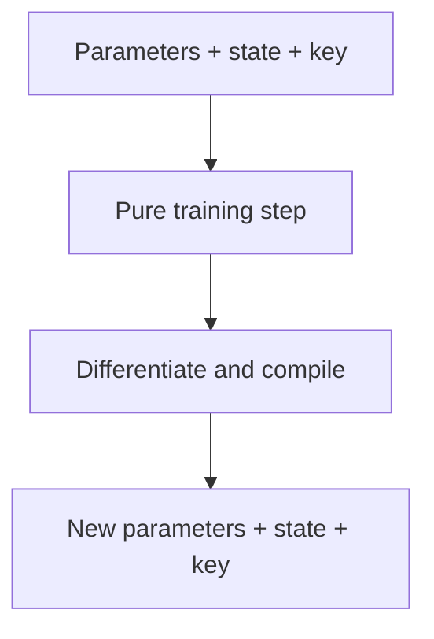

**JAX** is a Python numerical-computing framework that combines NumPy-like array operations with composable program transformations for automatic differentiation, compilation, and vectorization. Research code often expresses training as pure state transitions instead of mutating a model and optimizer in place.

## Transformations change the execution contract

`jax.grad` differentiates a scalar-valued function, `jax.vmap` applies one function across a batch axis, and `jax.jit` stages a function for compilation. These transformations compose, but they assume that relevant inputs and outputs are explicit. Python side effects inside a jitted function don't behave like a normal per-step execution log.

Randomness is also explicit. A training step receives a random key, splits it into independent subkeys, and returns the next key along with updated parameters and optimizer state. Reusing the same key for every dropout call can silently repeat the same mask.

## Example

A researcher opens a JAX transformer implementation to add an auxiliary loss. Preserve the existing parameter tree, pass the random key through the modified step, use `jax.value_and_grad` to calculate the scalar loss and its gradients, and return the updated optimizer state.

When benchmarking, compile once, perform warmup steps, and wait for device completion before measuring. Timing only asynchronous dispatch produces unrealistically low step times that don't reflect completed accelerator work.

## Why it matters here

Many influential research implementations use JAX even when a production team trains primarily with PyTorch. Reading its explicit-state and transformation model lets engineers reproduce published experiments without accidentally changing randomness, differentiation, or compilation behavior.

## Related terms

- [Gradient](glossary://gradient)
- [Optimizer state](glossary://optimizer-state)
- [Tensor](glossary://tensor)
- [PyTorch](glossary://pytorch)
