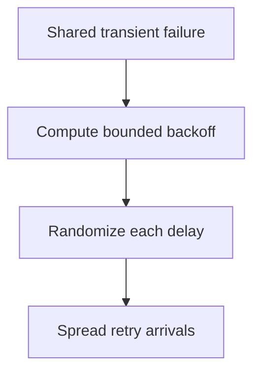

**Jitter** adds controlled randomness to retry timing so clients recovering from the same failure don't all retry at the same instant. It is usually combined with a capped exponential backoff, an overall deadline, and a limit on total attempts.

## Randomness protects the overloaded dependency

Without jitter, clients that receive the same error at the same moment often choose identical delays: one second, two seconds, four seconds. Those synchronized bursts can keep a recovering dependency overloaded even though each client appears to follow a reasonable backoff policy.

With full jitter, a client samples its next wait uniformly between zero and its current capped exponential upper bound. For attempt index $n$, one common policy is:

$$
\text{delay} \sim \operatorname{Uniform}(0, \min(\text{cap}, \text{base} \times 2^n))
$$

An explicit server `Retry-After` value remains a floor. Randomness shouldn't cause a client to retry before the server says it is ready.

## Example

One hundred model-gateway workers receive HTTP 429 at the same time. A fixed two-second delay schedules one hundred more requests two seconds later. Full jitter spreads those retries across the permitted window, reducing the next synchronized spike.

If the response includes `Retry-After: 2`, each worker waits at least two seconds and adds bounded randomness afterward. It must still respect its user-facing deadline and avoid repeating a non-idempotent tool action.

## Why it matters here

Model routing, gateway fallback, and retry-planner exercises depend on preventing retry storms without hiding permanent errors or duplicating side effects. Jitter is effective only when paired with classification, server retry hints, idempotency, attempt caps, and an explicit latency budget.

## Related terms

- [Retry backoff](glossary://retry-backoff)
- [Rate limit](glossary://rate-limit)
- [Circuit breaker](glossary://circuit-breaker)
- [Idempotency](glossary://idempotency)
