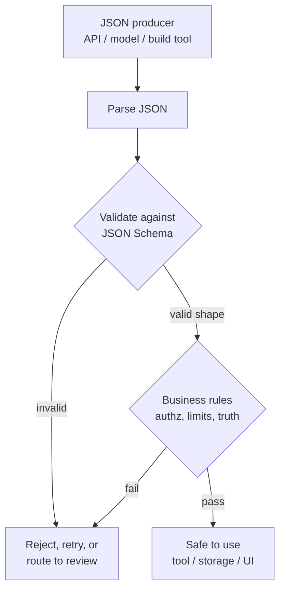

JSON Schema is a declarative vocabulary, written as JSON, that describes the structure of other JSON documents and asserts when an *instance* is valid. This entry uses **Draft 2020-12** (JSON Schema Core plus JSON Schema Validation). A schema can require fields, restrict types and enums, constrain nested objects and arrays, reject unknown properties, and attach documentation. Application rules must check whether field values are semantically correct for the policy.

## Intuition

A schema is a machine-checkable schema for shape. Producers such as APIs, models, and build tools emit JSON; consumers parse it. JSON Schema gives both sides reusable structural rules instead of one-off `if` checks scattered across services.

Validation is structural. A payload can pass every keyword and still be wrong: a valid model id that does not exist, a valid `action: "deploy"` the caller may not perform, or a citation string that points at the wrong document. Schema validation confirms shape; application checks establish truth and authorization.

## How it works

A **schema** is itself a JSON document. An **instance** is the JSON value you check against it. A validator walks the instance and evaluates keywords. Draft 2020-12 splits work across documents:

| Layer | Role |
|---|---|
| **Core** | Dialect, identifiers, and references: `$schema`, `$id`, `$ref`, `$defs`, anchors, and vocabulary declarations |
| **Applicator** | Apply subschemas: `properties`, `items` / `prefixItems`, `allOf` / `anyOf` / `oneOf`, `if` / `then` / `else`, `additionalProperties` |
| **Validation** | Assertions: `type`, `required`, `enum`, `const`, numeric bounds, string length / `pattern`, array size / `uniqueItems` |
| **Meta-data** | Annotations: `title`, `description`, `default`, `examples` (not failures by themselves) |
| **format** | Semantic hints (`date-time`, `email`, `uuid`, …). The standard dialect uses annotations; assertion behavior requires the assertion vocabulary or an explicit validator option |

JSON's six types plus `"integer"` (any number with zero fractional part) are the usual `type` values. Common object keywords in practice:

```json
{
  "$schema": "https://json-schema.org/draft/2020-12/schema",
  "type": "object",
  "properties": {
    "action": { "type": "string", "enum": ["evaluate", "deploy", "rollback"] },
    "traffic_percent": { "type": "number", "minimum": 0, "maximum": 100 },
    "model_id": { "type": "string", "minLength": 1, "maxLength": 128 }
  },
  "required": ["action", "model_id"],
  "additionalProperties": false
}
```

- **`required`**: named properties must be present.
- **`additionalProperties: false`**: reject keys not listed under `properties` (or matching `patternProperties`). Omitting this *allows* extra keys (the default), which is a common production surprise.
- **`enum` / `const`**: closed sets of allowed values.
- **`$ref` / `$defs`**: reuse subschemas without copy-paste.

Annotations such as `default` don't insert missing values during standard validation. Any automatic default filling is a separate library feature. `additionalProperties` also sees declarations within its own schema object; composed schemas may need `unevaluatedProperties` to close an object after other subschemas have evaluated fields.

A valid instance against the schema above:

```json
{ "action": "deploy", "traffic_percent": 10, "model_id": "reranker-v7" }
```

Invalid instances (and why):

| Instance | Failure |
|---|---|
| `{ "action": "deploy" }` | missing required `model_id` |
| `{ "action": "delete", "model_id": "reranker-v7" }` | `action` not in enum |
| `{ "action": "deploy", "model_id": "reranker-v7", "note": "urgent" }` | extra key with `additionalProperties: false` |
| `{ "action": "deploy", "model_id": "reranker-v7", "traffic_percent": 120 }` | `traffic_percent` above `maximum` |

In code, validation is typically a single library call (for example Ajv in JavaScript, or exporting a [Pydantic](glossary://pydantic) model to JSON Schema and validating instances). Pseudocode:

```python
def accept(instance: dict, schema: dict) -> dict:
    errors = validate(instance, schema)  # library-specific
    if errors:
        raise ValidationError(errors)
    return instance  # shape is trusted; policy checks come next
```

## Example

Tool arguments and structured model output use the same idea. Suppose an agent may propose a model-release action:

```json
{
  "name": "apply_model_release_action",
  "parameters": {
    "type": "object",
    "properties": {
      "action": {
        "type": "string",
        "enum": ["evaluate", "deploy", "rollback"]
      },
      "traffic_percent": {
        "type": ["number", "null"],
        "minimum": 0,
        "maximum": 100
      },
      "model_id": { "type": "string", "minLength": 1 },
      "reason": { "type": "string", "minLength": 1, "maxLength": 500 }
    },
    "required": ["action", "traffic_percent", "model_id", "reason"],
    "additionalProperties": false
  }
}
```

Pipeline after the model replies:

1. Parse the model string as JSON ([parsing](glossary://parsing)).
2. Validate against the schema. Reject or retry on failure.
3. Run **policy** that the schema cannot express: model is approved, requested traffic matches the review, idempotency key is present, and caller may deploy this environment.
4. Execute the tool and log the validated payload.

Many providers accept a JSON Schema (or a subset) for [structured output](glossary://structured-output) and [tool calling](glossary://tool-calling). Strict modes often require every property in `required` and `additionalProperties: false` on each object so the decoder can constrain tokens. That is a *provider subset* of JSON Schema, not the full Draft 2020-12 language. Always re-validate in your process even when the API claims schema adherence: refusals, truncation (`max_tokens`), and wrong-but-typed values still happen.

## Diagram



## Where to put the perimeter

Validate at every place untrusted or loosely typed JSON becomes trusted input:

- HTTP request and response bodies ([API schemas](glossary://api-contract))
- Tool and function arguments
- Structured model completions
- Config and content-build metadata
- Messages on queues and rows written to durable storage

Decide the invalid path explicitly: fail closed, bounded retry with the same schema, repair only with a second validated pass, or human review. Record the schema id and a redacted failure payload so you can distinguish invalid output from [schema drift](glossary://schema-drift) (producer changed fields without updating consumers).

## What still fails in production

| Failure | Why the schema did not save you |
|---|---|
| Wrong enum that is still allowed | Schema too wide; tighten enums or add policy |
| Hallucinated ids with correct type | Structure ok; need DB lookup / authz |
| Extra fields silently accepted | Default `additionalProperties` behavior left open |
| `format: "email"` accepted garbage | `format` is often annotation-only, not a hard assertion |
| Provider rejects a "valid" schema | Strict structured-output modes support only a subset |
| Version mismatch | Producer ships new fields; consumer schema is stale |

Treat the schema as versioned software. An additive optional field can still break an older consumer using `additionalProperties: false` when a new producer sends it. Renames, type changes, and newly required fields can also break compatibility; check the direction of producer/consumer changes. Pin the dialect through `$schema` and test both accept and reject test cases.

## Why it matters here

LLM systems turn free text into machine actions. JSON Schema is the shared language for that handoff: tool args, extraction results, eval rows, and API envelopes become reviewable, testable specifications instead of prose. You still need policy and product logic after validation, but without a schema perimeter, every model upgrade is a parsing incident waiting to happen.

## Related terms

- [Structured output](glossary://structured-output)
- [Pydantic](glossary://pydantic)
- [API schemas](glossary://api-contract)
- [Schema drift](glossary://schema-drift)
- [Tool calling](glossary://tool-calling)
