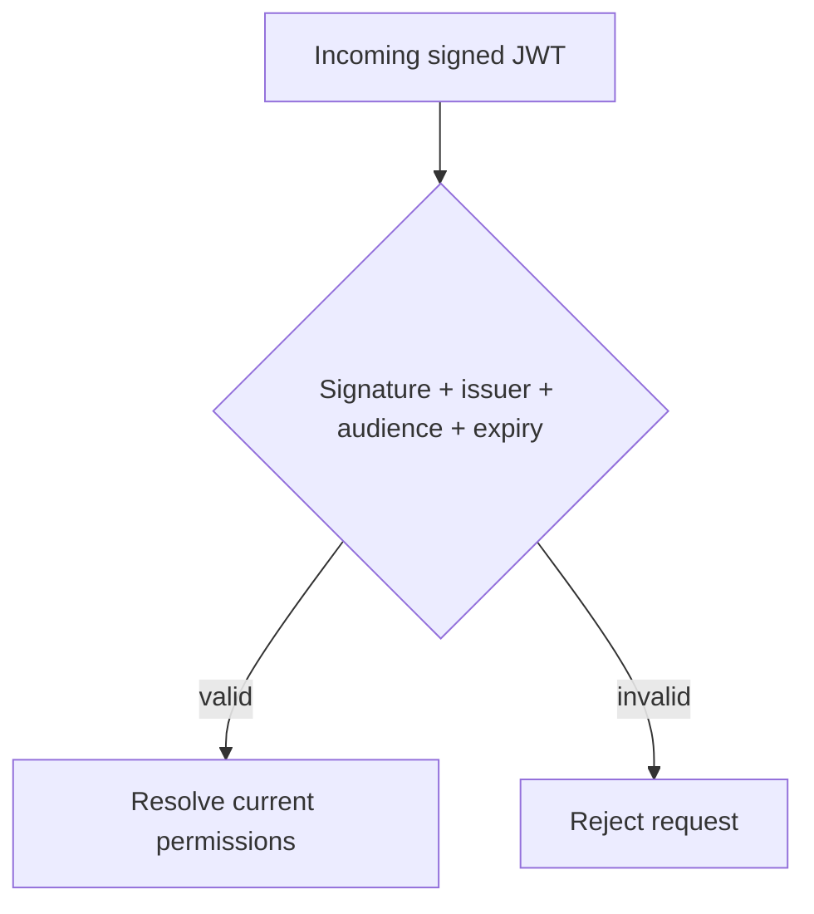

A **JSON Web Token (JWT)** is a compact representation of claims exchanged between parties. [RFC 7519](https://www.rfc-editor.org/rfc/rfc7519.html) defines claims such as issuer (`iss`), subject (`sub`), audience (`aud`), expiration (`exp`), and not-before time (`nbf`). Signed tokens protect the integrity of those claims; encrypted tokens can also protect confidentiality.

An application trusts a JWT only after enforcing its token profile: allowed algorithms and trusted keys, expected issuer and audience, required claims, expiration, and not-before time when present, plus any required session or revocation condition. RFC 7519 leaves registered-claim requirements to the token profile. Base64url provides encoding, while encryption provides confidentiality; keep sensitive information out of an ordinary signed token because its payload remains readable.

## Validate identity before checking source of truth

## Example

A project-settings request presents a token naming `sub=user-17`, `aud=workspace-api`, and an expiration one hour in the future. The server verifies the signature against the trusted issuer, confirms the audience, and checks the timestamp. It then loads the user's current workspace membership. Authorization uses the current role, so a role revoked after issuance no longer grants administrator access.

For this authentication flow, reject unsigned tokens, unexpected algorithms, incorrect audiences, expired or not-yet-valid claims, and keys selected solely from attacker-controlled token data. Validate the token's intended use too: an ID token authenticates a user to its client, while an API access token authorizes resource requests. Keep session authentication separate from authorization for each resource and operation. [RFC 8725](https://www.rfc-editor.org/rfc/rfc8725.html) describes algorithm, audience, and cross-token validation requirements.

## Why it matters here

Coding agents frequently implement JWT middleware, while enterprise assistants and MCP servers consume delegated identities. Establish trust through server-side verification and fresh policy evaluation of each identity and request.

## Related terms

- [OAuth](glossary://oauth)
- [RBAC](glossary://rbac)
- [permission scope](glossary://permission-boundary)
- [Secrets management](glossary://secrets-management)
