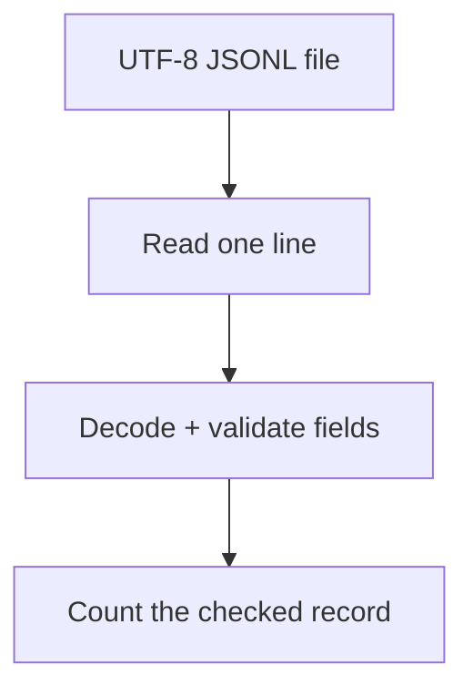

**JSON Lines** is a UTF-8 text format containing one complete JSON value per line, without a byte-order mark. Evaluation datasets commonly require each line to be a JSON object representing one independent example, although the format itself also permits arrays, strings, numbers, booleans, and `null`. Unlike one giant JSON array, a JSONL file can be read sequentially without loading every record into memory first.

JSON decoding and application validation are separate partitions. A syntactically valid JSON line may still violate a dataset schema by containing an array instead of an object, omitting a required field, or providing a number where a string is required. A blank line contains no JSON value. A final newline is recommended but not required. Newlines inside JSON strings must be escaped as `\n`; pretty-printing one record across physical lines breaks the format.

## Preserve the denominator

A model evaluator should identify the line number of a malformed record and stop rather than silently skipping it. Removing a difficult example changes the denominator and can make an evaluation score look better without any model improvement. Keep the committed test case stable and report both the number of correct records and the total records processed.



## Example

```jsonl
{"prompt":"Request 101?","expected":"approved","prediction":"approved"}
{"prompt":"Request 102?","expected":"blocked","prediction":"escalated"}
```

Each physical line is decoded independently with `json.loads(line)`. These two records contain one correct prediction out of two, so the exact-match score is `1 / 2`, not a score computed only from the passing row.

## Why it matters here

Training examples, evaluation rows, trace exports, and batch jobs often arrive as newline-delimited records. Correct streaming, schema checks, and denominator accounting make those datasets inspectable and prevent malformed inputs from masquerading as model-quality changes.

## Related terms

- [Dataset record](glossary://dataset-record)
- [Eval row](glossary://eval-row)
- [test case](glossary://fixture)
- [Parsing](glossary://parsing)
