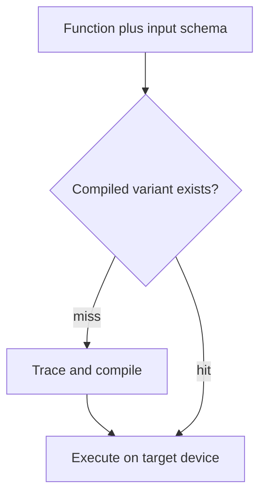

**Just-in-time (JIT) compilation** translates a program or function into an optimized executable during execution rather than producing every executable ahead of time. Machine-learning frameworks often stage a numerical function, inspect an abstract input schema, compile compatible operations for an accelerator, and cache the resulting executable. The first call can be expensive; later calls benefit only when their inputs match a reusable compiled variant.

## Compilation has an input schema

A compiled variant may depend on argument shapes, data types, selected static values, device placement, and compiler settings. Changing a batch from shape `[32, 512]` to `[7, 512]` can trigger another compilation even when the Python function is unchanged. Repeated shape churn can erase the speedup a benchmark reported for a stable, warmed-up batch.

Tracing a function for compilation also isn't the same as distributed request tracing. Compiler tracing captures operations and abstract values to build a program; observability tracing connects timed request spans across system perimeters.

## Example

A JAX training step wrapped with `jax.jit` receives a fixed `[32, 512]` token batch during warmup. Its first invocation traces the function, compiles the array program, and executes it. The next batch with a matching input schema can reuse that executable. A final batch with seven examples may produce a new variant and another visible compilation delay.

Padding the final batch to 32 rows and masking padded examples can preserve one stable input shape. When measuring performance, report compilation separately, warm up the intended variants, and wait for accelerator work to finish before stopping the timer.

## Why it matters here

Research-framework, kernel, and serving lessons rely on predictable execution specifications. Knowing when compilation happens prevents confusing one-time startup cost, accidental recompilation, asynchronous dispatch, and genuine accelerator throughput.

## Related terms

- [JAX](glossary://jax)
- [Data type](glossary://dtype)
- [CUDA kernel](glossary://cuda-kernel)
- [Fused kernel](glossary://fused-kernel)
