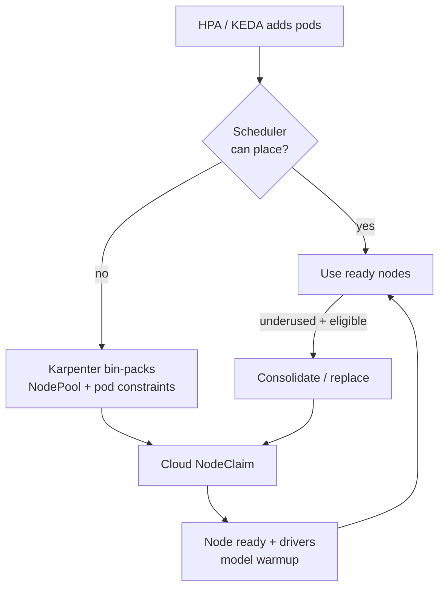

Karpenter is an open-source Kubernetes **node** autoscaler. It watches pods the kube-scheduler has marked unschedulable, bin-packs their CPU, memory, GPU, and other requests, and asks the cloud provider to launch (or later remove) instances that can run that batch. It does **not** scale pod replica counts; that is the job of HPA, KEDA, or a Deployment/Rollout controller.

AWS built the original project; the core is cloud-agnostic and runs as a controller in the cluster. On AWS the main CRs are `NodePool` (what kinds of nodes may exist and how they may be disrupted), a cloud `NodeClass` such as `EC2NodeClass` (AMI, subnets, security groups, IAM), and `NodeClaim` (one concrete provisioned node). Unlike the Kubernetes Cluster Autoscaler, which mostly grows and shrinks **fixed node groups**, Karpenter chooses instance types just-in-time from a wide offer set, without pre-defining a group per shape.

## Intuition

Two control loops sit under every GPU serving fleet:

1. **Pod scaling** (HPA / KEDA): "I need more replicas of this Deployment."
2. **Node provisioning** (Karpenter / Cluster Autoscaler): "Those pods have nowhere to sit."

Raising `replicas` with no free GPU nodes leaves pods `Pending`. Karpenter is the second loop: it turns scheduling constraints on the pod (resource requests, node selectors, taints/tolerations, topology) plus NodePool policy into a cloud API call that creates a matching machine.

## How it works

1. **Detect.** The default scheduler fails to place a pod and reports `PodScheduled=False` with reason `Unschedulable`. Dynamic NodePools provision from pending pod demand rather than CPU graphs or QPS. Static NodePools instead use `spec.replicas` to maintain a fixed node count even without pending pods.
2. **Batch and simulate.** Pending pods are grouped. Karpenter runs a scheduling simulation that respects resource requests, affinity, topology spread, PV topology, and DaemonSet overhead, then bin-packs pods onto candidate instance types.
3. **Pick capacity.** From the NodePool requirements (zones, arch, capacity type, instance family, GPU family, limits, weight), it selects offerings the cloud can still sell. On AWS, after packing onto the smallest viable type it typically considers a broader set of larger types and hands them to EC2 Fleet with a **price-capacity-optimized** strategy for Spot (lowest-price style behavior for on-demand).
4. **Launch and join.** A `NodeClaim` becomes a real VM, joins the cluster, and the normal scheduler places pods. Image pull, GPU driver DaemonSets, and model load still happen after the node exists.
5. **Disrupt later.** When demand falls or policy drifts, Karpenter can consolidate or replace nodes. NodePool budgets limit voluntary disruption; expiration and interruption follow different rules. PDBs govern graceful eviction, but a configured node termination deadline can override them.

### Core objects

| Object | Role |
|---|---|
| `NodePool` | Constraints, taints, expireAfter, consolidation, budgets; dynamic pools can limit CPU, memory, or GPU resources, while static pools use a node-count limit |
| `NodeClass` / `EC2NodeClass` | Provider plumbing: AMI selectors, subnets, security groups, instance profile, user data |
| `NodeClaim` | One launched node; tracks drift and lifecycle |

Multiple NodePools can isolate GPU fleets from general CPU workers, use different disruption aggressiveness, or pin teams to separate AMIs. For dynamic pools, higher `weight` expresses a scheduling preference; static pools cannot specify weight. Mutually exclusive taints and selectors avoid accidental dual matches.

### Disruption (scale-down and refresh)

Voluntary disruption is rate-limited by NodePool budgets (default `nodes: "10%"`). Percentage ceilings round up, then subtract deleting and NotReady nodes. Common methods:

- **Consolidation** (`WhenEmpty`, `WhenEmptyOrUnderutilized`, or `Balanced` in current versions): delete empty nodes, pack pods onto fewer nodes, or replace a node with a cheaper one when the simulation says it still fits. `Balanced` also weighs estimated savings against disruption.
- **Drift**: NodePool or NodeClass changed (AMI, requirements, etc.); replace drifted claims after budgets allow.
- **Expiration**: start draining after `expireAfter` (current default `720h`). Expiration proceeds independently of NodePool disruption budgets; without a termination deadline, blocking pods can keep draining from completing.
- **Interruption** (AWS): Spot reclamation warnings and some health events can trigger cordon/drain/replace before the instance dies.

Pods can block consolidation with `karpenter.sh/do-not-disrupt: "true"` or, in current versions, a duration measured from when the pod starts running. Drift can still select such a node when its NodeClaim has `terminationGracePeriod`. The annotation does not prevent expiration or interruption from starting; a configured termination deadline permits forced deletion of remaining pods, including PDB-protected pods. See the [disruption rules](https://karpenter.sh/docs/concepts/disruption/).

## Diagram



## Example

Interactive chat: KEDA scales a vLLM Deployment from 2 to 6 replicas because `vllm:num_requests_waiting` stays high. Each pod requests:

```yaml
resources:
  requests:
    cpu: "4"
    memory: 32Gi
    nvidia.com/gpu: "1"
  limits:
    nvidia.com/gpu: "1"
tolerations:
  - key: nvidia.com/gpu
    operator: Exists
    effect: NoSchedule
nodeSelector:
  karpenter.sh/nodepool: gpu-inference
```

Existing nodes already hold two g5-class instances; four pods stay Pending. A GPU NodePool allows single-GPU `g5` / `g6` types (or a wider multi-GPU allowlist if you pack several pods per host), on-demand (or Spot for batch), taints `nvidia.com/gpu=true:NoSchedule`, and a limit such as `nvidia.com/gpu: "16"`. Karpenter bin-packs the four pending pods (plus DaemonSet overhead for the GPU driver and metrics agents), launches four single-GPU instances under the sketch below (or fewer multi-GPU hosts if those types are allowed), waits for Ready, then the scheduler binds pods.

Illustrative capacity-planning budget; measure actual timings on the selected instance types:

| Stage | Example budget |
|---|---|
| Karpenter decide + cloud API | seconds |
| Instance boot + kubelet join | $1$–$3$ min |
| GPU driver / device plugin Ready | tens of seconds to a few minutes |
| Image pull (if cold) | $1$–$5$ min |
| Weight load + engine warmup | $1$–$10$+ min |

Pod autoscaling "success" at $t=0$ does not mean capacity at $t=0$. Until Ready and model-warm, protect SLOs with [backpressure](glossary://backpressure) and a warm min replica floor.

When traffic drops, consolidation with `WhenEmptyOrUnderutilized` may drain a half-empty GPU node. If weights stay resident only on warm nodes, aggressive consolidateAfter (for example `0s`) can reintroduce multi-minute [cold starts](glossary://cold-start). For inference NodePools, prefer longer `consolidateAfter`, `WhenEmpty` only, tighter budgets during business hours, or `karpenter.sh/do-not-disrupt` on long-lived serving pods.

Minimal GPU NodePool sketch (AWS-shaped; trim to your account and AMI). The allowlist starts at `g5.4xlarge`, which has one GPU and 64 GiB of host RAM. A `g5.xlarge` has only 16 GiB; a `g5.2xlarge` has 32 GiB before system and DaemonSet overhead, so neither fits this 32 GiB pod plus overhead. Confirm allocatable capacity in your AMI against the [AWS G5 specifications](https://aws.amazon.com/ec2/instance-types/g5/).

```yaml
apiVersion: karpenter.sh/v1
kind: NodePool
metadata:
  name: gpu-inference
spec:
  limits:
    nvidia.com/gpu: "16"
  disruption:
    consolidationPolicy: WhenEmpty
    consolidateAfter: 15m
    budgets:
      - nodes: "10%"
      # Block all voluntary disruption during business hours UTC
      - nodes: "0"
        schedule: "0 9 * * mon-fri"
        duration: 8h
  template:
    spec:
      nodeClassRef:
        group: karpenter.k8s.aws
        kind: EC2NodeClass
        name: gpu
      expireAfter: 720h
      taints:
        - key: nvidia.com/gpu
          value: "true"
          effect: NoSchedule
      requirements:
        - key: kubernetes.io/arch
          operator: In
          values: ["amd64"]
        - key: karpenter.sh/capacity-type
          operator: In
          values: ["on-demand"]
        - key: node.kubernetes.io/instance-type
          operator: In
          values: ["g5.4xlarge", "g5.8xlarge"]
```

## GPU-specific checks

Accelerator pods need more than `nvidia.com/gpu: 1` in the YAML:

- Instance family and GPU generation match the model (VRAM, CUDA capability, multi-GPU topology).
- Device plugin and driver DaemonSets run on the new node; a Ready node without a healthy GPU is still useless for inference.
- Taints/tolerations isolate GPU nodes from CPU cronjobs that would waste expensive capacity.
- Cloud quota and zonal capacity (especially Spot GPUs) often dominate failure modes.
- `startupTaints` for CNI or GPU init agents so Karpenter does not thrash extra nodes while temporary taints exist.
- Image size and weight path: node provision is only the first leg of cold start.
- Disruption policy: consolidating a warm multi-gigabyte model node to save a few dollars can cost minutes of TTFT on the next spike.

## Debug path

1. Confirm the pod is Pending for **Insufficient nvidia.com/gpu** (or similar), not CrashLoop, ImagePull, or readiness.
2. `kubectl describe pod` for failed scheduling messages; check requests, nodeSelector, affinity, tolerations, PVC zone.
3. Inspect Karpenter controller logs and events on the pod / NodeClaim / NodePool (`Unschedulable`, launch failures, insufficient capacity, limit exceeded).
4. Verify a matching NodePool exists, is Ready, weight and requirements overlap the pod, and `status.resources` is under `spec.limits`.
5. Check cloud provider: instance quotas, zonal GPU inventory, Spot capacity, IAM for the controller, subnet IP space.
6. After a node appears: device plugin, DCGM, drivers, then application readiness (weights loaded).
7. If nodes churn under load: consolidation policy, budgets, PDBs, `do-not-disrupt`, and preferred topology spreads that block packing.

## Trade-offs

| Choice | Gain | Cost / risk |
|---|---|---|
| Wide instance flexibility | Higher chance of Spot/on-demand fill, better packing | Less predictable GPU SKU and performance |
| Narrow GPU allowlist | Known VRAM and driver behavior | More Pending during capacity droughts |
| Aggressive consolidation | Lower idle GPU bill | Cold start and KV-cache loss on restarts |
| `WhenEmpty` only for serving | Stable warm capacity | Higher idle cost at trough |
| Spot for batch / eval | Large discount | Interruptions; need checkpointing and interruption handling |
| On-demand for interactive | Steadier supply | Higher continuous cost |
| Tight `limits.nvidia.com/gpu` | Bounds intended pool size | Scale-out stops at the limit; parallel, eventually consistent checks can temporarily overrun it |

Versus Cluster Autoscaler: Karpenter selects instance shapes without requiring a pre-baked node group per shape. Actual provisioning latency depends on the cloud and workload. You still own NodePool design (taints, limits, disruption); mis-set limits or missing startup taints can create repeated provisioning failures.

## Why it matters here

LLM and embedding services live on scarce accelerators. Curriculum work on GPU serving and autoscaling treats capacity as **two loops**: KEDA/HPA create pods; Karpenter (or equivalent) creates nodes. Understanding bin-packing, GPU NodePools, disruption budgets, and provision lag explains why replica metrics look healthy while TTFT still spikes, and why cost controls must not silently drain warm model memory.

## Related terms

- [Autoscaling](glossary://autoscaling)
- [KEDA](glossary://keda)
- [Kubernetes](glossary://kubernetes)
- [GPU](glossary://gpu)
- [Cold start](glossary://cold-start)
