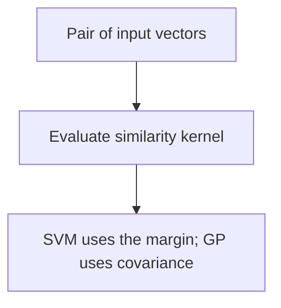

A kernel method learns from pairwise similarity values instead of requiring an explicit expanded feature representation. A valid positive-semidefinite kernel acts like an inner product in some possibly very high-dimensional feature space: $k(x,x')=\langle\phi(x),\phi(x')\rangle$. This lets algorithms express nonlinear behavior while evaluating similarities directly in the original input coordinates.

## Same similarity, different statistical meaning

A linear kernel uses the ordinary dot product. A polynomial kernel captures selected feature interactions, and a radial-basis-function kernel measures locality through distance. Support vector machines use kernel values to construct margin-based decision functions from support vectors. Gaussian processes interpret a kernel as covariance between unknown function values, producing a predictive distribution instead of only a separating score.

## Example

An exclusive-or dataset labels `(0,0)` and `(1,1)` as safe but `(0,1)` and `(1,0)` as review-required. No straight line separates those four points in the original plane. A radial kernel assigns high similarity to nearby examples and lower similarity to distant ones, allowing a nonlinear support-vector boundary around the positive cases. The same radial similarity can instead define how strongly a Gaussian-process regression prediction should borrow from nearby observations.

## Why it matters here

Kernels connect maximum-margin classification, similarity search, nonlinear feature maps, and uncertainty-aware regression. Understanding their shared mathematics prevents readers from assuming that every kernelized model has the same prediction target, probability interpretation, scaling cost, or behavior far from training data.

## Related terms

- [Radial basis function](glossary://radial-basis-function)
- [Support vector machine](glossary://support-vector-machine)
- [Gaussian process](glossary://gaussian-process)
