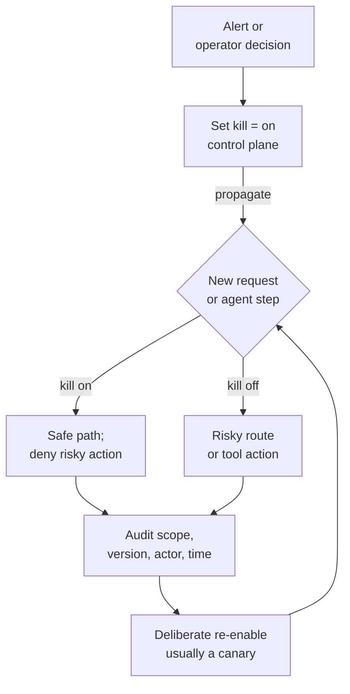

A **kill switch** is a runtime control that disables a feature, route, tool class, or third-party path **without deploying new code**, after the control state reaches its enforcement points. Someone (or an automated alert) flips a known control, eligible requests take the safe branch, and the risky path stops accepting new work within a measured propagation interval. Feature-flag platforms can implement kill switches as permanent operational flags, sometimes called circuit-breaker flags, built to shut off functionality under load, provider failure, or safety incidents.

A kill switch is narrower than a general [feature flag](glossary://feature-flag). Flags also power releases, experiments, and entitlements. A kill switch exists only to stop harm fast when normal deploy, review, or full [rollback](glossary://rollback) cannot catch up. It is also different from a [circuit breaker](glossary://circuit-breaker): the breaker opens itself from measured failure rates; the kill switch is a human (or alert-driven) decision that the path must stay off even if probes would succeed.

In AI products the unit you kill is rarely a UI widget. It is usually a model route, prompt version, retriever, tool pack, agent loop, or provider route. Those paths can spend tokens, move money, leak private text, or spawn sub-agents long after a bad deploy finished. The kill switch is how the [control plane](glossary://control-plane) stops that work while root-cause work continues offline.

## Intuition

A kill switch is a prewired emergency control separate from normal release and rollback paths. It must already exist, propagate within a measured interval, and have a tested safe branch before an incident starts.

| Control | Who trips it | Typical question |
|---|---|---|
| **Release flag** | Product / deploy process | "Is this ready for users?" |
| **Canary / traffic split** | Rollout automation | "Is the small cohort healthy?" |
| **Circuit breaker** | Failure-rate metrics | "Is this dependency sick right now?" |
| **Kill switch** | Operator or alert policy | "Should this path stay off until we say otherwise?" |

Maintain kill switches as part of the permanent safety controls. Keep the set small, name each switch for the *hazard it stops* (for example `kill_tool_model_promotion`), and practice activating it before an incident.

## How it works

A production kill switch is a short loop across control plane and data plane:

1. **Prewire the branch.** Before the risky path ships, wrap it so both the live path and the safe path exist in the binary. The off path must be real: previous answer path, read-only mode, controlled error, or [fail-closed](glossary://fail-closed) deny, not a half-implemented stub.
2. **Store desired state outside the request.** A flag service, config DB, or ops console owns the boolean (or multivariate "off / read-only / legacy") value. Prefer permanent flags for kill switches; temporary release flags get deleted and leave you without a lever.
3. **Propagate with a known freshness SLA.** Workers, gateways, and agent runtimes pull or subscribe. Stale local caches are a first-class failure mode: a 5-minute SDK poll means "flip" is not "fleet-wide stop."
4. **Enforce on every new unit of work.** Gate *new* tool calls, agent steps, and provider routes. Decide separately what happens to in-flight multi-step jobs (cancel, finish current step, drain with no new side effects).
5. **Audit and re-enable deliberately.** Log who flipped, when, why, config version, and which tenants or routes were affected. Re-enable is a second deliberate act, often with a canary, not an automatic half-open probe.

### Polarity and defaults

Naming polarity matters. Two common conventions:

- **Positive enable:** `if flags.is_enabled("tool_calling_v2"): run_agent()` with default **off**. Safe under flag-service outage if default is off, but a fully launched feature needs the flag permanently **on** until you invert the code.
- **Kill-on-true:** `if flags.is_enabled("kill_tool_model_promotion"): deny()` with default **false** (feature runs). Outage keeps promotions running unless you also fail closed on missing policy for high-risk tools.

For money-moving or destructive tools, prefer fail-closed on policy or allowlist errors *and* a dedicated kill switch that can force deny even when the feature is "fully released." Do not rely on inverted release flags that confuse operators about whether **enabled** means **feature on** or **feature dead**.

### Scope

Prefer scoped switches over a single "AI off" megatoggle:

| Scope | Stops | Still works |
|---|---|---|
| One tool class | Model promotion, deletes, external messages | Read tools, draft answers |
| One provider route | Calls to provider A | Fallback provider B |
| One model / prompt alias | Candidate generation path | Stable alias |
| One tenant or region | Blast radius of a bad tenant config | Rest of fleet |
| Agent multi-step | New planner steps / sub-agents | Single-turn answers |

Global "disable all generation" is a last resort. Scoped kills keep the product usable while you contain the hazard.

## Diagram



## Example

A release assistant ships with tools `promote_model` and `update_model_alias`. In the first hour after rollout, audit failures spike: the model invents checkpoint ids that pass a loose schema and change production routing.

Predeclared kill switches (already drilled in staging):

| Switch | Off behavior |
|---|---|
| `kill_tool_promote_model` | Tool returns structured deny; model must explain that promotion is paused |
| `kill_agent_multistep` | Force single-turn answer path; no planner loop |
| `kill_provider_route_b` | Pin traffic to provider A only |

Incident command flips `kill_tool_promote_model` first. Within the measured flag-propagation window, new promotion calls stop. Read tools and draft release notes still work. Concurrently, open agent runs finish the current read-only step but cannot schedule a new promotion. Metrics to watch after the flip:

- promotion tool invocation rate $\to 0$ for new sessions
- model-router change rate and rejected promotion count
- release-assistant answer success rate (should stay up on the degraded path)
- flag evaluation reason tags (`kill_on`, override, default)

```python
def maybe_run_tool(name, args, ctx, flags):
    if flags.bool("kill_tool_promote_model", default=False) and name == "promote_model":
        audit("kill_switch_block", tool=name, actor=ctx.operator, version=flags.version)
        return ToolResult(ok=False, error="model_promotion_disabled_by_kill_switch")

    if flags.bool("kill_agent_multistep", default=False) and ctx.step_index > 0:
        return ToolResult(ok=False, error="multistep_disabled_by_kill_switch")

    if name not in ctx.action_allowlist:
        return ToolResult(ok=False, error="not_allowlisted")  # fail closed on allowlist

    return execute_tool(name, args, ctx)
```

If promotion was the only broken surface, leave multistep on and kill only that tool. If the planner keeps inventing other write actions, flip `kill_agent_multistep` next. Re-enable only after a fix, a staged canary, and a clear owner.

## Production failure modes

- **Never wired.** The risky path shipped without a branch. At incident time the only option is deploy or traffic-level blackhole of the whole service.
- **Untested off path.** Kill flips, then the "safe" path 500s, loops, or silently no-ops without user-visible message. Drill the off path in staging and game days.
- **Stale propagation.** Local cache TTL is minutes; operators believe the fleet is safe while stragglers still promote models. Measure and alert on config age.
- **In-flight and multi-agent work.** Killing the parent session does not recall sub-agents, webhooks already fired, or jobs already on a queue. Pair kill switches with cancellation tokens, lease revocation, and queue drains.
- **Wrong polarity under outage.** Flag service down + default "feature on" for a high-risk tool equals fail open. High-risk tools should deny when policy state is unknown.
- **No audit.** Without who/when/version on the flip and on each blocked action, you cannot reconstruct the incident or prove containment.
- **Megatoggle only.** "Disable all AI" stops the product and discourages operators from using the control. Prefer scoped switches and verify them in drills.

## Trade-offs

| Choice | Upside | Cost |
|---|---|---|
| Permanent kill flags | Always available under incident | Inventory to maintain and review |
| Many fine-grained kills | Surgical containment | More names, more drills, more branch tests |
| One global AI off | Simple mental model | Huge availability hit; rarely practiced |
| Auto-flip from alerts | Faster than paging humans | False positives can amputate healthy paths |
| Manual-only flip | Human judgment on ambiguous quality bugs | Minutes of damage while on-call wakes up |
| Hard deny when killed | Clear fail-closed safety | User-visible degradation |
| Silent legacy fallback | UX continuity | Harder to see that containment happened |

Auto-kill from metrics works best for clear reliability signals (error rate, timeout storm, spend cap). Quality and safety regressions often need a human because the signal is noisier; pre-authorize who can flip which switch under [incident command](glossary://incident-command).

## Why it matters here

LLM and agent systems fail in partial, surprising ways: a tool schema is loose, a provider region dies, a prompt change increases jailbreak success, a multi-agent graph keeps spending after the parent looks "stopped." Deploy pipelines and full rollbacks are too slow for that shape of risk. Kill switches give operators a fast, reversible, audited way to contain blast radius on tools, routes, models, and agent loops while the last known-good path keeps answering. Without them, every AI launch bets that the next hour of production will only need a normal deploy to recover.

## Related terms

- [Feature flag](glossary://feature-flag)
- [Circuit breaker](glossary://circuit-breaker)
- [Fail closed](glossary://fail-closed)
- [Incident command](glossary://incident-command)
- [Canary rollout](glossary://canary-rollout)
