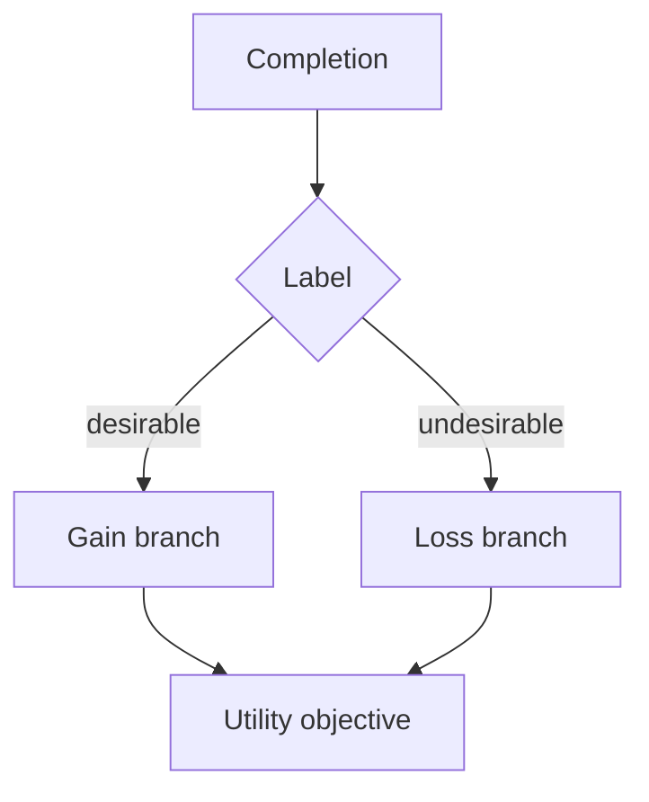

**Kahneman-Tversky Optimization (KTO)** aligns a language model from prompt/completion examples labeled desirable or undesirable. Unlike pairwise [DPO](glossary://dpo), each example can be labeled independently, so the dataset doesn't need a matched chosen/rejected pair for every prompt.

KTO builds a reference-relative reward-like signal from the completion log-probability ratio to a frozen reference policy. It centers that signal on a KL-derived reference point and applies separate sigmoid utility branches for desirable and undesirable completions. The class weights and reference point affect the objective; KTO does not fit a separate reward model. See the [original paper](https://arxiv.org/abs/2402.01306).

## When it fits

- Feedback naturally arrives as thumbs-up/down.
- Positive and negative examples aren't paired.
- Pair collection is expensive.

## Failure modes

Class imbalance can dominate objective. Reference-point and branch weights change behavior. Binary labels contain less comparative information than carefully matched pairs, so slice coverage and calibration matter.

## Example

Production feedback contains 8,000 helpful and 2,000 unhelpful responses without matched pairs. KTO can train from labels directly, provided class weights and slice coverage are controlled.

## Why it matters here

KTO expands alignment options when paired preferences are unavailable. Learning recovery from a policy's own mistakes requires online environment interaction.

## Related terms

- [DPO](glossary://dpo)
- [Preference data](glossary://preference-data)
- [Reward model](glossary://reward-model)
- [Offline evaluation](glossary://offline-evaluation)
