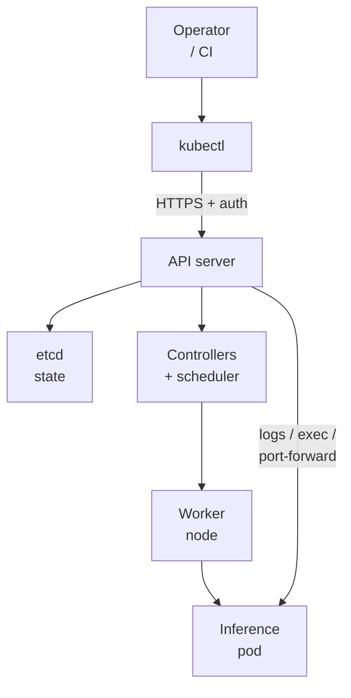

`kubectl` is the primary command-line client for a [Kubernetes](glossary://kubernetes) cluster. It talks to the cluster [control plane](glossary://control-plane) through the Kubernetes API: create and update objects from manifests, list and describe resources, stream container logs, exec into pods, port-forward, and manage Deployments and other rollouts. It does not schedule pods itself. Cluster operations make authenticated API requests; mutations can persist desired state for controllers to reconcile, while reads and debugging streams need not change it. Commands such as `kubectl config` can operate on local configuration without contacting a cluster.

Official docs phrase it simply: Kubernetes provides a command-line tool for communicating with a cluster's control plane using the Kubernetes API, and that tool is named `kubectl`. Other clients (Go/Python client libraries, dashboards, GitOps operators) use the same API; `kubectl` is the human-facing, script-friendly surface most operators live in day to day.

## Intuition

`kubectl` reads and mutates Kubernetes state through the API server. Desired state such as Deployments, Services, probes, and GPU requests lives in that API; controllers place work on nodes. For AI stacks the operating questions are concrete: is the GPU pod Pending or Ready? Did the model image roll out? Why did TTFT spike after deployment? What did the container log when CUDA initialization failed?

Without `kubectl` (or an equivalent API client), you are guessing from application metrics alone. Metrics show symptoms; `describe`, Events, and `logs` show whether the platform never scheduled a GPU, never marked the pod Ready, or never selected the new revision for traffic.

## How it works

1. **Discover config.** Outside the cluster, `kubectl` loads kubeconfig (default `$HOME/.kube/config`, or `KUBECONFIG` / `--kubeconfig`). A **context** is a named tuple of cluster endpoint, user credentials, and default namespace. Switch with `kubectl config use-context`. Inside a pod (CI job, debug sidecar), it can use in-cluster auth: ServiceAccount token at `/var/run/secrets/kubernetes.io/serviceaccount/token` plus `KUBERNETES_SERVICE_HOST` / `KUBERNETES_SERVICE_PORT`.
2. **Authenticate and authorize.** Credentials in the context (cert, token, exec plugin, cloud IAM helper) prove who you are. The API server enforces [RBAC](glossary://rbac): Role/ClusterRole bindings decide what you may get, list, create, patch, or delete.
3. **Map command → API.** Syntax is `kubectl [command] [TYPE] [NAME] [flags]`. Types accept short names (`po`, `deploy`, `svc`). `get` lists; `describe` builds a human report including related Events; `apply -f` declarative-merges file or stdin into live objects; `logs` / `exec` / `port-forward` open streaming connections for debug.
4. **Control plane does the rest.** Controllers and the scheduler react to the stored object. Your shell only sees the API response. Waiting for "pods Ready" is waiting for reconciliation, image pull, GPU attach, weight load, and readiness probes, not for `kubectl` itself to "finish deploying."

Version skew policy: the client minor version is supported within $\pm 1$ of each API server minor (for example `kubectl` v1.32 with API servers 1.31 to 1.33). During an HA control-plane upgrade, it must satisfy that bound for all API servers it can contact. Wider skew is unsupported and can produce errors or missing fields.

Declarative `apply` of version-controlled YAML (or Kustomize / Helm-rendered manifests) is the production path: reviewable, repeatable, GitOps-friendly. Imperative `create` / `run` / live `edit` are fine for experiments; they are harder to audit when the serving stack breaks at 2 a.m.

## Diagram



## Example

Ship a vLLM-style Deployment `llm-serve` in namespace `inference`, then verify the revision is actually serving before you blame the model.

```bash
# Who am I talking to? Wrong context is a classic outage amplifier.
kubectl config current-context
kubectl config set-context --current --namespace=inference

# Desired vs observed: replicas, image, rollout progress
kubectl get deploy llm-serve -o wide
kubectl rollout status deploy/llm-serve --timeout=5m
kubectl rollout history deploy/llm-serve

# Pod phase, node, restarts; Pending often means GPU/PVC/scheduling
kubectl get pods -l app=llm-serve -o wide
kubectl describe pod -l app=llm-serve | sed -n '/Events/,$p'

# Application truth: weight load, CUDA, tokenizer, OOM
kubectl logs -f deploy/llm-serve --tail=200
kubectl logs deploy/llm-serve --previous   # last crashed container

# Only Ready pods should back the Service
kubectl get endpointslices -l kubernetes.io/service-name=llm-serve
kubectl get svc llm-serve -o wide

# Review drift, then apply a reviewed change (prefer over ad-hoc live edits)
kubectl diff -f serve.yaml
kubectl apply -f serve.yaml
```

A pending GPU pod almost always shows first in `describe` Events (`FailedScheduling`, insufficient `nvidia.com/gpu`, node selector / taint mismatch, PVC not bound), not in Prometheus latency panels. A pod can be `Running` while still not Ready: multi-GB weights loading, CUDA warmup, or a readiness probe that hits `/health` before the engine accepts traffic. Users see timeouts; `kubectl get pods` looks "fine" until you read `READY 0/1`.

JSONPath and scripted output turn the same client into automation:

```bash
kubectl get pods -l app=llm-serve \
  -o jsonpath='{range .items[*]}{.metadata.name}{"\t"}{.status.phase}{"\t"}{.spec.nodeName}{"\n"}{end}'
```

## Debug path for model serving

Work top-down from desired state to traffic path:

1. **Context and RBAC.** Confirm cluster, namespace, and that you can read pods/events (`kubectl auth can-i get pods -n inference`).
2. **Deployment / rollout.** Desired replicas, image digest/tag, `rollout status`, stuck `Progressing` vs `Available`.
3. **Pod phase and Events.** `Pending` → scheduling/GPU/PVC; `ImagePullBackOff` → registry/auth/tag; `CrashLoopBackOff` → entrypoint/OOM/CUDA; `Running` with `0/1 Ready` → probes and app warmup.
4. **Logs (current and `--previous`).** OOM kills, missing tokenizer artifacts, CUDA driver/userland mismatch, failed model fetch.
5. **Service and endpoints.** For a selector-based Service, check matching pod labels, namespace, and EndpointSlice readiness. Empty endpoints can indicate a selector mismatch, missing matching pods, or readiness failures. `publishNotReadyAddresses` can also expose unready pods; verify the Service's policy before relying on Ready-only routing.
6. **Node and GPU.** `kubectl describe node` for allocatable `nvidia.com/gpu`, taints, and pressure; correlate with [cold start](glossary://cold-start) when new GPU nodes or large image pulls dominate scale-up lag.

Production issues often come from misread signals: wrong context, watching the wrong namespace, trusting `Running` over Ready, or changing live objects so Git no longer matches the cluster. Prefer `apply` of reviewed manifests; use `diff` before large deploys; keep secrets out of command history (`kubectl set env` with pasted keys is a common leak path).

## Safety habits

- Scope by namespace by default so a typo does not hit every tenant.
- Prefer least-privilege kubeconfig contexts and short-lived credentials; cluster-admin on a laptop is a blast-radius problem.
- Do not bake production secrets into manifests you `apply` from a shared laptop; use cluster [secrets management](glossary://secrets-management) and mount or inject them.
- Treat `exec` and interactive shells as break-glass: great for one-off diagnosis, poor as a permanent ops path.
- Keep client version within the supported skew of the control plane.

## Why it matters here

LLM APIs, retrieval workers, eval jobs, and GPU serving stacks commonly run on Kubernetes. `kubectl` is the bridge between "the model is wrong" and "the platform never scheduled a GPU, never finished loading weights, or never put the new revision behind the Service." Curriculum work on deployment, rollouts, and observability assumes you can move from latency charts to pod Events and container logs in one loop.

## Related terms

- [Kubernetes](glossary://kubernetes)
- [Control plane](glossary://control-plane)
- [Container image](glossary://container-image)
- [Cold start](glossary://cold-start)
- [Observability](glossary://observability)
