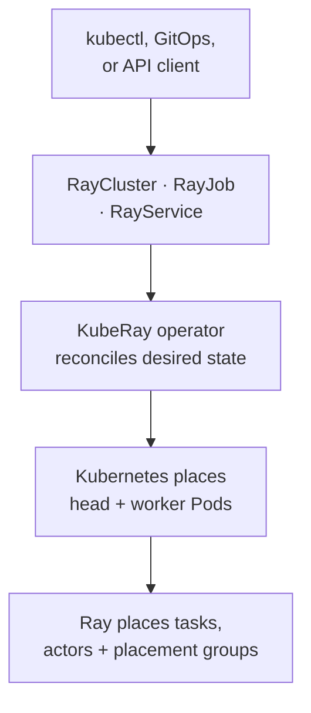

**KubeRay** is the Kubernetes operator and toolkit for running [Ray](glossary://ray) clusters and applications. It extends the [Kubernetes](glossary://kubernetes) API with three custom resource definitions (CRDs), then continuously reconciles those resources into Ray head Pods, worker Pods, Services, and lifecycle actions.

KubeRay manages cluster infrastructure around Ray. Ray still schedules tasks, actors, and placement groups inside the cluster; Kubernetes still schedules Pods onto machines. Keeping those partitions separate makes most placement and scaling failures much easier to diagnose.

## Three custom resources

| Resource | Use it for | What KubeRay owns |
| --- | --- | --- |
| `RayCluster` | A long-lived or directly managed Ray cluster | Head Pod, worker groups, Services, scaling bounds, cluster lifecycle |
| `RayJob` | A finite batch job such as training, evaluation, or data processing | Ray cluster creation, job submission after readiness, job status, optional cleanup |
| `RayService` | A continuously served Ray Serve application | Ray cluster plus Serve application, health reconciliation, upgrades, Kubernetes Service |

`RayCluster` is the primitive underneath the other two. Choose `RayJob` when completion is part of The schema. Choose `RayService` when a Serve application needs a stable service lifecycle and managed upgrades. Use a bare `RayCluster` when another system owns job submission or several workloads intentionally share one cluster.

## Control loops and schedulers

Three independent systems make decisions:

1. **KubeRay operator** watches Ray CRDs and reconciles Kubernetes objects.
2. **Kubernetes scheduler** places head and worker Pods on nodes according to resources, affinity, selectors, and taints.
3. **Ray scheduler** places tasks and actors on Ray nodes according to logical CPU, GPU, custom-resource, and placement-group requests.

KubeRay can request eight GPU worker Pods without proving eight suitable GPUs exist. Kubernetes may leave those Pods `Pending`. Conversely, all Pods can be `Running` while Ray leaves an actor pending because its logical resource request or placement-group topology cannot be satisfied.

## Diagram



## Example

A finite GPU evaluation should usually run as a `RayJob`, with a shared cluster reserved for workloads that need persistent capacity. This trimmed manifest shows the ownership perimeter; production manifests also need images, volumes, security settings, probes, and network policy.

```yaml
apiVersion: ray.io/v1
kind: RayJob
metadata:
  name: model-eval
spec:
  entrypoint: python /app/evaluate.py
  shutdownAfterJobFinishes: true
  rayClusterSpec:
    rayVersion: "<pinned-ray-version>"
    enableInTreeAutoscaling: true
    headGroupSpec:
      rayStartParams: {}
      template:
        spec:
          containers:
            - name: ray-head
              image: registry.example.com/ray-eval@sha256:<digest>
    workerGroupSpecs:
      - groupName: gpu-workers
        replicas: 0
        minReplicas: 0
        maxReplicas: 8
        rayStartParams: {}
        template:
          spec:
            containers:
              - name: ray-worker
                image: registry.example.com/ray-eval@sha256:<digest>
                resources:
                  limits:
                    nvidia.com/gpu: "1"
```

Operationally, follow state through both APIs:

```bash
kubectl get rayjobs,rayclusters,pods
kubectl describe rayjob model-eval
kubectl get events --sort-by=.lastTimestamp
kubectl logs deploy/kuberay-operator

# Run from the Ray head Pod when Kubernetes objects look healthy.
ray status
```

The Kubernetes commands answer whether desired Pods exist and can run. `ray status` answers whether Ray sees their resources and can schedule the submitted work.

## Autoscaling chain

KubeRay autoscaling spans separate layers:

1. Ray tasks, actors, or placement groups create logical resource demand.
2. Ray Autoscaler, usually a sidecar in the head Pod, adjusts desired worker replicas in the `RayCluster`.
3. KubeRay creates or deletes worker Pods to match that desired count.
4. Kubernetes schedules those Pods. If cluster capacity is missing, a Kubernetes node autoscaler may provision nodes.

Ray Autoscaler reacts primarily to Ray resource demand, not raw GPU utilization. A GPU at 10 percent utilization does not by itself request scale-down if a reserved actor still owns that logical GPU. A queue of pending GPU actors can request more workers even before physical GPU utilization rises.

Ray Serve adds another loop: Serve replica autoscaling can create actor demand, which can trigger Ray worker scaling, which can then trigger Kubernetes node scaling. Each layer needs its own limits, cooldowns, readiness checks, and observability.

## Debug path

| Symptom | Inspect first | Likely perimeter |
| --- | --- | --- |
| CRD is accepted but no head Pod appears | KubeRay operator logs and CR status conditions | Operator reconciliation, RBAC, invalid Pod template |
| Worker Pods remain `Pending` | Pod events, allocatable GPUs, selectors, taints, PVCs | Kubernetes scheduling or node capacity |
| Pods run but Ray actors remain pending | `ray status`, custom resources, placement groups | Ray logical scheduling |
| Scale-out stalls | Ray demand, desired worker replicas, Pod events, node autoscaler | One of three scaling loops stopped handing off |
| RayService upgrade never becomes healthy | RayService status, Serve status, readiness, application logs | New Ray cluster or Serve deployment failed health checks |
| Recreated cluster lost in-flight work | Ray object and actor durability, external checkpoints | Infrastructure recovered; application state did not |

Operator health, cluster health, and application health are different claims. A healthy KubeRay controller can faithfully create a broken image. A healthy Kubernetes Pod can host a Ray process that lacks required logical resources. A healthy Ray cluster can still run an incorrect training or serving application.

## Why it matters here

KubeRay often supplies the outer lifecycle for distributed AI systems: learners, rollout engines, environment workers, judges, data pipelines, and Serve applications. It can enforce Kubernetes placement constraints and create Ray clusters, but it cannot infer the communication topology required by Megatron, NCCL, or a multi-GPU inference engine. Kubernetes affinity and node labels must align with Ray placement groups and framework rank groups.

That distinction prevents a common systems mistake: treating successful actor placement as proof that high-bandwidth GPU collectives remain inside the intended NVLink or rack perimeter.

## Official references

- [Ray on Kubernetes](https://docs.ray.io/en/latest/cluster/kubernetes/index.html)
- [KubeRay project](https://github.com/ray-project/kuberay)
- [KubeRay autoscaling](https://docs.ray.io/en/latest/cluster/kubernetes/user-guides/configuring-autoscaling.html)
- [Kubernetes operator pattern](https://kubernetes.io/docs/concepts/extend-kubernetes/operator/)

## Related terms

- [Ray](glossary://ray)
- [Kubernetes](glossary://kubernetes)
- [Control plane](glossary://control-plane)
- [Autoscaling](glossary://autoscaling)
- [GPU](glossary://gpu)
- [NCCL](glossary://nccl)
