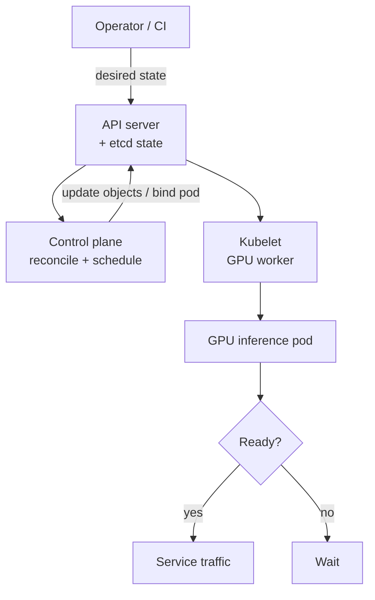

Kubernetes (often abbreviated **K8s**) is an open source platform for running containerized workloads across a cluster of machines with declarative configuration and continuous automation. You describe *desired* state: how many replicas, which image, CPU/memory/GPU requests, health probes, and how traffic should reach pods. Controllers continuously reconcile *current* cluster state toward that description.

The name comes from Greek for helmsman or pilot; the "8" stands for the eight letters between K and s. Google open sourced the project in 2014, drawing on production experience from internal systems such as Borg. Kubernetes provides a portable control layer for placing containers on nodes, restarting failures, rolling out versions, discovering services, and scaling capacity. Build pipelines, application middleware, and managed platform services can sit around that layer.

For AI/ML and LLM work, Kubernetes is the usual place where inference APIs, embedding workers, retrieval services, eval runners, and training jobs share networking, secrets, GPU nodes, and rollout policy. Packaging still starts with a [container image](glossary://container-image); Kubernetes decides *where* those images run, *how many* run, and *when* they receive traffic.

## Intuition

Docker (or another OCI runtime) runs one container well on one host. Kubernetes runs fleets: place pods on free capacity, replace dead ones, drain nodes, shift traffic during rollouts, and scale replica counts when demand changes. Its control loops independently reconcile cluster state toward the manifests you applied.

A thermostat illustrates reconciliation: you set the temperature (desired state), sensors read the room (current state), and the controller turns heat on or off until they match, then keeps watching. A Deployment that should have three Ready GPU pods follows the same loop: if one dies or a node disappears, the system creates a replacement. It restores the state you declared. If readiness never waits for model weights, Kubernetes will send traffic to a pod that is still loading 40 GB of parameters.

## How it works

### Control plane and nodes

A cluster has two layers:

| Layer | Typical components | Job |
| --- | --- | --- |
| **Control plane** | API server, etcd, scheduler, controller manager | Store desired/observed state, schedule pods, run reconciliation |
| **Worker nodes** | kubelet, container runtime (often containerd), kube-proxy / CNI | Run pods, report status, enforce local resource limits |

You (or CI) talk to the **API server** with [kubectl](glossary://kubectl) or a client library. Objects are stored in **etcd**. The **scheduler** binds new pods to nodes that have enough free resources and match selectors, taints/tolerations, and affinity rules. Controllers (Deployment, ReplicaSet, Job, endpoints, and many others) watch the API and create, update, or delete objects until observed state matches the spec. Node agents (kubelet) pull images, start containers, run probes, and report pod status back.

That split is the cluster form of a [control plane](glossary://control-plane) vs data plane: the control plane decides placement and desired counts; worker nodes run the GPU processes that actually prefill and decode.

### Reconciliation

Each controller is a non-terminating loop:

1. **Observe** current objects and status (from the API).
2. **Diff** against desired state in the object's `spec`.
3. **Act** by writing to the API (create a Pod, update a Service endpoint list, mark a Job complete) or by driving an external system (for example, a node autoscaler that calls a cloud API).

Controllers are level-based: they care about "is desired equal to current?" more than about replaying every event in order. Desired state can keep changing under load; the cluster does not need a single global "stable" moment as long as loops keep making useful progress.

### Core objects for serving

| Object | Role in an LLM stack |
| --- | --- |
| **Pod** | Smallest deployable unit: one or more containers that share network namespace (for example, vLLM + a metrics sidecar) |
| **Deployment** | Desired replica count, image, rollout strategy for long-running servers |
| **Service** | Stable discovery and routing; a normal selector-based ClusterIP Service routes to Ready endpoints unless configured to publish unready addresses |
| **ConfigMap / Secret** | Non-secret and secret configuration injected as env or files |
| **PVC / volume** | Shared model cache, tokenizer files, or scratch for large downloads |
| **HPA / KEDA ScaledObject** | Replica count driven by metrics or queue depth ([autoscaling](glossary://autoscaling)) |
| **Job / CronJob** | Finite batch: evals, backfills, offline embedding runs |

GPU capacity is usually advertised by a **device plugin** (commonly NVIDIA's) as an extended resource such as `nvidia.com/gpu`. The default plugin exposes whole GPU units through matching `requests` and `limits`; configure MIG, time-slicing, or a specialized scheduler for fractional sharing.

### Probes matter more than phase

The kubelet can run three kinds of health checks:

- **Startup probe**: allows a long model load before other probes run.
- **Readiness probe**: controls eligibility for normal Service traffic, together with readiness gates; `publishNotReadyAddresses` deliberately bypasses this default.
- **Liveness probe**: repeated failure restarts the container; keep slow model loading from triggering a restart loop by using startup and readiness probes appropriately.

A pod can be `Running` while the model is still mapping weights into VRAM. Until readiness (and any readiness gates) succeed, the pod should stay out of Service endpoints. For LLM servers, readiness must mean "accepting inference," not "process has a PID."

## Diagram



## Example

Serve a chat model with two warm replicas on GPU nodes, weights mounted from a shared cache, and readiness that waits until the engine reports healthy. This manifest is a sketch: replace the image digest, use a GPU product label that your cluster advertises, and provide a PVC whose access mode and topology allow both replicas to mount it.

```yaml
apiVersion: apps/v1
kind: Deployment
metadata:
  name: llm-serve
  namespace: inference
spec:
  replicas: 2
  selector:
    matchLabels:
      app: llm-serve
  template:
    metadata:
      labels:
        app: llm-serve
    spec:
      nodeSelector:
        nvidia.com/gpu.product: NVIDIA-A10
      containers:
        - name: engine
          image: registry.example.com/vllm@sha256:<full-image-digest>
          # Assumes an image whose entrypoint starts the vLLM API server.
          args: ["--model", "/models/llama-3-8b-instruct"]
          ports:
            - containerPort: 8000
          resources:
            requests:
              cpu: "4"
              memory: 32Gi
              nvidia.com/gpu: "1"
            limits:
              cpu: "8"
              memory: 48Gi
              nvidia.com/gpu: "1"
          volumeMounts:
            - name: model-cache
              mountPath: /models
              readOnly: true
          startupProbe:
            httpGet:
              path: /health
              port: 8000
            failureThreshold: 60
            periodSeconds: 10
          readinessProbe:
            httpGet:
              path: /health
              port: 8000
            periodSeconds: 5
          livenessProbe:
            httpGet:
              path: /health
              port: 8000
            periodSeconds: 20
            failureThreshold: 3
      volumes:
        - name: model-cache
          persistentVolumeClaim:
            claimName: model-cache-ro
---
apiVersion: v1
kind: Service
metadata:
  name: llm-serve
  namespace: inference
spec:
  selector:
    app: llm-serve
  ports:
    - port: 80
      targetPort: 8000
```

A separate embedding Deployment can scale from queue depth with [KEDA](glossary://keda) while sharing the same cluster DNS, secret plumbing, and network policy. Interactive chat stays at `minReplicas > 0` so [cold starts](glossary://cold-start) do not hit every morning spike; batch workers may scale to zero when the queue is empty.

During a rolling update to a new image digest, the Deployment creates new pods, waits for readiness (weights loaded), then terminates old ones. Clients using the Service only see Ready endpoints, so a half-loaded replica should not take chat traffic.

## What fails in production

| Symptom | Cluster truth | Typical fix |
| --- | --- | --- |
| Timeouts while pods look `Running` | Not Ready, or readiness too weak (HTTP 200 before weights load) | Startup + readiness that require engine-ready; check Endpoints |
| Pods stuck `Pending` | No free `nvidia.com/gpu`, wrong nodeSelector/taints, PVC unbound | Free GPUs, fix selectors, node autoscaler / [Karpenter](glossary://karpenter) |
| `OOMKilled` after load | Host RAM exceeds the container's memory limit | Inspect host-memory usage and raise or reduce it appropriately |
| CUDA out-of-memory error | VRAM cannot fit weights, KV cache, or temporary buffers | Reduce concurrency/context, change model precision, or use GPUs with more VRAM; raising host RAM limits does not add VRAM |
| Rollout hangs | New pods never Ready; maxUnavailable / surge too tight | Fix probe or image; watch `kubectl rollout status` |
| Traffic to bad revision | Service selected wrong labels; canary without traffic split | Label discipline; explicit canary Service or mesh weights |
| Scale-out does nothing useful | HPA raised replicas but pods cannot schedule | Treat node supply and pod count as two loops |

Debug with a short loop: Deployment desired vs available → Pod phase and events → probe failures and container logs → GPU allocatable on nodes → Service Endpoints → only then model quality. Many "model is broken" pages are Pending GPUs, missing tokenizer files in the image, or readiness that flipped too early.

## Trade-offs

Kubernetes buys portable declarative ops, dense multi-tenant packing, and a huge ecosystem (device plugins, GPU Operators, HPA/KEDA, service meshes). It costs operational surface: control-plane health, CNI, storage, RBAC, image pull rate limits, and GPU driver/device-plugin compatibility. Managed serverless (for example Cloud Run) can be enough for CPU APIs and light models; multi-GPU serving, custom metrics scaling, and mixed online/batch fleets usually land on Kubernetes or a managed Kubernetes service.

Declare GPU class, memory headroom for KV cache, probe semantics, and weight delivery (bake vs mount vs fetch) in the same manifests that set replica count. Orchestration without those application facts only automates the wrong desired state.

## Why it matters here

Curriculum and production LLM systems both sit on clusters more often than on single hosts: chat gateways, vLLM or TGI deployments, embedding queues, RAG sidecars, and eval Jobs. Understanding reconciliation, scheduling, and readiness connects user-facing TTFT and error rates to cluster objects as well as model weights. Capacity, rollout, or GPU failures often trace to desired state or probes, so inspect those alongside transformer behavior.

## Related terms

- [KubeRay](glossary://kuberay)
- [kubectl](glossary://kubectl)
- [Container image](glossary://container-image)
- [Docker](glossary://docker)
- [Autoscaling](glossary://autoscaling)
- [Cold start](glossary://cold-start)
