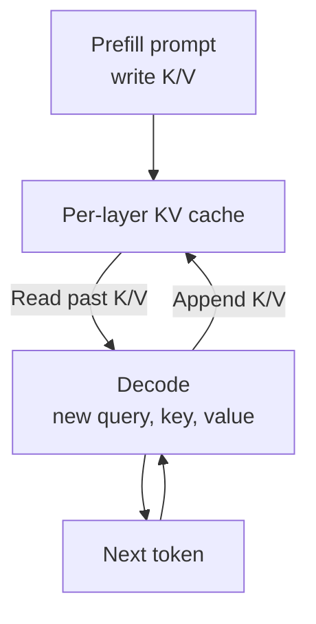

A **key-value (KV) cache** stores the attention **keys** and **values** for tokens already processed so autoregressive generation can reuse them instead of recomputing the whole prefix on every new token. Queries are recomputed for the current token; past $K$ and $V$ are loaded from memory.

Without a cache, step $t$ of generation re-runs the full forward pass over tokens $1..t$. With a cache, the model projects only the new token, appends its $K$/$V$ slices, and attends the new query against the stored history. That trades repeated compute for a memory footprint that grows with sequence length, layers, KV heads, and concurrent requests.

## Intuition

In [self-attention](glossary://self-attention), each position produces three vectors: query $q$, key $k$, and value $v$. At generation time the sequence is causal: token $t$ may attend only to positions $\le t$. Once token $j$ has been processed, its $k_j$ and $v_j$ at a given layer no longer change while the model, positions, and prefix stay fixed. That representation depends on earlier context as well as the token itself, but not on future tokens.

So the expensive part of "look at everything before me" can be staged:

1. **Write once:** compute and store $k_j, v_j$ when position $j$ first appears (prompt prefill or a prior decode step).
2. **Read many times:** every later step streams those stored vectors and scores the new $q_t$ against them.

Queries are **not** cached in the same way: only the current token's query is needed for the next prediction. Each layer projects it from that token's current hidden state, which can already incorporate earlier context through preceding layers. Attention score matrices are also not stored long-term; they are formed on the fly from $q_t$ and the cached keys.

The cache is per **layer** and per **KV head**. A 32-layer model keeps 32 independent $K$/$V$ histories. Under multi-head attention you store one KV pair per query head; under [grouped-query attention](glossary://grouped-query-attention) or multi-query attention you store fewer KV heads, which is the main architectural lever for shrinking this tensor.

## How it works

**Prefill.** The full prompt of length $N$ is processed (often largely in parallel). Each layer projects the prompt into $K,V$ for all $N$ positions and writes them into the cache. Prefill also produces the first output token. Cost and [TTFT](glossary://ttft) track prompt length; see [prefill](glossary://prefill).

**Decode.** For each new token the model:

1. Embeds only that token (plus positional info such as RoPE).
2. Runs each layer: compute $q_t, k_t, v_t$ for the new position only.
3. Concatenates $k_t, v_t$ onto the cached $K,V$.
4. Computes attention of $q_t$ over the full cache length $t$, then finishes the block (MLP, residuals).
5. Samples the next token and repeats until stop.

That loop is the [decode phase](glossary://decode-phase). Serving stacks (vLLM, TGI, TensorRT-LLM, SGLang) spend most of their engineering budget on **where** this cache lives, **how** it is packed, and **who** shares prefixes.

Mathematically, for one head at step $t$ (causal mask omitted for clarity):

$$
\mathrm{Attention}(q_t,\, K_{1:t},\, V_{1:t})
=
\mathrm{softmax}\!\left(\frac{q_t K_{1:t}^{\top}}{\sqrt{d_k}}\right) V_{1:t}
$$

with $K_{1:t} = [K_{1:t-1};\, k_t]$ built by **append**, not full recompute of past keys.

### Complexity sketch

| Approach | Work at decode step $t$ (order, one head) | Total over $T$ generated tokens |
| --- | --- | --- |
| Recompute full prefix every step | $O(t)$ projections + $O(t^2)$ attention over the full sequence | roughly $O(T^2)$ projections and $O(T^3)$ attention if naive |
| With KV cache | $O(1)$ new $K$/$V$ + $O(t)$ attention for the new query only | $O(T)$ new $K$/$V$ writes + $O(T^2)$ attention over the run |

Attention still grows with context length each step; the win is avoiding replaying the entire transformer stack over the history. On GPUs, long-context decode often becomes **memory-bandwidth** bound: each step must stream large weights **and** a growing KV tensor from [HBM](glossary://hbm).

## Diagram



## Formula and sizing

For a batch of $B$ equal-length sequences with ordinary dense attention, keys **and** values, all layers (before allocator padding and quantization metadata):

$$
\text{KV bytes}
=
2 \times L \times n_{\mathrm{kv}} \times d_k \times T \times B \times b
$$

| Symbol | Meaning |
| --- | --- |
| $2$ | store both $K$ and $V$ |
| $L$ | number of transformer layers |
| $n_{\mathrm{kv}}$ | KV heads (equals $n_q$ in MHA; smaller under GQA/MQA) |
| $d_k$ | head dimension |
| $T$ | sequence length in tokens (prompt + generated so far) |
| $B$ | concurrent sequences in the batch |
| $b$ | bytes per element (2 for FP16/BF16, 1 for FP8 KV, etc.) |

**Per-token** cost (one sequence) is $2 L n_{\mathrm{kv}} d_k b$. Multiply by $T$ and by live concurrency for fleet capacity. Always use **$n_{\mathrm{kv}}$**, not query head count, when the model uses GQA.

```python
def kv_cache_bytes(layers, kv_heads, head_dim, seq_len, batch, bytes_per=2):
    return 2 * layers * kv_heads * head_dim * seq_len * batch * bytes_per

# Llama-3-8B-class geometry: 32 layers, 8 KV heads, d_k=128, fp16
print(round(kv_cache_bytes(32, 8, 128, 8192, 4) / 1e9, 3), "GB")
# ~4.295 GB for batch 4 at 8k context
```

If that config used full MHA with 32 KV heads, the same batch would need about **17.2 GB** of cache alone, before weights, activations, and fragmentation.

## Example

A chat request carries a 4,000-token system+user prompt. Prefill writes $K$ and $V$ for those 4,000 positions in every layer and predicts token 4,001. The next decode forward pass **processes** that selected token to predict token 4,002. It:

- runs one new position through the network,
- appends a single new $K$/$V$ row per layer (per KV head),
- attends that token's queries over the 4,001 cached positions,

instead of replaying attention over the original 4,000 tokens from scratch. After processing position 4,500, the cache holds 4,500 positions; dense-attention cache memory and per-step KV traffic have grown by about 12.5% versus the end of prefill. A just-selected output token does not acquire its own KV until it is processed in a subsequent forward pass.

If eight such conversations sit in a continuous batch at ~8k tokens each on a GQA model with $L{=}32$, $n_{\mathrm{kv}}{=}8$, $d_k{=}128$, FP16, the live cache is about **8.6 GB**, independent of whether the model weights themselves are 16 GB or 70 GB. Long prompts and high concurrency exhaust GPU memory even when weights fit.

## Worked numbers (decode bandwidth intuition)

At decode step $t$, one sequence must read roughly the full cache for attention (plus write one new row). Order-of-magnitude KV traffic per step for that sequence:

$$
\text{bytes read} \approx 2 \times L \times n_{\mathrm{kv}} \times d_k \times t \times b
$$

For $L{=}32$, $n_{\mathrm{kv}}{=}8$, $d_k{=}128$, $b{=}2$, $t{=}8192$:

$$
2 \times 32 \times 8 \times 128 \times 8192 \times 2 \approx 1.07\,\mathrm{GB}
$$

per sequence per step for KV alone (same order as the full cache for that sequence, because attention must stream it). Batch that by concurrent users and add weight loads: decode becomes a bandwidth problem, which is why GQA, KV quantization, paging, and batching policy matter as much as FLOPs.

## Trade-offs

- **Compute vs memory.** Caching avoids repeatedly recomputing the prefix. Turning it off frees persistent KV storage but adds prefix computation and temporary activation memory; the latency change depends on the workload and implementation.
- **Linear growth.** Cache size scales with $T$ and $B$. Product limits on context length and concurrency are often **KV budget**, not parameter count.
- **Architecture.** GQA/MQA shrink $n_{\mathrm{kv}}$. Cross-layer sharing and latent attention variants (e.g. MLA-style designs) further change what is stored; the product still has a "past context state" with a bytes formula.
- **Layout and fragmentation.** Naive contiguous max-length allocation wastes memory under variable lengths. [PagedAttention](glossary://pagedattention) and related block allocators manage the cache like virtual memory.
- **Reuse.** [Prefix cache](glossary://prefix-cache) / automatic prefix sharing keep shared system prompts or multi-turn prefixes resident so prefill does not rewrite identical $K$/$V$.
- **Precision.** Storing KV in FP8 or lower cuts bytes and bandwidth; quality and kernel support must be validated per model.
- **Correctness hazards.** Wrong cache length, misaligned RoPE positions, or reusing a cache after a mid-sequence edit (branching chat, speculative draft discard) produces silent garbage. Speculative decoding and beam search need careful accept/reject cache rollback.

## Debug path

Split latency into queue, prefill/TTFT, and decode gaps (TPOT/ITL). Then ask whether the symptom tracks **compute** or **KV memory**.

| Symptom | Likely KV-related cause |
| --- | --- |
| TTFT fine, tokens/s falls as chats lengthen | Growing KV reads; bandwidth or batching pressure |
| OOM while weights fit | Cache allocation, max context × concurrency, fragmentation |
| Low occupancy, high VRAM | Reserved but unused contiguous cache; need paging/pooling |
| Good fleet TPS, bad per-user stream | Continuous batch admits heavy prefills; decode steps starve |
| Wrong or repetitive output after edit/branch | Stale or wrongly indexed cache entries |

Inspect allocator metrics (used vs reserved blocks), eviction/preemption, prefix hit rate, and whether capacity math used $n_{\mathrm{kv}}$ or $n_q$. If TTFT itself is bad, prefill cost or prompt length may dominate instead of the growing cache.

## Why it matters here

Almost every modern serving story (continuous batching, PagedAttention, prefix caching, GQA, KV quantization, long-context pricing) is a story about managing this tensor under variable sequence lengths. Model cards list parameter counts; production capacity is often limited by **bytes of KV per concurrent token**. When you size GPUs, set context limits, or debug "slow after the first token," start from the KV cache.

## Related terms

- [Prefill](glossary://prefill)
- [Decode phase](glossary://decode-phase)
- [PagedAttention](glossary://pagedattention)
- [Continuous batching](glossary://continuous-batching)
- [Grouped-query attention](glossary://grouped-query-attention)
