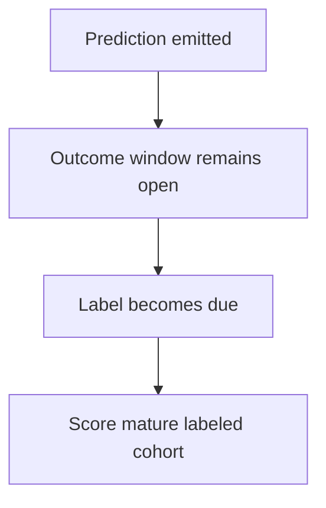

Label delay is the time between a prediction and the moment its true outcome becomes observable. A model may predict that a training job will miss a service target immediately, while the actual outcome is unknowable until the job finishes or its deadline passes. Monitoring accuracy before labels mature creates misleading quality estimates.

## Separate maturity from missingness

An immature label is not yet expected because its observation window remains open. A missing mature label should already have arrived and may indicate broken instrumentation. Reporting must track both the eligible mature denominator and label coverage within that cohort. Treating immature cases as negatives biases accuracy and class-specific metrics; its direction depends on the predictions and eventual outcomes. Even the mature labeled subset can be biased if missingness or label delay depends on the outcome, so coverage alone does not prove representative quality.

## Example

At noon, six training-job risk predictions exist. Five jobs have already reached the deadline needed to determine whether they missed their service target. The sixth job's deadline is 13:00. Quality metrics at noon may use the five mature predictions, provided all five labels are present. The sixth prediction remains pending; calling it a true negative would invent an outcome. If one of the five mature labels is absent, report 4/5 label coverage and investigate instrumentation.

## Why it matters here

Predictive monitoring separates immediate input freshness, early distribution changes, and delayed quality evidence. Tracking label maturity protects precision, recall, calibration, release gates, and retraining decisions from denominator errors that would otherwise make unhealthy models appear safe.

## Related terms

- [Precision](glossary://precision)
- [Recall](glossary://recall)
- [Data drift](glossary://data-drift)
