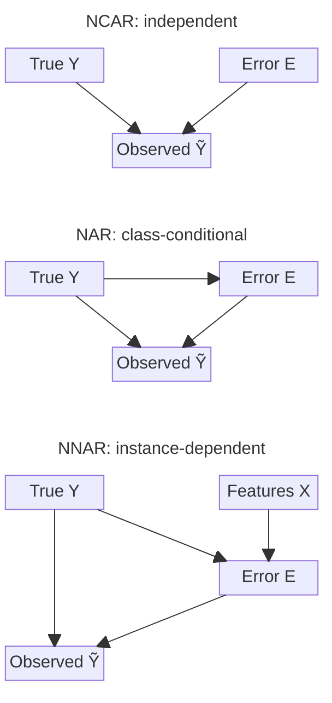

**Label noise** is incorrect, inconsistent, or unstable supervision on training or evaluation data: wrong classes, flipped ratings, contradictory guidelines, or automatic labels that systematically err. Label noise occurs when observed target $\tilde{y}$ differs from the intended target $y$; features $x$ may still be valid. For subjective preferences, disagreement can reflect legitimate differences in taste; define the target population and rubric before treating it as corruption.

In supervised learning you minimize risk under the observed labels. If those labels are wrong, the optimizer can still drive loss down: sufficiently expressive deep nets can memorize arbitrary corruptions and look good on a noisy train split while generalizing poorly on clean test data. On eval sets, noise can make metrics unstable, ceilings artificial, and model comparisons unfair. Measure error rates for your dataset and slices rather than assuming a universal range.

## Intuition

Training and scoring both assume "the label column is mostly right." Break that and two failures show up together:

1. **Wrong objective.** Cross-entropy and ranking losses push the model toward the observed $\tilde{y}$. Random flips blur decision boundaries. Systematic flips (always confuse "sarcasm" with "praise") teach the wrong boundary.
2. **Wrong report card.** If the holdout is as noisy as the train set, a model that copies labeler bugs can score better than a cleaner model. You only see the gap on adjudicated gold or a cleaner slice.

Noise includes random flips, guideline ambiguity, rater fatigue, majority votes without adjudication, outdated policies, and model-assisted labels that reproduce the same mistakes at scale.

## Formula

Write true class $Y$, observed (possibly noisy) label $\tilde{Y}$, and features $X$. Classical taxonomies (Frénay & Verleysen: NCAR / NAR / NNAR) and modern deep-learning surveys share the same core objects.

**Instance-independent noise** uses a **noise transition matrix** $T \in [0,1]^{C \times C}$ with entries

$$
T_{ij} = P(\tilde{Y}=j \mid Y=i).
$$

Rows sum to 1. The noisy class posterior is a linear mix of the clean posterior:

$$
P(\tilde{Y}=j \mid x) = \sum_{i=1}^{C} T_{ij}\, P(Y=i \mid x).
$$

**Symmetric (uniform) noise** with rate $\tau \in [0,1]$ flips a correct label to any other class with equal probability:

$$
T_{ii} = 1 - \tau, \qquad
T_{ij} = \frac{\tau}{C-1}\ \ (i \neq j).
$$

**Asymmetric class-conditional noise** keeps $T$ independent of $x$ but not uniform: some confusions dominate (for example, `"spam"` $\to$ `"ham"` more often than `"spam"` $\to$ `"promo"`). Each class can have its own flip rate $\tau_i$, so $T_{ii}=1-\tau_i$. Pair-flip noise is the special case that puts each row's remaining mass on one wrong class.

**Instance-dependent noise** lets the flip depend on the example:

$$
T_{ij}(x) = P(\tilde{Y}=j \mid Y=i, X=x).
$$

Ambiguous, rare, or boundary cases get higher flip rates. This matches much real human annotation and is harder to identify from noisy data alone.

**Binary class-conditional flips** (Natarajan et al.) with rates $\rho_{+1}=P(\tilde{Y}=-1 \mid Y=+1)$ and $\rho_{-1}=P(\tilde{Y}=+1 \mid Y=-1)$ admit loss correction when the rates are known and $\rho_{+1}+\rho_{-1}<1$. That inequality alone does not identify unknown noise rates or the clean posterior from noisy labels; additional information or assumptions are needed. Naive empirical risk under noisy labels is generally biased.

**Inter-rater agreement** estimates whether humans share a stable label. For two raters, Cohen's kappa corrects chance agreement:

$$
\kappa = \frac{p_o - p_e}{1 - p_e},
$$

where $p_o$ is observed agreement and $p_e$ is agreement expected under independent marginals. Low $\kappa$ on a double-labeled sample points to noise or ambiguity; inspect the labeling process before attributing the result to the model.

## Diagram

From NCAR through NAR to NNAR, the noise process gets more realistic: random flips independent of class and features, class-biased flips, then flips concentrated near hard or underspecified regions of $x$.

## Example

Consider a hypothetical content-moderation team training a binary classifier under a written `hostile` versus `ok` rubric. Assume its label file has $N=20{,}000$ rows from single-pass raters plus a weak teacher model for the long tail.

| Source of rows | Count | Estimated clean error |
|----------------|------:|----------------------:|
| Single rater, clear abuse | $12{,}000$ | $\sim 2\%$ |
| Single rater, sarcasm / jokes | $5{,}000$ | $\sim 25\%$ |
| Teacher-model pseudo-labels | $3{,}000$ | $\sim 18\%$ |

On sarcasm, raters often mark "great job deleting my account" as `ok` because they skim sentiment words. That is **asymmetric, instance-dependent** noise: the true class is closer to `hostile`, the observed label is `ok`, and flips cluster on sarcastic surface forms, not on clear slurs.

Train with ordinary cross-entropy on the full set. On a random production-style holdout (same noise process), accuracy looks fine ($\sim 0.94$). On a 400-row **adjudicated gold** slice with double review and a written sarcasm rule:

| Slice | Precision (`hostile`) | Recall (`hostile`) |
|-------|----------------------:|-------------------:|
| Noisy holdout | $0.91$ | $0.88$ |
| Gold sarcasm subset | $0.86$ | $0.41$ |

The model under-flags hostile sarcasm because the training labels taught it not to. Precision on the noisy holdout was misleading; recall on the clean sarcasm slice collapsed. Fix path: rewrite the guideline with 20 sarcasm exemplars, re-label the disputed boundary and a random 1% sample, drop or down-weight unreviewed teacher labels, retrain, and gate on the gold slice plus [evaluation slices](glossary://evaluation-slice) for rare abuse types.

## How it works in practice

**Where noise enters**

- Ambiguous or outdated guidelines; multi-label tasks forced into one class
- Single-pass raters; majority vote without adjudication of ties
- Class imbalance that starves rare cases of review time
- Automatic / LLM labels and weak teachers that copy systematic errors
- Preference data for [reward models](glossary://reward-model) and DPO: inverted pairs, length bias, and rater-specific taste all act as label noise
- Eval and [model-judge](glossary://model-judge) rubrics that disagree with human gold

**How overparameterized models respond**

DNNs often fit clean patterns early, then fit noise later (memorization of corrupted labels is well documented). Standard regularization (weight decay, dropout, augmentation) helps only up to moderate noise rates; it does not fully close the clean-vs-noisy test gap when corruption is heavy. Early stopping on a **clean** validation set helps when you have one.

**What teams actually do**

| Family | Idea | Use when |
|--------|------|----------|
| **Measure first** | Double-label a sample; report $\kappa$, disagreement by slice, gold vs production label match rate | Always, before large retrain |
| **Clean / relabel** | Adjudicate disputed boundary; fix guidelines; remove or soft-label clear errors | Noise is concentrated and guidelines can be clarified |
| **Robust training** | Sample selection (trust small-loss / high-agreement rows), loss correction via estimated $T$, robust or symmetric losses, label smoothing | Large noisy corpora you cannot fully re-label |
| **Eval hygiene** | Hold a [golden dataset](glossary://golden-dataset) adjudicated and versioned; never train on it | Release gates and incident review |

Prioritize rows where raters, heuristics, and model-assisted labels **disagree**, and include random rows for broad QA coverage. Turn disagreements into clearer rules, then retrain and re-evaluate.

**Production failure pattern**

1. Offline metrics on noisy holdouts look stable or "improving."
2. Live behavior fails on a known hard boundary (sarcasm, medical edge cases, safety policy wording).
3. Post-incident gold re-label shows the training labels were wrong there all along.
4. Without slice metrics and gold, the team tunes thresholds forever instead of fixing supervision.

## Why it matters here

Label noise is the silent failure mode for classifiers, SFT sets, preference pairs, reward models, and automated judges. It trains the wrong behavior and makes eval results look better or worse than they are. Curriculum and production work both need measured disagreement, adjudicated gold, and slice-aware review; otherwise you optimize toward rater bugs and teacher-model artifacts.

## Related terms

- [Class imbalance](glossary://class-imbalance)
- [Golden dataset](glossary://golden-dataset)
- [Human in the loop](glossary://human-in-the-loop)
- [Evaluation slice](glossary://evaluation-slice)
- [Overfitting](glossary://overfitting)
