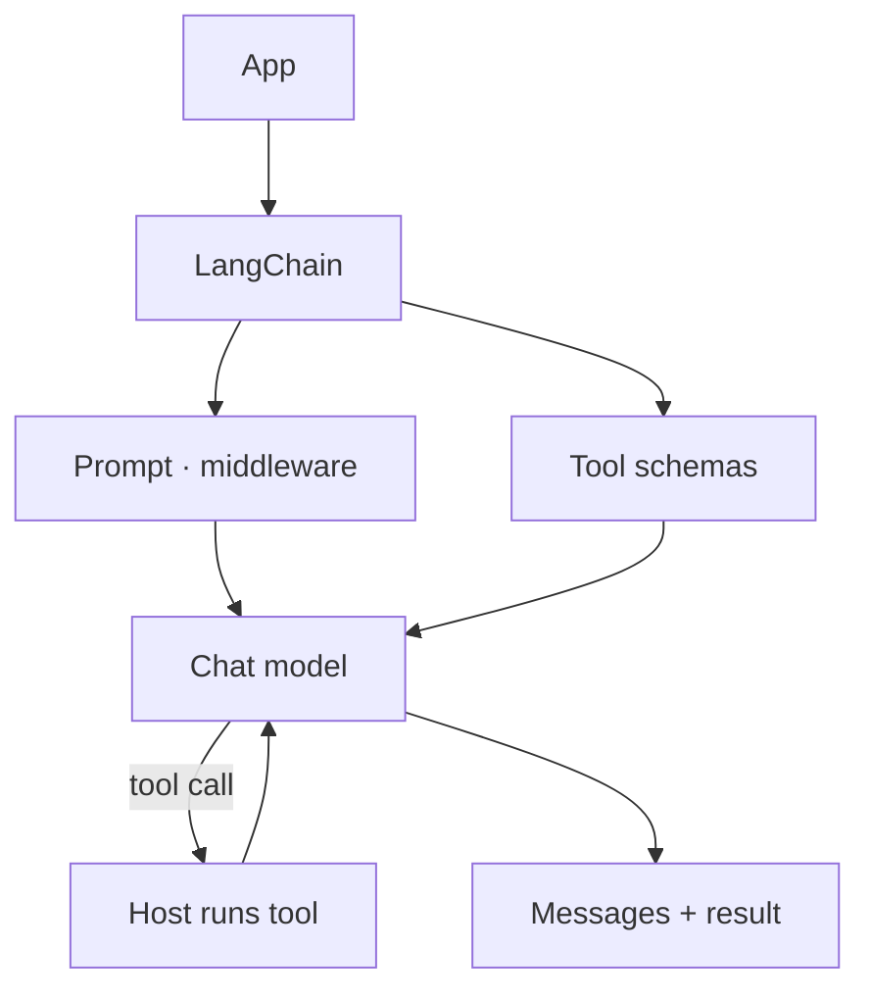

LangChain is an open-source framework for building LLM applications and agents: shared interfaces for models and tools, plus an agent harness that owns prompts, middleware, tool dispatch, and the model loop. Predetermined multi-step flows such as retrieve-then-generate were its original unit of composition; [LangGraph](glossary://langgraph) provides the lower-level graph runtime for durable state and control flow.

The framework combines provider abstractions with reusable chain patterns for [RAG](glossary://rag), tool use, and ReAct-style loops. Integrations for chat models, embeddings, vector stores, and tools live in provider and community packages. LangSmith supplies tracing and evaluation in the same ecosystem. These packages reduce adapter code, but they do not own application policy, authorization, or release evidence.

## Diagram



## How it works

LangChain gives LLM application components **shared interfaces** that developers can compose into a product architecture.

1. **Models.** Chat models, embeddings, and related APIs share interfaces so you can swap `openai:…`, Anthropic, Google, Bedrock, local endpoints, and others with small code changes. Message lists became the common unit after chat-completion APIs became standard.
2. **Tools.** Python callables or declared tools expose name, description, and argument schema. The model proposes a call; application code still validates args, auth, and side effects before execution ([tool calling](glossary://tool-calling)).
3. **Agent harness.** `create_agent(model=…, tools=…, system_prompt=…)` wires a model + tools + prompt into a loop. Middleware can add guardrails, retries, routing, and policy. The loop is an [agent scaffold](glossary://agent-scaffold): the framework provides defaults; you still own budgets, allowlists, and stop conditions.
4. **Composition.** Older and still-useful patterns compose steps as runnables (prompt → model → parser; retrieve → pack → generate). Fixed two-step RAG chains always retrieve then answer; agentic RAG lets the model decide when to search. Neither composition guarantees answer quality.
5. **Observability.** Callbacks and LangSmith traces record spans for model calls, tool I/O, retries, and latency so a bad answer can be opened into raw prompts and tool results.

What the framework **gives**: portable model/tool glue, a fast path from "call a model" to "tool-using agent," and hundreds of integrations for stores, loaders, and providers.

What it **hides if you let it**: the exact prompt bytes, who is allowed to call which tool, permission filters on retrieval, retry semantics, cost caps, eval rows, and failure UX. Those remain product code even when the glue is LangChain.

## Example

An eval assistant looks up a pinned run, then answers. The model proposes a tool call; the LangChain agent harness normally **executes** the registered callable and feeds its result back into the model loop. Authorization must therefore happen inside the tool or enforcing middleware before that execution. This sketch assumes an initialized `chat_model` and uses a mock result; the comment is not an implemented authorization check.

```python
# Import paths change across LangChain releases; verify them against pinned docs.
from langchain.agents import create_agent

def lookup_eval_result(run_id: str) -> dict:
    """Return gated slice results for an authorized eval run."""
    # Trusted code: authz, project check, pinned results store
    return {"run_id": run_id, "status": "blocked", "failed_slices": ["prompt_injection"]}

agent = create_agent(
    model=chat_model,
    tools=[lookup_eval_result],
    system_prompt=(
        "Use lookup_eval_result for release questions. "
        "Do not invent metrics or approval state."
    ),
)

result = agent.invoke(
    {
        "messages": [
            {
                "role": "user",
                "content": "Can eval run candidate-42 pass the release gate?",
            }
        ]
    }
)
# Inspect result["messages"] for tool call, tool result, final reply
```

A fixed RAG chain (always retrieve once, then generate) is the other common shape: embed query → similarity search → fill prompt with top-$k$ chunks → one model call. A fixed call count can make latency and cost easier to bound than an open agent loop when the product does not need multi-step tool use; actual performance still depends on the workload.

## Production ownership

Use LangChain for **connectors and orchestration glue**. Keep these outside the black box:

| Concern | Why it cannot live only inside the framework |
|--------|-----------------------------------------------|
| Authn / tenant identity | Enforce identity in trusted middleware and policy code |
| Tool allowlist and arg policy | Proposed calls are untrusted until checked |
| Retrieval ACL / metadata filters | Unauthorized chunks must never enter context |
| Prompts and version tags | You need reproducible evals and rollbacks |
| Step, time, and token budgets | Unbounded loops burn cost and hang sessions |
| Traces, eval rows, user errors | Ops and product UX are yours |

When a run misbehaves, expand one trace into: raw messages, tool name and args, tool observation, retriever candidates, retry count, and span timings. If you cannot see those pieces, add instrumentation before stacking another abstraction.

## Trade-offs

| Wins | Costs |
|------|--------|
| Fast prototype of model + tools + RAG | Abstraction layers can obscure the real request path |
| Provider-portable model and embedding APIs | Major upgrades can change imports and execution semantics |
| Shared patterns for memory, parsers, retrievers | Extra indirection vs thin explicit HTTP + tool loop |
| LangGraph-backed durability for agents | Graph/state design still needs deliberate failure edges |

Custom thin code often wins for strict authorization, unusual state machines, tight latency budgets, or when every intermediate prompt must be unit-tested without a framework stack. Frameworks win when integration surface area (many models, stores, tools) is the bottleneck and you keep ownership of policy and evals.

## Why it matters here

LangChain is the default industry reference for "framework-assisted LLM apps." Learners need both skills: ship a working agent quickly with standard interfaces, and still design the control plane (permissions, budgets, traces, evals) as if the glue layer were replaceable. Comparing LangChain to [LlamaIndex](glossary://llamaindex) (document/RAG-centric) and [LangGraph](glossary://langgraph) (orchestration runtime) clarifies which layer you are choosing.

## Related terms

- [LangGraph](glossary://langgraph)
- [Agent scaffold](glossary://agent-scaffold)
- [Tool calling](glossary://tool-calling)
- [RAG](glossary://rag)
- [LlamaIndex](glossary://llamaindex)
