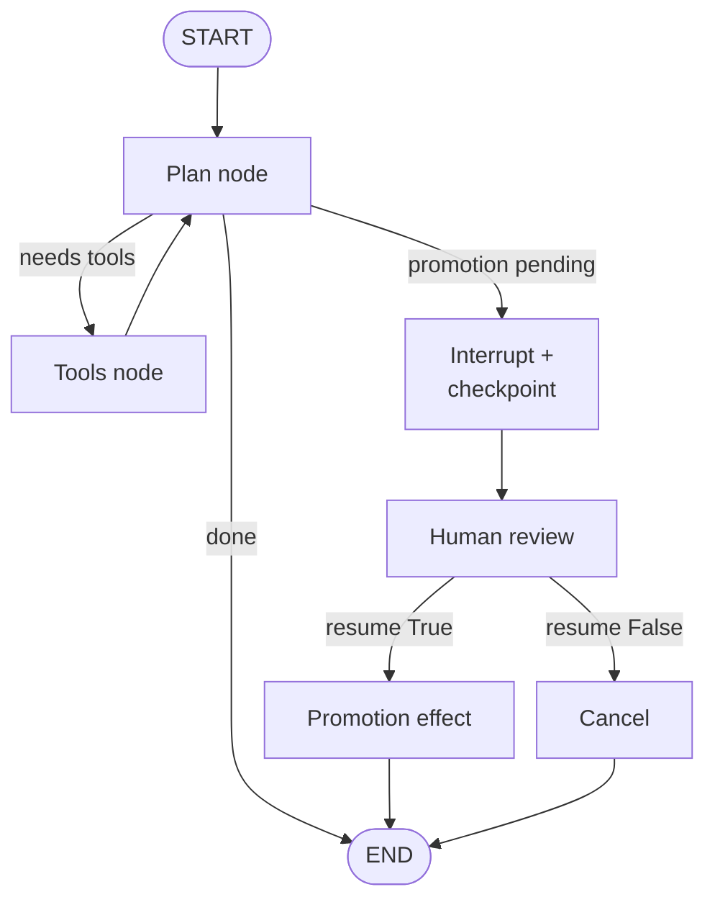

**LangGraph** is a low-level orchestration library (from the LangChain team) for building long-running, stateful LLM agents and workflows as **graphs**: shared **state**, **nodes** that update it, and **edges** that choose what runs next. Compile the graph with a **durable checkpointer** and a stable `thread_id`, and the runtime can pause for a human and recover persisted progress after a process restart. Resume may replay node code from a suitable boundary; a checkpoint is not a saved Python instruction pointer.

A single chat completion is one model call. Most agent products need more: tool loops, retries, approval gates, multi-agent handoffs, and crash recovery. LangGraph makes that control plane explicit. Nodes do the work (model call, tool, pure code). Edges and `Command` choose the next step. Reducers define how partial updates merge into state. Checkpoints make the run durable and inspectable.

Under the hood the runtime is inspired by Pregel-style **message passing**: the graph advances in discrete **super-steps**. Nodes scheduled for the same step can run in parallel; sequential nodes land on separate super-steps. With a checkpointer, LangGraph writes a state snapshot at each super-step boundary (not mid-function inside a node). That boundary is what resume, time travel, and fault recovery attach to.

LangGraph adds durable graph control flow alongside [LangChain](glossary://langchain), a broad LLM app toolkit for prompts, tools, retrievers, and integrations. You can use the graph runtime with LangChain chat models and tools or with your own model clients; its product value is the state machine.

## Diagram



## How it works

1. **Define state.** Usually a `TypedDict` (or Pydantic model) of channels: messages, plan, tool results, approval flags, budgets. Each channel may have a **reducer** that merges a node update with the current value. Default is replace. Lists of chat messages typically use `add_messages` so new turns append and same-id messages can be overwritten.

2. **Add nodes.** A node is a function `(state) -> partial_update` (optionally with config/runtime). It may call a model, run tools, or just branch logic. Nodes return only the keys they change; the runtime merges via reducers.

3. **Wire edges.** Fixed edges always go $A \to B$. Conditional edges call a routing function on state and return the next node name(s). Multiple outgoing destinations run in the same next super-step (fan-out). Dynamic fan-out uses `Send` when the number of workers is not known ahead of time (map-reduce).

4. **Compile.** `builder.compile(checkpointer=...)` validates structure and attaches persistence. For production use a durable saver (for example Postgres), not `InMemorySaver`.

5. **Invoke with a thread.** Pass `config={"configurable": {"thread_id": "..."}}`. The checkpointer keys every snapshot by that id. Same thread continues; a new id starts empty state.

6. **Pause and resume.** Call `interrupt(payload)` inside a node for human-in-the-loop. The runtime checkpoints and returns control. Resume with `Command(resume=value)` on the **same** `thread_id`. The node restarts from the top, so code before `interrupt` must be idempotent or live in an earlier node.

Conceptually, for each state key $k$ after a node returns update $u_k$:

$$
s'_k = \rho_k(s_k, u_k)
$$

where $\rho_k$ is the reducer for channel $k$ (identity-replace if none is set). For messages with `add_messages`, $\rho$ appends new messages and merges by message id when the update targets an existing one.

## Example

A release graph that plans, reads eval evidence, and requires approval before a model-promotion side effect. This is a control-flow sketch: the `[...]` message placeholders and mock tools must be replaced before execution.

```python
from typing import Annotated, Literal, TypedDict
from langgraph.graph import END, START, StateGraph
from langgraph.graph.message import add_messages
from langgraph.checkpoint.memory import InMemorySaver  # use Postgres in prod
from langgraph.types import Command, interrupt


class AgentState(TypedDict):
    messages: Annotated[list, add_messages]
    model_id: str | None
    target_alias: str | None
    approved: bool | None


def plan(state: AgentState):
    # model proposes next action from state["messages"]
    # return AIMessage with tool_calls, or final text + promotion fields
    return {"messages": [...]}


def tools(state: AgentState):
    # trusted code validates + runs allowlisted tools
    return {
        "messages": [...],  # ToolMessages
        "model_id": "reranker-v7",
        "target_alias": "canary",
    }


def approval(state: AgentState) -> Command[Literal["promote", "cancel"]]:
    decision = interrupt({
        "action": "promote_model",
        "model_id": state["model_id"],
        "target_alias": state["target_alias"],
    })
    if decision is True:
        return Command(update={"approved": True}, goto="promote")
    return Command(update={"approved": False}, goto="cancel")


def promote(state: AgentState):
    # Runs after approval; retries still require an idempotency key.
    return {"messages": [...]}


def cancel(state: AgentState):
    return {"messages": [...]}


def route_after_plan(state: AgentState) -> Literal["tools", "approval", "__end__"]:
    last = state["messages"][-1]
    if getattr(last, "tool_calls", None):
        return "tools"
    if state.get("target_alias"):
        return "approval"
    return END


builder = StateGraph(AgentState)
builder.add_node("plan", plan)
builder.add_node("tools", tools)
builder.add_node("approval", approval)
builder.add_node("promote", promote)
builder.add_node("cancel", cancel)
builder.add_edge(START, "plan")
builder.add_conditional_edges("plan", route_after_plan)
builder.add_edge("tools", "plan")
builder.add_edge("promote", END)
builder.add_edge("cancel", END)

graph = builder.compile(checkpointer=InMemorySaver())
config = {"configurable": {"thread_id": "release-8841"}}

# Run until interrupt (promotion needs review)
result = graph.invoke(
    {"messages": [{"role": "user", "content": "Promote reranker-v7 to canary"}]},
    config,
)
# pending payload is under result["__interrupt__"] for the UI

# Later: same thread_id, human approves
final = graph.invoke(Command(resume=True), config)
```

Persist every value needed to resume a run: chat text, `model_id`, `target_alias`, approval status, tool outputs, and the next node. The state schema defines the product's recovery and control behavior.

## Checkpointing and threads

With a checkpointer, each super-step boundary produces a checkpoint: a snapshot of channel values, which nodes run next, and metadata (step, writes). For a linear path `START -> A -> B -> END` you get separate checkpoints after input, after A, and after B. Parallel nodes that finish in the same super-step share that tick; pending writes from successful siblings survive if another sibling fails.

| Concept | Role |
| --- | --- |
| `thread_id` | Primary key for a run's checkpoint history (conversation, ticket, job) |
| Checkpoint | Full state snapshot at a super-step boundary |
| Super-step | One tick: all scheduled nodes for that step |
| Store (optional) | Cross-thread durable memory, separate from thread checkpoints |
| Durability mode | `exit` / `async` / `sync` trade write cost vs crash recovery |

Production checklist: durable checkpointer, stable `thread_id` from your product identity (not random per request unless you intend a fresh run), serialization that matches your state types, and encryption if checkpoints hold PII or secrets. `InMemorySaver` is for local experiments; a process restart empties it.

## Production failure modes

These are the failures graphs hide until traffic hits them:

- **Non-idempotent side effects.** On resume an interrupted node restarts from the top, so an email send or row insert before `interrupt` can fire twice. Moving a write after approval prevents it from running before approval, but does not prevent duplication if the process dies after the external write and before its result is persisted. Use durable tasks where appropriate and external idempotency keys or transactions for retry-safe writes.
- **Bare `try/except` around `interrupt`.** Pause is implemented with a special exception. Catching all exceptions swallows the pause and breaks HITL.
- **In-memory checkpointer in production.** Workers die, deploys roll, pods scale. Without durable checkpoints you cannot resume approval threads.
- **Vague state.** If you only store "step 4" and free-form text, you cannot safely retry tools or prove what a human approved. Store action hashes, tool args, policy version, and budgets explicitly.
- **Unbounded loops.** Tool-calling cycles need hard caps (`recursion_limit`, step budgets, cost ceilings). Prefer routing to a graceful fallback before `GraphRecursionError`.
- **Mixed static edges and `Command(goto=...)` from the same node.** Both paths can fire; pick one routing style per node.
- **Resume with the wrong API.** After an interrupt, resume with `Command(resume=...)`. Continuing a finished multi-turn conversation on the same thread is a plain input dict starting from `START` again with reducers merging new messages, not a bare `Command(update=...)` as if it were a chat API.

## Trade-offs

LangGraph pays off when control flow is **branchy, long-lived, or human-gated**: multi-step tools, review queues, multi-agent handoffs, recoverable jobs. A short RAG chain with one retrieve-then-generate path may not need a graph.

Cost of the abstraction: you own the state schema, reducer semantics, and resume/idempotency rules. Making every helper a node adds transitions and state to debug. Under-specifying failure edges (timeouts, rejects, budget exhaustion) leaves the same ad hoc callbacks a graph was meant to replace. Treat the graph as an [agent scaffold](glossary://agent-scaffold) and [state machine](glossary://state-machine): the model proposes; trusted edges and policy decide what is allowed next.

## Why it matters here

Agent systems fail less often on "the model was wrong" alone than on invisible control flow: lost tool state after a crash, double charges after retry, approvals that only lived in a worker's RAM, or loops with no stop condition. LangGraph is how many production stacks make that control flow **named, checkpointed, and reviewable**. Understanding nodes, reducers, super-steps, `thread_id`, and `interrupt` is the vocabulary for designing and debugging multi-step LLM systems, whether you ship LangGraph itself or a custom graph with the same shape.

## Related terms

- [LangChain](glossary://langchain)
- [State machine](glossary://state-machine)
- [Human in the loop](glossary://human-in-the-loop)
- [Workflow checkpoint](glossary://workflow-checkpoint)
- [Agent scaffold](glossary://agent-scaffold)
