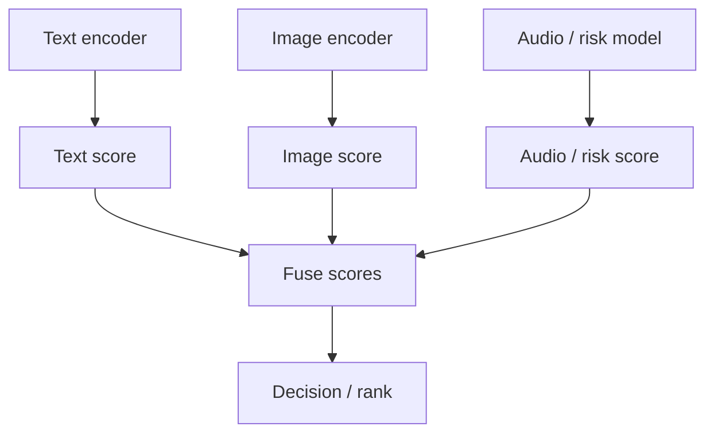

**Late fusion** (also called **decision-level fusion**) combines scores, labels, rankings, or policy decisions from separate models *after* each model has finished processing its own input stream. Streams stay independent for almost the whole pipeline. Only a thin fusion layer (average, max, weighted sum, learned meta-model, or hand-authored rules) produces the final answer.

Survey taxonomy (Baltrušaitis, Ahuja, and Morency) groups fusion by stage: early (feature-level), late (decision-level), and hybrid (both). In [early fusion](glossary://early-fusion), modalities meet in shared layers near the start. [Cross-attention](glossary://cross-attention) lets one stream read another mid-stack while they remain separate through earlier layers.

## Diagram



## Intuition

Late fusion keeps modality or subsystem models independent until their scores or decisions reach an aggregation layer. A text safety model, an image safety model, and an account-risk model each emit a score; policy then decides whether to allow, review, or escalate. You can inspect, replace, calibrate, or disable one branch without retraining the others.

This modularity lets teams inspect, replace, calibrate, or disable each branch independently. Fine-grained grounding, such as binding one image region to one text span ("is the red button the cancel control?"), needs early joint sequence models or cross-attention. Late fusion fits systems with established specialists, independently arriving or failing modalities, and auditable per-branch failure modes.

## How it works

A typical late-fusion path:

1. **Per-stream models.** Train or call a unimodal (or specialist) model for each input: text classifier, image classifier, ASR-then-NLP path, rules engine, retrieval ranker, risk model. Each produces its own output $s_m$ (logits, probabilities, ranks, labels, or structured flags).
2. **Normalize and calibrate.** Put scores on a comparable scale. Raw logits from different heads are not interchangeable. [Calibration](glossary://calibration) on a shared validation set (temperature scaling, isotonic, Platt) is often required before arithmetic fusion so that $0.9$ means roughly the same thing on every branch.
3. **Fuse.** Apply a fixed rule or a small learned combiner (see Formula). Fusion can also be *asymmetric policy*: escalate if any high-severity branch fires, rather than averaging everything into one float.
4. **Threshold and act.** Map the fused score or rule outcome through a [decision threshold](glossary://decision-threshold) (or multi-tier gates: allow / review / block).

**Missing modalities.** Late fusion makes branch-specific fallback easier to express. Define the missing branch's behavior, renormalize remaining weights if that is the intended rule, and validate each supported missing-modality pattern. Require review or denial when a safety branch is unavailable.

**What can be fused.** Probabilities, [logits](glossary://logits), class labels (majority vote), rank lists ([reciprocal rank fusion](glossary://reciprocal-rank-fusion) is rank-level late fusion), calibrated risk scores, and hand rules. The fusion layer needs clear ownership of scale, thresholds, and who is allowed to override whom.

## Formula

Classic classifier combination (Kittler et al.) starts from distinct measurement vectors $x_1,\ldots,x_R$ for $R$ experts and posterior estimates $P(\omega_k \mid x_i)$. Under **conditional independence** of the measurements given the class, the **product rule** is:

$$
P(\omega_k \mid x_1,\ldots,x_R)
\propto
P(\omega_k)^{1-R}
\prod_{i=1}^{R} P(\omega_k \mid x_i).
$$

Under stronger approximations (posteriors not far from priors), Kittler et al. obtain the **sum rule**. With equal class priors, its prior correction is the same for every class and the decision reduces to summing posteriors:

$$
\operatorname{assign}\; z \to \omega_j
\quad\text{if}\quad
\sum_{i=1}^{R} P(\omega_j \mid x_i)
=
\max_k \sum_{i=1}^{R} P(\omega_k \mid x_i).
$$

Related fixed rules include max, min, median, and majority vote over hard labels. Kittler's analysis is widely cited for a practical lesson: the **sum / average rule is often more robust to estimation error** than the product rule, because a single near-zero probability multiplies the whole product into silence.

**Weighted linear fusion** of calibrated scores (common in production):

$$
s = \sum_{m=1}^{M} w_m\, \tilde{s}_m,
\qquad
\sum_m w_m = 1,\; w_m \ge 0,
$$

where $\tilde{s}_m$ is a calibrated branch score for the same target. Calibration can change after the weighted average, so check the fused output too. Weights can be fixed from validation, or a small meta-model (stacking) can learn a non-linear map $f(\tilde{s}_1,\ldots,\tilde{s}_M)$ from held-out or out-of-fold predictions to avoid training-data leakage.

**Check scale and policy before averaging.** Averaging uncalibrated logits of different models, mixing ranks with probabilities, or averaging a high text risk with a low image risk can hide a hard failure. Safety systems often prefer OR / max / threshold-on-any-branch over a single blended score.

## Example

A content moderation stack scores a user post with three independent branches:

| Branch | Output | Meaning |
| --- | --- | --- |
| Text safety | $s_t = 0.91$ | calibrated $P(\text{violates})$ |
| Image safety | $s_i = 0.42$ | calibrated $P(\text{violates})$ |
| Account risk | $a = 0.15$ | prior risk in $[0,1]$ |

**Naive average** of the two modality scores:

$$
\frac{0.91 + 0.42}{2} = 0.665.
$$

If your block threshold is $0.80$, the average *allows* the post even though text is clearly high risk. That failure can expose users to a high-risk input in production.

**Late fusion as policy** (safer default for asymmetric risk):

$$
\text{escalate if }
\max(s_t, s_i) \ge 0.85
\quad\text{or}\quad
a \ge 0.70
\quad\text{or}\quad
(s_t \ge 0.60 \;\land\; s_i \ge 0.60).
$$

Here $\max(s_t,s_i)=0.91$ triggers escalate. Each branch still has its own score for logging, ablation, and on-call debug.

```python
def fuse_moderation(s_text: float, s_image: float, account: float) -> str:
    # Calibrated scores in [0, 1]; thresholds from validation + policy review
    if max(s_text, s_image) >= 0.85 or account >= 0.70:
        return "escalate"
    if s_text >= 0.60 and s_image >= 0.60:
        return "escalate"
    if max(s_text, s_image) >= 0.50:
        return "review"
    return "allow"

assert fuse_moderation(0.91, 0.42, 0.15) == "escalate"
assert fuse_moderation(0.40, 0.35, 0.10) == "allow"
```

The same pattern appears in retrieval: run BM25 and dense retrieval separately, then fuse *rank lists* with RRF or fuse *scores* only after calibration. That is late fusion of heterogeneous rankers, not a single early-fused multimodal encoder.

## Worked numbers

Three calibrated class probabilities for the same binary label "toxic", from text, image, and audio specialists:

$$
p_t=0.80,\quad p_i=0.70,\quad p_a=0.20.
$$

**Average (sum rule style):**

$$
\bar{p} = \frac{0.80+0.70+0.20}{3} \approx 0.567.
$$

**Product (independence-style product rule on posteriors; equal priors so $P(\omega)^{1-R}$ cancels):**

$$
p_{\Pi} \propto 0.80 \cdot 0.70 \cdot 0.20 = 0.112,
\quad
(1-p)_{\Pi} \propto 0.20 \cdot 0.30 \cdot 0.80 = 0.048,
$$

so after renormalizing on those two masses:

$$
P_{\Pi}(\text{toxic}) = \frac{0.112}{0.112+0.048} = 0.70.
$$

The audio branch favors non-toxic ($0.20$ toxic probability) and pulls the average toward $0.57$. A bare product of toxic-class scores alone ($0.112$) is not a normalized probability and can look "near zero" even when the complementary-class product is smaller still; normalize across classes, preferably in log space for numerical stability. In production, choose whether one high-risk branch is sufficient (max/OR), several must agree (AND), or all provide soft evidence (average/learned weights). These are different policies.

## Trade-offs

| Design | When streams meet | Strength | Cost / risk |
| --- | --- | --- | --- |
| Late fusion | Scores / decisions | Modular, ablatable, missing-modality friendly, reuses specialists | Misses token-level cross-modal binding |
| Hybrid / intermediate | Mid features + late head | Some shared structure without full early concat | More moving parts to train and serve |
| Cross-attention | Mid stack, $Q$ vs $K,V$ | Grounded reading of one stream by another | Extra blocks; still not fully interleaved |
| Early fusion | Input / early features | Fine-grained joint reasoning in one stack | Longer sequences, larger KV, joint failure modes |

**When late fusion is the right default**

- You already have strong unimodal models and need a product surface quickly.
- Modalities are often missing, delayed, or owned by different teams/services.
- You need independent [SLOs](glossary://slo), kill switches, or audit trails per branch.
- Fusion is ranking or gating (hybrid search, moderation, fraud signals), not deep grounded generation.

**When it fails**

- Task needs region-phrase binding, OCR+layout reasoning, or multi-hop multimodal inference.
- Branches are uncalibrated and someone ships a weighted sum of incompatible scores.
- One dominant modality always wins, so the combiner learns to ignore weaker experts (modality collapse at the *decision* layer).
- Fusion latency stacks serial specialist calls without parallelization or caching.

## Why it matters here

Late fusion lets teams ship multimodal and multi-signal products using specialist components: moderation, ranking ensembles, hybrid retrieval, sensor + text stacks, and risk engines. Curriculum work on [vision-language models](glossary://vision-language-model), early fusion, cross-attention, calibration, and hybrid search all depend on knowing *when* streams meet and *what* is being merged. Choosing late fusion prioritizes modularity, inspectability, and failure isolation.

## Related terms

- [Early fusion](glossary://early-fusion)
- [Cross-attention](glossary://cross-attention)
- [Calibration](glossary://calibration)
- [Decision threshold](glossary://decision-threshold)
- [Reciprocal Rank Fusion](glossary://reciprocal-rank-fusion)
