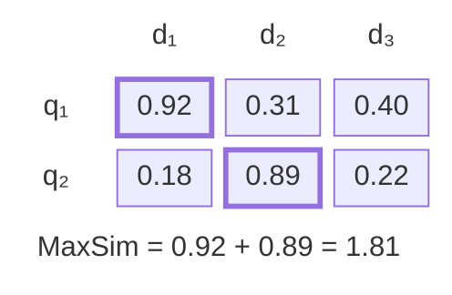

**Late interaction** is a neural ranking design that encodes the query and each document **separately** into bags of contextual token (or patch) vectors, then scores relevance with a cheap interaction that runs only at query time. The canonical operator is [MaxSim](glossary://maxsim): each query vector finds its best match among document vectors; those maxima are summed. The name comes from ColBERT (Contextualized Late Interaction over BERT; Khattab and Zaharia, SIGIR 2020): interaction is *delayed* relative to full joint attention, but still fine-grained, so document multi-vectors can be precomputed offline.

The design sits between two extremes. A [bi-encoder](glossary://bi-encoder) collapses each side to one vector and scores with a single dot product (representation-focused, fully decomposable). A [cross-encoder](glossary://cross-encoder) runs joint self-attention over the concatenated pair (full early interaction, no reusable document index). Late interaction keeps token-level evidence without a transformer forward per candidate over the whole corpus.

## Intuition

Pooling a passage into one embedding is like summarizing a manual into a single keyword cloud. Related topics stick together; exact constraints (version pins, negation, field names, rare IDs) blur. Full joint attention over every query-document pair is like reading the whole manual against the question each time: accurate, but you cannot pre-index a million manuals that way.

Late interaction keeps a **bag of contextual vectors** per document. At query time the question is also a bag of vectors. Scoring asks: for each piece of the question, does *some* piece of the document match well? Evidence is allowed to come from different sentences. That soft multi-constraint match is why late interaction often beats single-vector dense retrieval on hard queries while remaining far cheaper than cross-encoding every candidate from scratch.

## How it works

1. **Offline document encode.** Run a document encoder $f_D$ on each passage. Keep a contextual embedding per kept token (or image patch for multimodal models such as ColPali). Project to a small width (classically $m = 128$), L2-normalize, and store the bag. Punctuation and other low-value tokens are often dropped to shrink storage.
2. **Index multi-vectors.** Either store bags for exact MaxSim over a shortlist, or put every document token vector into a multi-vector / IVF / residual index (ColBERTv2 residual compression; PLAID-style engines) so candidate generation can prune the corpus.
3. **Online query encode.** Run $f_Q$ once on the live query (often with a special `[Q]` marker and fixed-length padding). Produce query token vectors $E_q$.
4. **Late interaction.** Score each candidate document bag $E_d$ with MaxSim (or an equivalent multi-vector operator). Sort by score. Optionally pass the top hits to a learned [reranker](glossary://reranker).

Two serving modes are common:

| Mode | Role |
| --- | --- |
| **Rerank** | First stage is BM25, dense ANN, or hybrid; late interaction re-scores top-$k$ (e.g. 100 to 1000) with exact MaxSim. |
| **End-to-end** | Each query vector retrieves near-neighbor document vectors; unique parent docs are refined with full MaxSim. |

The interaction itself has **no trainable parameters** in ColBERT-style systems; all learning is in the encoders. Online scoring is a GPU-friendly matrix max-reduce.

## Formula

Let $E_q = \{q_1,\ldots,q_{N}\}$ and $E_d = \{d_1,\ldots,d_{M}\}$ be L2-normalized contextual embeddings. ColBERT defines relevance as the sum of per-query-token maximum similarities (cosine implemented as a dot product):

$$
S_{q,d} = \sum_{i=1}^{N} \max_{1 \le j \le M} q_i^\top d_j
$$

Equivalently, if $A \in \mathbb{R}^{N \times M}$ has entries $A_{ij} = q_i^\top d_j$, then

$$
S_{q,d} = \sum_{i=1}^{N} \max_j A_{ij}
$$

Squared $L_2$ distance was also used for end-to-end FAISS retrieval in the original work; production stacks usually normalize and use inner product. Query-length padding (e.g. $N_q = 32$ with `[MASK]` slots) acts as soft query augmentation so unused slots can reweight or expand signal without a separate expansion model.

Complexity intuition for reranking $k$ candidates: one short query encode plus $O(k \cdot N \cdot M \cdot m)$ for MaxSim (highly parallelizable), versus $k$ full cross-encoder forwards over concatenated sequences of length $|q|+|d|$.

## Diagram

Contrast with neighboring designs (Khattab and Zaharia, Fig. 2 style):

| Design | Offline doc form | Interaction timing |
| --- | --- | --- |
| Representation / bi-encoder | 1 vector | Single similarity at query time |
| Interaction matrix + deep net | Often none reusable | Early, learned over full $q \times d$ matrix |
| Cross-encoder (BERT joint) | None | Early joint self-attention per pair |
| **Late interaction** | Bag of token vectors | Delayed MaxSim (or similar) at query time |

## Example

**Framework documentation search.** Query: `PyTorch gradient clipping after AMP unscale`. A single dense vector may pull a generic gradient-clipping overview that mentions mixed precision but misses operation order. With late interaction:

- Query tokens `gradient` and `clipping` match the optimizer section.
- `AMP` and `unscale` match the mixed-precision API details.
- `after` matches the operation-order constraint if contextual embeddings preserve that relation.

Each constraint can latch onto a different span; the sum rewards multi-hit evidence.

**Worked MaxSim (toy, after L2-normalization).** Two query tokens, three document tokens:

|  | $d_1$ (gradient) | $d_2$ (unscale) | $d_3$ (optimizer) | row max |
| --- | --- | --- | --- | --- |
| $q_1$ (gradient) | 0.92 | 0.31 | 0.40 | 0.92 |
| $q_2$ (unscale) | 0.18 | 0.89 | 0.22 | 0.89 |

$$
S = 0.92 + 0.89 = 1.81
$$

If a third query token (`after`) reaches only $0.15$ against a document that never specifies operation order, the weak max can help diagnose topical similarity without the required relation. MaxSim permits different query tokens to match unrelated spans or reuse the same document token. High summed similarity therefore leaves order and negation unverified. Inspect argmax matches and evaluate relation-sensitive cases explicitly.

**Historical quality/cost anchor (MS MARCO re-rank).** The [original ColBERT evaluation](https://arxiv.org/html/2004.12832v2) reported 34.9 MRR@10 re-ranking BM25 top-1000, with 61 ms and 7B FLOPs per query, versus its BERT-base joint ranker at 36.0 dev MRR@10, 10.7 s, and 97T FLOPs. These measurements use the paper's hardware, setup, and cost accounting. Benchmark the deployed pipeline to estimate its latency. The paper's end-to-end retrieval also improved recall@1000 over its BM25 first stage.

## Sizing and production cost

Index size scales with **tokens kept**, not documents alone:

$$
\text{bytes} \approx N_{\mathrm{docs}} \times \bar{M} \times b
$$

where $\bar{M}$ is mean kept vectors per passage and $b$ is bytes per vector.

| Layout | $b$ (approx.) | Rough cost at 1M docs × 100 tokens |
| --- | --- | --- |
| fp16, $m=128$ | 256 B / vector | ~25.6 GB |
| ColBERTv2 residual (2-bit) | ~36 B / vector | ~3.6 GB |
| ColBERTv2 residual (1-bit) | ~20 B / vector | ~2.0 GB |
| Single-vector 768-d float32 | 3072 B / doc (1 vector) | ~3.1 GB |

What fails in production if you ignore that shape:

- **Storage and rebuilds.** Uncompressed token-level indexes can be much larger than single-vector indexes; compression can change that comparison, as the table illustrates. Account for centroids, posting lists, document mappings, and rebuild costs in addition to vector payloads.
- **Latency without pruning.** Exhaustive MaxSim over the full corpus is not the product path. Use candidate generation (BM25/dense shortlist, or PLAID / multi-vector ANN) so MaxSim runs on hundreds to thousands of bags, not millions.
- **Score quirks.** Unweighted sums can favor longer query bags or boilerplate-heavy docs. Teams prune document tokens, weight query tokens, or always send MaxSim hits into a cross-encoder for final order.
- **Chunking.** Respect the encoder's supported length and evaluate any shift from its training chunk distribution. A 4k-token page may be truncated or need splitting; larger bags also change storage, scoring cost, and the opportunity for spurious token matches.
- **Multimodal variants.** ColPali-style models apply the same late-interaction idea to vision-language patch embeddings for document images; storage multiplies with patch count, so page-level indexing budgets matter even more.

## Trade-offs

| Axis | Bi-encoder | Late interaction | Cross-encoder |
| --- | --- | --- | --- |
| Offline index | 1 vector / doc | Many vectors / doc | None (query-dependent) |
| Matching | Pooled similarity | Token/patch MaxSim | Full joint attention |
| Query cost | 1 encode + ANN | 1 encode + multi-vector search + MaxSim | 1 encode **per candidate** |
| Typical role | First-stage recall | First stage or strong mid stage | Rerank top tens/hundreds |
| Storage | Lowest | Higher; needs compression at scale | N/A for full corpus |

Use late interaction when hard multi-constraint queries lose under pooling and you can afford multi-vector storage plus a specialized index or mid-stage. Keep hybrid BM25 + dense as the baseline; measure lifts on slices that care about identifiers, negation-adjacent policy language, and multi-span evidence alongside average recall@k.

## Why it matters here

Late interaction is the retrieval middle ground the RAG stack needs when single-vector dense search plateaus but full cross-encoding of the corpus is impossible. It teaches **granularity of evidence**: query-document interaction timing and resolution are key quality choices alongside encoder capacity. [ColBERT](glossary://colbert), MaxSim, ColBERTv2/PLAID, and multimodal ColPali-style models are all instances of this same delayed multi-vector scoring idea.

## Related terms

- [MaxSim](glossary://maxsim)
- [ColBERT](glossary://colbert)
- [Bi-encoder](glossary://bi-encoder)
- [Cross-encoder](glossary://cross-encoder)
- [Dense retrieval](glossary://dense-retrieval)
