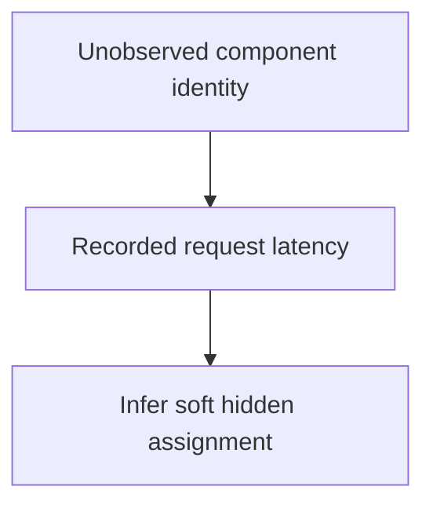

A latent variable represents a quantity assumed by a statistical model but not directly observed in the dataset. Examples include the unknown component that generated a request latency, an unobserved document topic, or a compressed representation inferred by an autoencoder. The variable helps explain observed patterns, but its existence as a real-world cause must be validated separately.

## Hidden assignments are model assumptions

In a two-component Gaussian mixture, each observed latency $x_i$ has an unseen component label $z_i$. The fitted model estimates probabilities such as $P(z_i=\text{fast}\mid x_i)$ from latency; it does not observe a verified queue identifier in the request. Different models, component counts, or initializations can produce different hidden assignments for the same observation. A numerical fit alone leaves the variable's physical interpretation unverified.

## Example

A service records request latencies of 28, 30, 32, 86, 90, and 94 milliseconds without recording which queue handled each request. A mixture model proposes a fast component near 30 and a slow component near 90. A 50 millisecond request can receive partial responsibility for both components because the true source wasn't observed. Tracing the actual queue would turn a hidden assignment into an observed feature; until then, the mixture label remains an inference under stated assumptions.

## Why it matters here

Probabilistic modeling, variational autoencoders, hidden-state sequence models, and representation learning depend on reasoning about unobserved structure. Researchers must distinguish a useful explanatory variable from an experimentally verified mechanism.

## Related terms

- [Gaussian mixture model](glossary://gaussian-mixture-model)
- [Expectation-maximization](glossary://expectation-maximization)
- [Embedding](glossary://embedding)
