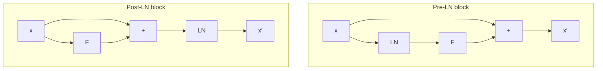

**Layer normalization (LayerNorm)** re-centers and re-scales activations across designated feature axes, then applies learned per-feature scale and shift (Ba, Kiros, and Hinton, 2016). In the usual Transformer configuration, for one token hidden state $x \in \mathbb{R}^{d}$, it computes mean and variance over the $d$ features of *that* token only, divides the centered vector by $\sqrt{\sigma^{2}+\epsilon}$, multiplies by $\gamma$, and adds $\beta$. With that axis choice, statistics do not mix batch items or sequence positions, and train and serve use the same rule even at batch size 1.

That design was a deliberate flip of batch normalization: BatchNorm estimates mean and variance across examples for each feature coordinate and needs running averages at inference. LayerNorm estimates mean and variance across features for each example, which fits variable-length sequences, small minibatches, and [autoregressive decoding](glossary://autoregressive-decoding). In Transformers it is the usual scale-control block on the [residual stream](glossary://residual-stream), later often replaced by lighter [RMSNorm](glossary://rmsnorm) while keeping the same "normalize per token over hidden dim" contract.

## Intuition

Attention and the MLP read each token's feature vector. If some coordinates drift to huge magnitudes while others collapse, [softmax](glossary://softmax) logits and later matmuls become brittle: [gradients](glossary://gradient) explode or vanish, and mixed-precision paths overflow. LayerNorm resets each token vector to zero mean and variance $\sigma^2/(\sigma^2+\epsilon)$ before learned $\gamma$ and $\beta$ stretch and shift it. That variance is approximately one when $\sigma^2$ dominates $\epsilon$, and zero for a constant vector. The network keeps control of which directions matter without letting raw residual scale run away.

Adding a constant offset to every coordinate of $x$ cancels in mean subtraction. Positive rescaling is exactly canceled when $\epsilon=0$ and variance is nonzero; with fixed positive $\epsilon$, scale invariance is only approximate when variance dominates epsilon. In per-token LayerNorm, neighboring sequences and concurrent requests do not enter $\mu$ or $\sigma^{2}$.

## Formula

For $x \in \mathbb{R}^{d}$ (one token's features; Ba et al. write this for the summed inputs of a layer with $H$ units):

$$
\mu = \frac{1}{d}\sum_{i=1}^{d} x_i, \qquad
\sigma^{2} = \frac{1}{d}\sum_{i=1}^{d} (x_i - \mu)^{2}
$$

$$
\hat{x} = \frac{x - \mu}{\sqrt{\sigma^{2} + \epsilon}}, \qquad
\mathrm{LayerNorm}(x) = \gamma \odot \hat{x} + \beta
$$

- $\epsilon > 0$ stabilizes the denominator (PyTorch `nn.LayerNorm` default: $10^{-5}$).
- $\gamma, \beta \in \mathbb{R}^{d}$ are learnable affine parameters (Ba et al.: gain $g$ and bias $b$), usually initialized to ones and zeros. In PyTorch these are `weight` and `bias` when `elementwise_affine=True`.
- Variance uses the *biased* (population) estimator, $\frac{1}{d}$ not $\frac{1}{d-1}$, matching `torch.var(..., correction=0)`.

In frameworks, mean and variance are taken over the last $D$ axes given by `normalized_shape`. For NLP tensors of shape $(B, T, d)$, that is almost always the final hidden size $d$ only: one independent normalization per `(batch, time)` position.

PyTorch implements the paper equation as:

$$
y = \frac{x - \mathrm{E}[x]}{\sqrt{\mathrm{Var}[x] + \epsilon}} \odot \gamma + \beta
$$

with the same statistics in train and eval (no running-mean buffers).

## How it works

1. Take one position's hidden state $x$ of width $d$ (ignore batch and sequence for the reduction).
2. Compute $\mu$ and $\sigma^{2}$ over those $d$ features with the biased variance above.
3. Form $\hat{x} = (x - \mu) / \sqrt{\sigma^{2}+\epsilon}$.
4. Apply the learned affine map $\gamma \odot \hat{x} + \beta$.
5. Feed the result into the next op (attention QKV projections, MLP, or LM head), depending on Pre-LN vs Post-LN placement.

## Worked numbers

Take a four-dimensional token activation:

$$
x = [3.0,\ 1.0,\ -1.0,\ 5.0]
$$

Mean: $\mu = (3+1-1+5)/4 = 2$. Centered: $[1,\ -1,\ -3,\ 3]$. Variance: $\sigma^{2} = (1+1+9+9)/4 = 5$, so $\sqrt{\sigma^{2}} = \sqrt{5} \approx 2.236$. With $\epsilon \approx 0$ for the hand calc, $\gamma = \mathbf{1}$, $\beta = \mathbf{0}$:

$$
\mathrm{LayerNorm}(x) \approx [0.447,\ -0.447,\ -1.342,\ 1.342]
$$

Mean of the output is $0$; scale is unit before any nontrivial $\gamma$. RMSNorm would skip the mean subtraction and divide by $\mathrm{RMS}(x)$ only, so a pure offset would survive.

```python
import math

def layer_norm(x, eps=1e-5, gamma=None, beta=None):
    d = len(x)
    if d == 0:
        raise ValueError("activation vector must be nonempty")
    gamma = [1.0] * d if gamma is None else gamma
    beta = [0.0] * d if beta is None else beta
    if len(gamma) != d or len(beta) != d:
        raise ValueError("affine parameter lengths must match the vector")
    mu = sum(x) / d
    var = sum((v - mu) ** 2 for v in x) / d
    inv = 1.0 / math.sqrt(var + eps)
    return [g * (v - mu) * inv + b for v, g, b in zip(x, gamma, beta)]

print([round(v, 3) for v in layer_norm([3.0, 1.0, -1.0, 5.0])])
# [0.447, -0.447, -1.342, 1.342]
```

## Example

A Pre-LN decoder block (GPT-2 style placement of the residual, with LayerNorm rather than RMSNorm) applies LayerNorm on the residual stream *before* each sublayer, then adds the sublayer output back:

$$
x \leftarrow x + \mathrm{Attn}(\mathrm{LayerNorm}(x))
$$
$$
x \leftarrow x + \mathrm{FFN}(\mathrm{LayerNorm}(x))
$$

For hidden width $d = 4096$, each of those norms computes $\mu$ and $\sigma^{2}$ over 4096 features per token. At decode time the batch dimension may be 1; LayerNorm still sees a full $d$-vector, so statistics stay well defined. The original Transformer and BERT-style stacks used Post-LN instead:

$$
x \leftarrow \mathrm{LayerNorm}\big(x + \mathrm{Sublayer}(x)\big)
$$

Xiong et al. (2020) show that Post-LN multiplies the residual path by a LayerNorm Jacobian at every block, which can produce large expected gradients near the output at initialization and make learning-rate warmup more important. Pre-LN keeps an identity contribution $I$ on the residual path:

$$
\frac{\partial x_{\ell+1}}{\partial x_{\ell}} = I + J_{F,\ell}\, J_{\mathrm{LN},\ell}
\quad\text{(Pre-LN)}, \qquad
\frac{\partial x_{\ell+1}}{\partial x_{\ell}} = J_{\mathrm{LN},\ell}\,(I + J_{F,\ell})
\quad\text{(Post-LN)}
$$

Pre-LN residual streams accumulate unnormalized updates, so production Pre-LN stacks (and the Xiong analysis) still put a final LayerNorm (or RMSNorm) before the unembedding / LM head. GPT-2 is a common Pre-LN + LayerNorm reference; many later open models keep Pre-norm placement but swap LayerNorm for RMSNorm (for example Llama-family stacks).

## Diagram



LN denotes LayerNorm. F denotes one attention or feed-forward sublayer.

## LayerNorm vs BatchNorm vs RMSNorm

| | LayerNorm | BatchNorm | RMSNorm |
|---|---|---|---|
| Statistics over | Features of one sample | Batch (per feature) | Features of one sample |
| Centers (subtract mean)? | Yes | Yes | No |
| Train/eval identical? | Yes | No (running stats) | Yes |
| Batch size 1 OK? | Yes | Depends on reduction size; spatial BatchNorm can still use multiple spatial positions | Yes |
| Common in modern LLMs | GPT-2 era, many encoders | Rare in decoders | Llama-style and later |

RMSNorm (Zhang and Sennrich, 2019) drops mean-centering and uses $\mathrm{RMS}(x) = \sqrt{\frac{1}{d}\sum_i x_i^{2}+\epsilon}$, usually with scale $\gamma$ only. Same placement story (Pre-norm + final norm); different residual-stream mean behavior and slightly cheaper kernels.

## Debug path

When a LayerNorm implementation produces unexpected results, inspect these contracts:

- **Wrong axis.** Normalizing over sequence length or batch instead of hidden features still "runs" if shapes broadcast, but it is a different model. Check `normalized_shape` / last-dim convention against the checkpoint config.
- **Epsilon and dtype.** $\epsilon$ is part of the numeric definition. Too small under FP16 can blow up when $\sigma^{2}$ is tiny; too large warps scale. Match the training config when porting. BF16 often tolerates LayerNorm reductions better than FP16; still watch fused kernels that cast differently than the reference.
- **Affine parameters.** $\gamma$ and $\beta$ are full $d$-vectors (or `normalized_shape`), not scalars. Missing, swapped, or transposed weights (PyTorch keys `weight` / `bias`) show up as global quality collapse, not a clean shape error.
- **Placement and final norm.** A Pre-LN port without the final norm, or a Post-LN recipe with a Pre-LN learning-rate schedule, trains differently than the paper or the open weights you thought you matched.
- **Fused kernels and TP.** Sequence-parallel / tensor-parallel implementations may shard activations through LayerNorm. A kernel that reduces over the wrong partition silently changes $\mu$ and $\sigma^{2}$. Validate against a single-GPU reference on a short prompt.
- **Mixed precision NaNs.** If loss becomes NaN early, log pre-norm residual norms, post-norm norms, and layerwise gradient norms. Unstable Pre-LN streams grow with depth; unstable Post-LN often shows large top-layer gradients at init (warmup and lower peak LR are the usual levers).

## Why it matters here

LayerNorm is the scale contract that lets deep residual Transformers train: it ties feature geometry, residual placement, and numeric stability into one op you will reimplement, fuse, shard, and mismatch when porting weights. Reading Pre-LN vs Post-LN Jacobians, knowing the biased variance and $\epsilon$ details, and knowing when a stack actually uses RMSNorm instead, keeps architecture choices and production debugging grounded.

## Related terms

- [RMSNorm](glossary://rmsnorm)
- [Residual stream](glossary://residual-stream)
- [Transformer](glossary://transformer)
- [Gradient](glossary://gradient)
- [Mixed precision](glossary://mixed-precision)
