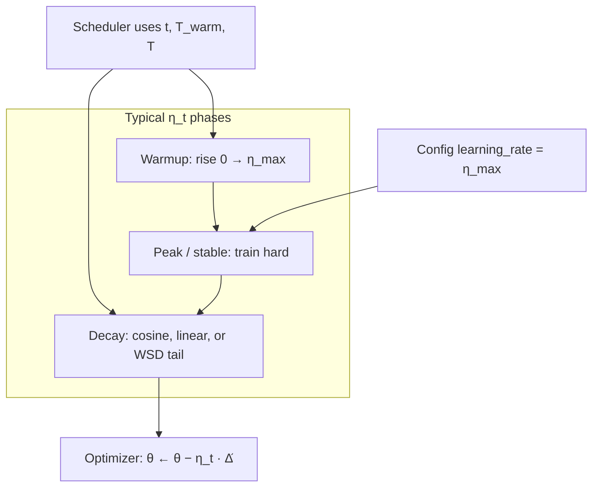

A **learning rate schedule** is a function $\eta_t$ (or $\eta(t)$) that sets the optimizer's [learning rate](glossary://learning-rate) as a function of training progress, usually the global step $t$ or the epoch. The optimizer still computes the update direction from gradients and its internal state; the schedule only multiplies that direction by a time-varying scale.

In configs you often see a single headline `learning_rate` (the peak $\eta_{\max}$) plus knobs such as `warmup_ratio`, `lr_scheduler_type`, `num_train_epochs`, and `max_steps`. The number that actually hits the weights on step $t$ is $\eta_t$, not the peak string in YAML.

## Intuition

Training has phases with different risk profiles:

1. **Early:** weights (or adapters) are cold; Adam moments are empty; large steps can spike loss, especially under mixed precision.
2. **Mid:** a high rate is useful for covering the loss surface and making progress across the data.
3. **Late:** you want smaller steps so the model settles rather than thrashing around a basin; constant peak rates often keep train loss noisy and hurt late validation.

A schedule encodes that story: **warmup** up to a peak, then **decay** (or hold then decay) as the token budget is spent. The peak rate still matters most, but two runs with the same peak and different schedules can diverge as much as two different peaks.

## Formula

### Linear warmup + cosine decay

The workhorse schedule for modern LLM pretraining and fine-tuning (cosine shape from SGDR / Loshchilov and Hutter, 2016; warmup from large-batch and Transformer practice):

$$
\eta_t =
\begin{cases}
\eta_{\max}\cdot\dfrac{t}{T_{\text{warm}}} & t < T_{\text{warm}} \\[0.8em]
\eta_{\min} + \dfrac{1}{2}(\eta_{\max}-\eta_{\min})\left(1+\cos\pi\dfrac{t-T_{\text{warm}}}{T-T_{\text{warm}}}\right) & t \ge T_{\text{warm}}
\end{cases}
$$

Here $T$ is the planned total steps, $0<T_{\text{warm}}<T$ is the warmup length, and $0\le\eta_{\min}\le\eta_{\max}$ are the floor and peak. The formula covers $0\le t\le T$; specify clamping or another policy after $T$. At $t=T_{\text{warm}}$, $\eta_t=\eta_{\max}$. At $t=T$, $\eta_t=\eta_{\min}$. Hugging Face's `get_cosine_schedule_with_warmup`, with its default half-cycle, multiplies the optimizer's base `lr` by a factor that goes from $0$ to $1$ then half-cosines to $0$; use `get_cosine_with_min_lr_schedule_with_warmup` (or `lr_scheduler_type="cosine_with_min_lr"`) for a nonzero floor.

### Original Transformer (inverse square root)

Vaswani et al. (2017) used a single closed form with Adam:

$$
\eta_t = d_{\text{model}}^{-0.5}\cdot\min\!\bigl(t^{-0.5},\; t\cdot T_{\text{warm}}^{-1.5}\bigr)
$$

with $t\ge1$ and $T_{\text{warm}}=4000$ in the paper. The first branch of the $\min$ is inverse-sqrt decay; the second is linear warmup. Peak scale is tied to $d_{\text{model}}$. Other recipes use an explicit peak with cosine or WSD; Transformers also provides `inverse_sqrt`.

### Warmup–stable–decay (WSD)

For open-ended pretraining where you do not want to fix the full token budget up front (Hu et al., 2024; widely used in recent LLM pretrains):

$$
\eta_t =
\begin{cases}
\eta_{\max}\cdot\dfrac{t}{T_{\text{warm}}} & t < T_{\text{warm}} \\[0.6em]
\eta_{\max} & T_{\text{warm}} \le t < T_{\text{warm}}+T_{\text{stable}} \\[0.6em]
f_{\text{decay}}\!\left(\dfrac{t - T_{\text{warm}} - T_{\text{stable}}}{T_{\text{decay}}}\right) & \text{otherwise}
\end{cases}
$$

where $f_{\text{decay}}$ is linear, cosine, or similar, mapping progress in $[0,1]$ from $\eta_{\max}$ down to $\eta_{\min}$. Hugging Face exposes this as `warmup_stable_decay` / `get_wsd_schedule`. The stable phase can run indefinitely on a main branch; you branch a short decay to produce a usable checkpoint without committing every future token at cosine design time.

### Linear warmup + linear decay

BERT-style and the historical Hugging Face Trainer default (`lr_scheduler_type="linear"`):

$$
\eta_t =
\begin{cases}
\eta_{\max}\cdot\dfrac{t}{T_{\text{warm}}} & t < T_{\text{warm}} \\[0.6em]
\eta_{\max}\cdot\dfrac{T-t}{T-T_{\text{warm}}} & t \ge T_{\text{warm}}
\end{cases}
$$

(ending at $0$ when $t=T$). Same warmup idea; the decay is a straight line instead of a cosine half-wave.

## Diagram



## How it works

Libraries implement schedules as **multipliers** on the optimizer's parameter-group `lr`:

1. You construct the optimizer with base `lr=η_max` (or a per-group base).
2. Each step (or epoch) the scheduler computes a factor $\lambda_t$ (or absolute $\eta_t$) and writes `param_groups[i]["lr"]`. The decay examples here keep the factor in $[0,1]$; schedulers in general need not.
3. The optimizer step uses the current group `lr`. Adam moments are **not** reset by the schedule; only the scale of the adaptive step changes.

**Step-based vs epoch-based.** LLM training almost always steps the schedule **per optimizer step** (after gradient accumulation), not per epoch. Miscounting accumulation steps undercounts $t$ and warps the whole curve.

**What the schedule changes.** The schedule scales the optimizer update over time; the loss, data order, and [optimizer state](glossary://optimizer-state) ($m$, $v$) remain separate. Restoring weights without the scheduler and step index is a classic resume bug: you may restart at peak $\eta$ after the model already finished decay, or sit near zero while the curve thinks you are still warming up.

### Common schedule families (practice)

| Family | Shape after warmup | When you see it |
| --- | --- | --- |
| Constant (+ optional warmup) | Flat $\eta_{\max}$ | Short SFT ablations; some RL loops |
| Linear decay | Straight line to $0$ or $\eta_{\min}$ | Classic BERT / HF default `"linear"` |
| Cosine decay | Half-cosine to $0$ or $\eta_{\min}$ | Default LLM pretrain/SFT recipe |
| Cosine with restarts | Multiple cosine cycles (SGDR) | Vision; less common for LLM SFT |
| Inverse sqrt | Slow tail decay | Original Transformer; some long runs |
| WSD | Long flat, short final decay | Modern open-ended pretraining |
| Reduce-on-plateau | Drop when a metric stalls | Classical CV; rare as primary LLM pretrain schedule |

## Example

Supervised fine-tune, AdamW, peak $\eta_{\max}=2\times 10^{-4}$, $T=1000$ steps, $3\%$ linear warmup, then cosine to a $10\%$ floor of the peak:

```python
import math
from torch.optim import AdamW
from torch.optim.lr_scheduler import LambdaLR

optimizer = AdamW(model.parameters(), lr=2e-4, weight_decay=0.01)
total_steps = 1000
warmup = int(0.03 * total_steps)  # 30 steps
min_ratio = 0.1                   # floor = 0.1 * peak

def lr_lambda(step: int) -> float:
    if step < warmup:
        return float(step) / float(max(1, warmup))
    progress = (step - warmup) / float(max(1, total_steps - warmup))
    progress = min(1.0, max(0.0, progress))
    # half-cosine from 1 → min_ratio
    cosine = 0.5 * (1.0 + math.cos(math.pi * progress))
    return min_ratio + (1.0 - min_ratio) * cosine

scheduler = LambdaLR(optimizer, lr_lambda)

for step in range(total_steps):
    # ... forward, loss, backward, clip_grad_norm_ ...
    optimizer.step()
    scheduler.step()
    optimizer.zero_grad()
```

Same shape with Hugging Face (nonzero floor needs the min-lr variant; plain `"cosine"` / `get_cosine_schedule_with_warmup` decays to $0$):

```python
from transformers import get_cosine_with_min_lr_schedule_with_warmup
# or get_scheduler(
#     "cosine_with_min_lr", optimizer,
#     num_warmup_steps=warmup, num_training_steps=total_steps,
#     scheduler_specific_kwargs={"min_lr_rate": 0.1},
# )

scheduler = get_cosine_with_min_lr_schedule_with_warmup(
    optimizer,
    num_warmup_steps=warmup,
    num_training_steps=total_steps,
    min_lr_rate=0.1,
)
```

**Phase check for this run:**

| Step $t$ | Phase | $\eta_t$ (approx.) |
| --- | --- | --- |
| $0$ | start of warmup | $\sim 0$ |
| $15$ | mid warmup | $\sim 1\times 10^{-4}$ |
| $30$ | end of warmup / peak | $2\times 10^{-4}$ |
| $515$ | mid cosine | $\sim 1.1\times 10^{-4}$ |
| $1000$ | end | $2\times 10^{-5}$ ($0.1\times$ peak) |

Without the $30$-step warmup, the first updates use full $2\times 10^{-4}$. Adam applies bias correction to its initially empty moments, so an empty second moment alone does not prove an oversized update. Warmup can still improve early optimization stability; its need depends on architecture, peak rate, batch size, and numeric precision.

## Worked numbers

Take $T=100$, $T_{\text{warm}}=10$, $\eta_{\max}=3\times 10^{-4}$, $\eta_{\min}=0$. Cosine after warmup:

$$
\eta_t = \frac{\eta_{\max}}{2}\left(1+\cos\pi\frac{t-10}{90}\right),\quad t\ge 10
$$

| $t$ | Progress after warmup | $\eta_t$ |
| --- | --- | --- |
| $0$ | warmup | $0$ |
| $5$ | warmup | $1.5\times 10^{-4}$ |
| $10$ | $0$ | $3.0\times 10^{-4}$ |
| $55$ | $0.5$ | $1.5\times 10^{-4}$ |
| $100$ | $1.0$ | $0$ |

If you **mis-set** $T$ (configured $T=1000$ but stopped at $100$), cosine barely moves: at $t=100$ with $T=1000$, progress after warmup is only $\sim 0.09$, so $\eta_t$ is still $\approx 0.98\,\eta_{\max}$. The schedule never did its job. Conversely, if real training is longer than configured $T$, many implementations clamp progress at $1$ and leave you stuck at $\eta_{\min}$ for the rest of the run.

## Sizing

**Warmup length.** Common SFT defaults are $1$–$5\%$ of total steps, or a fixed few hundred to a few thousand steps on long pretrains. Large global batch (linear scaling of peak $\eta$ with batch size, Goyal et al., 2017) usually needs **more** warmup, not less: you are applying a larger peak while the network and optimizer state are still cold.

**Peak $\eta$ vs schedule.** Sweep peak first with a fixed schedule shape; then change warmup ratio and decay type. A moderate peak with cosine often beats a higher constant rate that looks fast for a few hundred steps and then thrashes validation.

**Token budget commitment.** Cosine and linear-to-zero need an honest $T$ (or `max_steps` / planned tokens). If you might extend pretraining or branch intermediate checkpoints, prefer **WSD** or cosine-with-min-lr so the stable phase is reusable.

**Per-group rates.** Layer-wise decay multiplies a base schedule by a layer coefficient. The schedule still sets the global clock; groups differ only in their base `lr`.

## Debug path

| Signal | Schedule-related cause |
| --- | --- |
| Loss spike / `NaN` in first steps | Missing or too-short warmup; peak too high for cold Adam moments |
| Train loss falls early, eval thrashes late | No decay, or $T$ too large so decay never arrives |
| Loss almost flat after mid-run | Decay already near $\eta_{\min}$; wrong `max_steps` / double-counted epochs |
| Resume from checkpoint diverges | Weights restored, scheduler step or `last_epoch` not; jump to wrong $\eta_t$ |
| "Same recipe" differs across tools | Epoch-stepped vs step-stepped scheduler; grad accum not reflected in $t$ |
| Continual pretrain after cosine end | Rewarming a fully decayed cosine run often costs quality; WSD main-branch resume is the usual fix |

Log `param_groups[0]["lr"]` every $N$ steps next to loss and grad norm (read it *after* each `scheduler.step()`). Align $T$ with optimizer steps, not micro-batches under gradient accumulation. Framework `last_epoch` and step-before-vs-after-optimizer conventions differ, so verify when the library mutates `param_groups` against the intended LR at each step. If the LR plot doesn't match the intended curve, fix the schedule before retuning the peak.

## Trade-offs

- **Cosine / linear to zero:** simple and strong when $T$ is known; brittle if the token budget changes mid-run.
- **WSD:** flexible for long pretraining and checkpoint branching; you must still choose when and how hard to decay.
- **Long warmup:** safer at large batch / high peak; wastes steps if peak was already conservative.
- **Restarts (SGDR):** can escape plateaus in some settings; for LLM SFT they often just re-inject high LR and damage a good basin.
- **Schedule vs clip:** [gradient clipping](glossary://gradient-clipping) bounds the supplied gradient norm, while the schedule sets the optimizer's time-varying scale; check both alongside the adaptive parameter-update norm.

## Why it matters here

Nearly every pretrain, SFT, LoRA, and preference-training recipe in this curriculum is "optimizer + peak learning rate + **schedule** + clip." Two runs with the same model, data, and peak `lr` can still diverge because warmup length, decay shape, or total-step accounting differed. Reading a training config means checking whether $\eta_t$ is still near peak when you care about late quality, whether resume will land on the right part of the curve, and whether the schedule assumes a fixed token budget you no longer have.

## Related terms

- [Learning rate](glossary://learning-rate)
- [AdamW](glossary://adamw)
- [Optimizer](glossary://optimizer)
- [Optimizer state](glossary://optimizer-state)
- [Gradient clipping](glossary://gradient-clipping)
