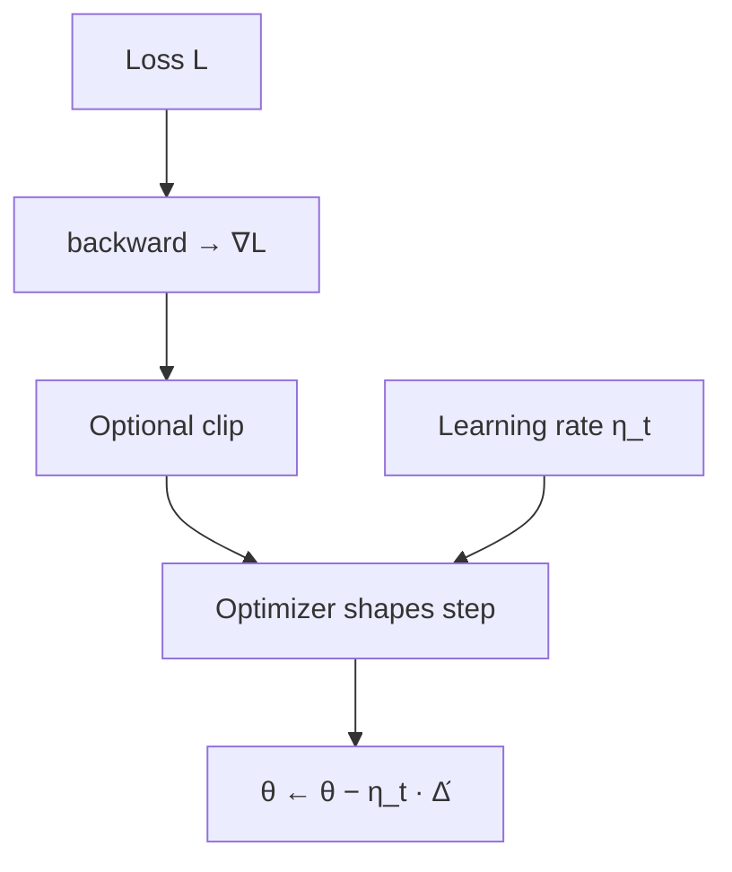

The **learning rate** $\eta$ (also written $\alpha$ or `lr`) is the scalar that scales how far parameters move on each optimizer step. After backpropagation fills gradients, the optimizer applies an update whose magnitude is proportional to $\eta$. Too small and training crawls or stalls. Too large and loss spikes, weights leave a useful basin, or updates erase pretrained behavior during fine-tuning.

In code it is almost always the `lr=` argument to the optimizer (PyTorch `torch.optim.AdamW(..., lr=2e-5)`). Schedulers change the *current* learning rate over steps; the headline number people quote is usually the peak $\eta$ after warmup.

## Intuition

The gradient estimates a local descent direction and $\eta$ sets the step scale. A tiny $\eta$ moves slowly. A huge $\eta$ magnifies minibatch noise and curvature error, so parameters can overshoot, oscillate, or diverge.

Adaptive optimizers such as AdamW still use a single base learning rate. They reshape each coordinate using gradient history (moments $m$ and $v$), but $\eta$ multiplies the final adaptive step. Changing `lr` remains the first knob to try when a run is unstable or flat.

For LLM work the same number means different things by stage. Pretraining, full fine-tuning, adapter tuning, and preference/RL training have different update geometries and data. LoRA often uses a higher rate than full-weight tuning, but its usual initialization combines a random factor with a zero factor, not two random factors. There is no universal ordering of optimal rates across these stages; validate the actual parameterization, objective, batch size, and held-out behavior.

## Formula

Plain gradient descent on parameters $\theta$ with loss $L$:

$$
\theta \leftarrow \theta - \eta \, \nabla_\theta L
$$

Here $\eta > 0$ is the learning rate. For a scalar weight with gradient $g = \partial L / \partial \theta$, the step is simply $\Delta\theta = -\eta g$.

**SGD with momentum** still multiplies the velocity by $\eta$. **Adam / AdamW** (Kingma and Ba, 2014; Loshchilov and Hutter, 2017) form bias-corrected moments $\hat{m}_t$, $\hat{v}_t$ and step

$$
\theta_t \leftarrow \theta_{t-1} - \eta \frac{\hat{m}_t}{\sqrt{\hat{v}_t}+\epsilon}
$$

(with AdamW's decoupled weight decay applied separately). The paper's good default for many small-scale problems was $\alpha = 0.001$; LLM fine-tunes almost never use that default as-is.

A **schedule** multiplies or replaces $\eta$ over training. With a time-dependent factor $\eta_t$ (warmup then cosine decay is common):

$$
\theta_t \leftarrow \theta_{t-1} - \eta_t \cdot \widehat{\Delta}_t
$$

where $\widehat{\Delta}_t$ is the optimizer's direction (raw gradient, momentum, or Adam step). The peak $\eta_{\max}$ is what configs usually list as `learning_rate`; $\eta_t$ is what actually hits the weights on step $t$.

## Worked numbers

Take one scalar parameter $\theta = 1.0$ and gradient $g = 2.0$ (so plain GD wants to decrease $\theta$). Compare three learning rates for a single step:

| $\eta$ | Update $-\eta g$ | New $\theta$ | Effect |
| --- | --- | --- | --- |
| $10^{-4}$ | $-0.0002$ | $0.9998$ | Tiny move; many steps needed |
| $10^{-2}$ | $-0.02$ | $0.98$ | Moderate, often healthy scale |
| $1.0$ | $-2.0$ | $-1.0$ | Large move; whether it overshoots depends on the loss surface |

For another **plain gradient-descent** illustration, take a scalar parameter of magnitude $|\theta| \approx 0.1$ and gradient component $|g| \approx 0.01$. With $\eta = 2\times 10^{-4}$:

$$
|\Delta\theta| \approx \eta |g| = 2\times 10^{-4} \times 0.01 = 2\times 10^{-6}
$$

which is a small relative change per step ($\sim 2\times 10^{-5}$ of $\|\theta\|$). Raise $\eta$ to $10^{-2}$ and the same gradient produces a relative change near $0.1\%$ of the weight *per step*; over thousands of steps that can dominate pretrained features unless the schedule and data justify it.

Do not apply that raw-gradient displacement estimate to AdamW. For its first step with $g=0.01$, zero initial moments, negligible epsilon, and no decay, bias correction gives $\hat m=g$ and $\hat v=g^2$, so the displacement is approximately $\eta$, not $\eta g$. Measure actual update norms relative to parameter norms when diagnosing an adaptive optimizer.

## Diagram



## Example

Supervised LoRA fine-tune of a chat model on instruction data (AdamW, global batch 64, rank 16 adapters only):

```python
import torch
from torch import nn

# Stand-in: only adapter params are trainable in a real LoRA setup
adapter = nn.Linear(64, 64)
optimizer = torch.optim.AdamW(adapter.parameters(), lr=2e-4, weight_decay=0.0)

# Peak lr = 2e-4; linear warmup for 3% of steps, then cosine toward ~0
total_steps = 1000
warmup = int(0.03 * total_steps)

def lr_at(step: int) -> float:
    peak = 2e-4
    if step < warmup:
        return peak * step / max(1, warmup)
    progress = (step - warmup) / max(1, total_steps - warmup)
    return peak * 0.5 * (1.0 + torch.cos(torch.tensor(progress * 3.14159265))).item()

for step in range(total_steps):
    for g in optimizer.param_groups:
        g["lr"] = lr_at(step)
    # ... forward, loss, backward, clip_grad_norm_, optimizer.step()
```

These recipe-specific ranges provide starting points for a sweep. Retune for the optimizer, parameterization, batch size, and held-out task:

| Setting | Starting peak $\eta$ (AdamW) | Notes |
| --- | --- | --- |
| Small nets from scratch | $10^{-3}$ | Matches Adam's classic default scale |
| LLM full fine-tune | $10^{-5}$ to $5\times 10^{-5}$ | Protect base capabilities |
| LoRA / QLoRA SFT | $10^{-4}$ to $2\times 10^{-4}$ | Adapters only; common recipe band |
| Preference / RL full-weight (DPO, GRPO, …) | $\sim 5\times 10^{-7}$ to $5\times 10^{-6}$ | Often ~10× below full SFT; many full-weight DPO recipes cluster near $5\times 10^{-7}$ |
| Preference / RL LoRA or QLoRA | $\sim 10^{-6}$ to $5\times 10^{-5}$ | Adapters often sit higher than full-weight preference; retune vs your rank and KL/β |

Compare runs with the **same data, steps, batch, and seeds** while only $\eta$ (and its schedule) changes before blaming architecture or rank. A rate that looked fine for a small adapter can still damage instruction-following if it overwhelms the frozen base on hard batches; warmup plus decay often matters as much as the peak.

## Sizing and interactions

**Batch size.** For SGD-style training, a common practical rule (Goyal et al., 2017) is linear scaling: when you multiply global batch size by $k$, try multiplying $\eta$ by $k$ (with warmup so early steps stay stable). Adaptive methods do not always follow the same curve; treat linear scaling as a starting guess and validate. Loss reduction (mean vs sum) also rescales gradients, so "same `lr`" across codebases is not comparable if reduction differs.

**Gradient clipping.** Clipping caps $\|\nabla L\|$ *before* the optimizer step. Frequent clipping can reflect the chosen threshold, data, loss scale, or unstable optimization; inspect those causes before changing the learning rate. Adaptive preconditioning and weight decay also make the clipped gradient norm different from the parameter-update norm.

**Mixed precision.** FP16/BF16 and loss scaling change the numeric path to $\nabla L$, not the definition of $\eta$. After unscale, the optimizer should see gradients in the same units as an FP32 run; a mis-ordered AMP pipeline can make a previously good `lr` explode.

**Per-parameter groups.** Libraries allow different `lr` per group (for example higher on a new head, lower on the backbone). LLM recipes more often use one base rate plus a schedule, sometimes with layer-wise decay; either way the learning rate is still the group-level step scale.

## Debug path

| Signal | Likely $\eta$-related cause |
| --- | --- |
| Loss $\to$ `NaN` / `Inf`, grad norms explode | Peak $\eta$ too high, missing warmup, or bad first steps |
| Loss flat; grad norms healthy and non-zero | $\eta$ too low, or schedule already decayed to near zero |
| Train loss falls; eval collapses early | Overwriting pretrained features; lower peak, longer warmup, or freeze more |
| Good early curve, thrashing late | No decay; peak held constant too long |
| Resume from checkpoint diverges | Restored weights but wrong current `lr` / step index for the schedule |
| "Same config" differs across tools | Different loss reduction, grad accum steps, or whether `lr` is per-token vs per-step |

Log **current** learning rate every step (from `param_groups[0]["lr"]`), pre-clip grad norm, update norm, and train/eval loss together. If update norms stay huge relative to parameter norms after warmup, cut $\eta$. If grads look fine and loss barely moves for many tokens, raise $\eta$ on a short sweep (for example half-decade grid: $1\times 10^{-5}, 3\times 10^{-5}, 1\times 10^{-4}, \ldots$) rather than guessing once.

## Trade-offs

- **Speed vs stability.** Higher $\eta$ can cut wall-clock to a target loss but raises divergence and catastrophic forgetting risk on pretrained models.
- **Peak vs schedule.** A moderate peak with sensible warmup and cosine decay often beats a constant high rate that looks fast for 500 steps then fails.
- **Stage mismatch.** Copying pretrain `lr` into SFT or RL is a common production failure: the model already sits near a useful region and needs smaller edits.
- **Coupling with other knobs.** Weight decay, clip threshold, batch size, and $\eta$ move together; change one primary knob per experiment when diagnosing.

## Why it matters here

Almost every pretrain, SFT, LoRA, DPO, and RLHF recipe in this curriculum is "optimizer + learning rate + schedule + clip." Mis-set $\eta$ is the most common reason a fine-tune either never moves or quietly destroys base quality. Reading a training config means knowing whether `2e-4` is a LoRA peak, a pretrain peak, or a bug for full-weight updates, and judging runs on held-out tasks rather than chart smoothness alone.

## Related terms

- [Gradient](glossary://gradient)
- [Optimizer](glossary://optimizer)
- [AdamW](glossary://adamw)
- [Learning rate schedule](glossary://learning-rate-schedule)
- [Gradient clipping](glossary://gradient-clipping)
