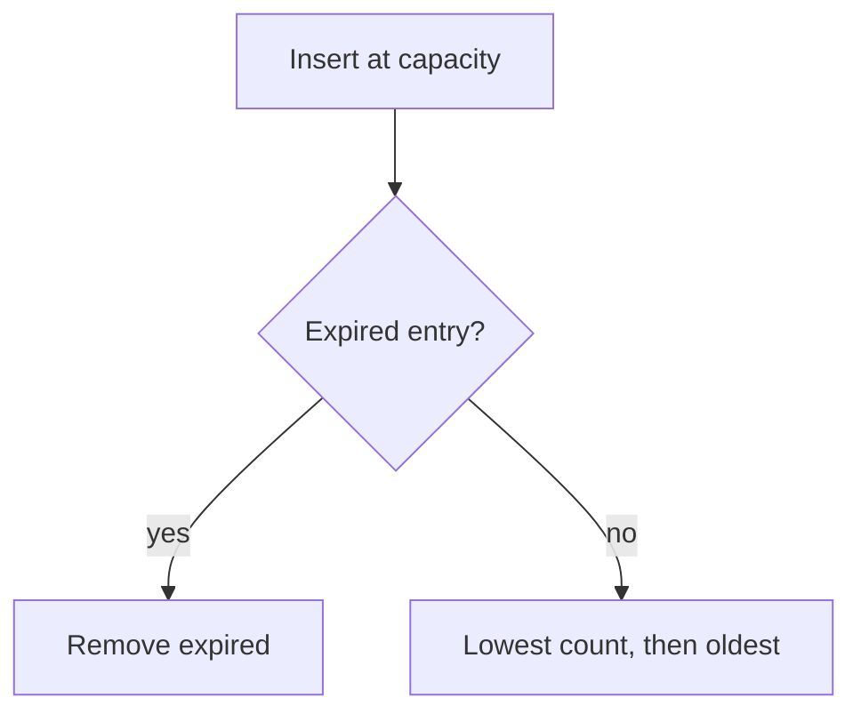

A least-frequently-used (LFU) cache evicts the live entry with the smallest access count when admitting a new entry would exceed capacity. If several entries share the same count, a common deterministic tie-breaker evicts the least recently used entry within that frequency group.

## Frequency buckets separate policy from expiry

An efficient LFU design keeps a key-to-entry map, frequency-to-[ordered dictionaries](glossary://ordered-dict), and the minimum live frequency. A successful lookup moves its key from frequency $f$ into frequency $f+1$. Updating an existing live key can count as an access when the interface explicitly says so.

Time-to-live expiry is a different rule. An expired entry must be removed before choosing any frequency-based capacity victim, even if the expired entry was extremely popular. Without that cleanup, a stale high-frequency item can incorrectly evict a valid lower-frequency entry. Opportunistic full scans cost $O(n)$; an expiry heap can identify expired deadlines more selectively.

## Diagram

## Example

In a two-entry cache, insert `a` and `b`, then read `a` once. Their frequencies become two and one. Inserting `c` evicts `b`. If `a` has expired before the insertion, remove `a` instead and keep live `b`, even though `a` had the higher historical count.

## Why it matters here

The LFU TTL practice bundle combines frequency, recency, injected clocks, and inclusive deadlines. Distinguishing these invariants prevents solutions that pass ordinary cache examples but corrupt eviction when expired entries remain in high-frequency buckets.

## Related terms

- [LRU cache](glossary://lru-cache)
- [TTL deadline](glossary://ttl-deadline)
- [collections.OrderedDict](glossary://ordered-dict)
- [Injected now](glossary://injected-now)
