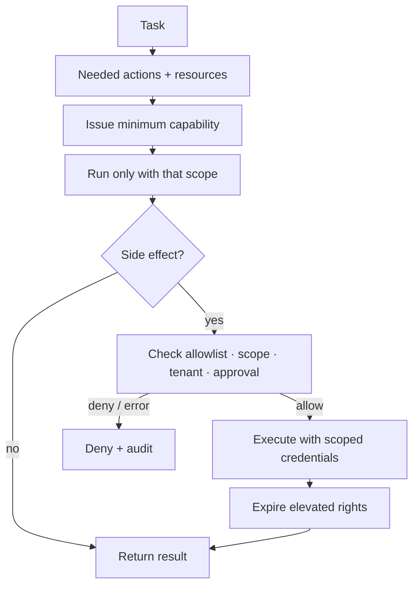

**Least privilege** is the rule that every user, service account, worker, tool, or agent-mediated flow should hold only the source of truth needed for its *current* job, and nothing broader by default. Jerome Saltzer and Michael Schroeder stated it in their 1975 paper *The Protection of Information in Computer Systems*: every program and every user should operate with the least set of privileges necessary to complete the job. Least privilege limits blast radius. Accidents, bugs, prompt injection, and compromised credentials cause less harm when a principal's source of truth is scoped to the task.

NIST SP 800-53 control **AC-6** restates the same idea for organizations: allow only authorized accesses that are necessary to accomplish assigned tasks, for users *and* for processes acting on their behalf. In AI products, service roles, retrieval scopes, tool credentials, spend caps, and approval state belong in the privilege design alongside the model.

Privilege is time-bounded as well as action-bounded. A short-lived token scoped to the one reviewed checkpoint, project, and canary alias needed for an authorized promotion can satisfy least privilege. Short lifetime alone does not make an unnecessarily broad token least privilege. A long-lived production-admin key "for the agent" exceeds the required scope, even if the system prompt says "be careful."

## Intuition

Grant source of truth through temporary capabilities scoped to the task. The model proposes text and tool calls; trusted code decides which capabilities exist at all.

| Dimension | Too broad | Least privilege shape |
| --- | --- | --- |
| Action | Any tool the catalog lists | [Action allowlist](glossary://action-allowlist) for this role / task |
| Resource | Whole DB, whole bucket, all projects | One table, object prefix, model alias, or project |
| Operation | Read + write + delete + admin | Exact verbs needed now (`SELECT`, not `DROP`) |
| Identity | Shared `agent-prod` superkey | Per-workload or user-delegated short-lived token |
| Time | Standing admin forever | Just-in-time elevation; expire after the job |
| Autonomy | Auto-run money / email / deploy | [Policy gate](glossary://policy-gate) or human approval for high impact |

Saltzer and Schroeder also noted that least privilege reduces the number of potential interactions among privileged programs, so fewer programs must be audited when privilege is misused. In agent stacks that means fewer tools, narrower credentials, and fewer ambient secrets in the runtime environment.

OWASP's agent guidance and **LLM06 (Excessive Agency)** make the same split: excessive *functionality* (too many tools), excessive *permissions* (tools that run with too much power), and excessive *autonomy* (high-impact actions without independent checks). Least privilege is the design answer to the first two; gates and human review address the third.

## How it works

Enforcement lives outside the model. A fluent request for admin rights must still fail if code and infrastructure never granted those rights.

1. **Name the principal.** Authenticated user, service account, agent session, or delegated workload identity. Never take "who is calling" from free-form model text.
2. **Inventory the job.** Which resources, verbs, tenants, spend limits, and environments does *this* task need? Default is empty; each grant is deliberate.
3. **Bind capability to the job.** Prefer role + resource scope + operation over a single global "agent" role. Prefer short-lived credentials over standing secrets ([secrets management](glossary://secrets-management)).
4. **Mediate every side effect.** Before retrieval packs private context, before a tool runs, before a deploy or payment API is called, re-check allowlist, ACL, tenant, and approval state in trusted code.
5. **Fail closed on uncertainty.** Missing policy, timed-out ACL, unknown tool name, or expired approval means deny or omit, not "probably fine" ([fail closed](glossary://fail-closed)).
6. **Drop privilege when done.** End the session token, revoke the JIT grant, and tear down the sandbox mounts. Standing privileges leave capabilities available after the task ends, increasing the impact of a later compromise.
7. **Audit allows and denials.** Record principal, action, resource (or hash), policy version, and decision so misuse is investigable ([audit trail](glossary://audit-trail)).

A useful mental model is complete mediation plus minimal source of truth: every access path is checked, and each check starts from a narrow grant. [RBAC](glossary://rbac) and [ACLs](glossary://acl) are mechanisms; least privilege is the sizing rule you apply when you assign those roles and list entries.

## Diagram



## Example

A model-release agent helps authenticated engineers inspect evals and promote approved checkpoints. Product policy:

| Capability | Engineer | Release manager |
| --- | --- | --- |
| `read_eval_report` | Own project | Own project |
| `fetch_release_policy` | Read | Read |
| `draft_release_notes` | Yes | Yes |
| `promote_model` | No | One reviewed checkpoint, canary alias, after approval ticket |

The runtime never holds a production-admin key. When a release manager approves a promotion, the control plane mints a **one-shot** credential:

- Principal: `svc:model-promotion` acting for `user:release_19`
- Scope: `POST /models/{model_id}/aliases/canary` only for `model_id=reranker-v7` and project `search`
- Cap: canary alias only; no production alias or checkpoint deletion
- TTL: $5$ minutes, single use
- Approval binding: ticket `appr_88` hashes actor, checkpoint, target alias, and expiry

This is an authorization sketch: the helpers must use authenticated identity and authoritative resource metadata. `approval_valid` must bind project, actor, checkpoint, alias, and expiry. The downstream service must atomically consume single-use credentials; a `uses=1` claim alone does not prevent replay.

```python
# Trusted runtime: model may propose; this code decides.
ALLOWED = {
    "engineer": {"read_eval_report", "fetch_release_policy", "draft_release_notes"},
    "release_manager": {
        "read_eval_report", "fetch_release_policy", "draft_release_notes", "promote_model"
    },
}

def authorize_tool(principal, name: str, args: dict) -> dict:
    if name not in ALLOWED.get(principal.role, set()):
        audit("deny", principal, name, reason="not_allowlisted")
        raise PermissionError(f"action not permitted: {name}")

    if name == "read_eval_report":
        report = lookup_eval_report(args["eval_run_id"])
        if report.project_id != principal.project_id:
            audit("deny", principal, name, reason="cross_project")
            raise PermissionError("project mismatch")
        return {"cred": mint_read_token(principal, args["eval_run_id"], ttl_s=60)}

    if name == "promote_model":
        if principal.role != "release_manager":
            raise PermissionError("role cannot promote models")
        if args["target_alias"] != "canary":
            raise PermissionError("target alias out of policy")
        model = lookup_model(args["model_id"])
        if model.project_id != principal.project_id:
            raise PermissionError("project mismatch")
        if not approval_valid(args["approval_id"], principal, args):
            raise PermissionError("missing or expired approval")
        # One-shot, checkpoint-bound credential; not production admin
        return {
            "cred": mint_promotion_token(
                principal,
                model_id=args["model_id"],
                project_id=model.project_id,
                target_alias="canary",
                ttl_s=300,
                uses=1,
            )
        }

    return {"cred": None}  # pure draft / public read paths
```

If the model, after a prompt-injected document, proposes `promote_model` directly to the production alias with no approval, `authorize_tool` rejects it. If an engineer proposes any promotion, the allowlist denies it. If the approval ticket names `reranker-v7` but the tool args name `reranker-v8`, approval binding fails. None of those denials depend on the model following instructions.

What fails in production when least privilege is skipped:

- A single shared agent key that can read every project and change production aliases becomes a fleet-wide incident under one successful injection.
- RAG with a service account that can see all documents defeats per-user ACLs once chunks enter the prompt.
- "Temporary" admin for debugging left in the worker env is permanent standing privilege.
- Tool catalogs that expose shell, SQL, or email "for flexibility" convert every jailbreak into remote agency.

## Trade-offs

Narrow grants cost design and operations: more roles, more credential minting, more "permission denied" paths to test, and occasional friction when a real task needs a new scope. Broad standing privileges feel faster until the first incident. The usual engineering pattern is:

- Start deny-by-default and add scopes when a real workflow needs them.
- Separate read paths from write paths so an eval summarizer never inherits deployment power.
- Use just-in-time elevation with audit for rare high-impact jobs instead of permanent admin roles.
- Pair least privilege with [bounded execution environments](glossary://bounded-execution-environment) so even a permitted code-run tool cannot escape to host credentials.

Pair least privilege with authentication, tenant isolation, and output filtering. It sizes *what authenticated code is allowed to do* once identity is known.

## Why it matters here

LLM and agent systems turn natural language into retrieval, tool calls, and side effects. Enforce source of truth in trusted controls: a buggy plan or injected instruction can use any credential, tool, or index grant the runtime provides. Least privilege keeps that source of truth small enough for failures to stay local. For AI/ML engineers it shows up in IAM roles for training and serving jobs, scoped vector and SQL access for RAG, per-tool allowlists and spend caps for agents, short-lived secrets in runtimes, and approval-bound writes. Design privileges for the job you intend; assume the model will eventually ask for everything else.

## Related terms

- [permission scope](glossary://permission-boundary)
- [Action allowlist](glossary://action-allowlist)
- [Fail closed](glossary://fail-closed)
- [Policy gate](glossary://policy-gate)
- [RBAC](glossary://rbac)
